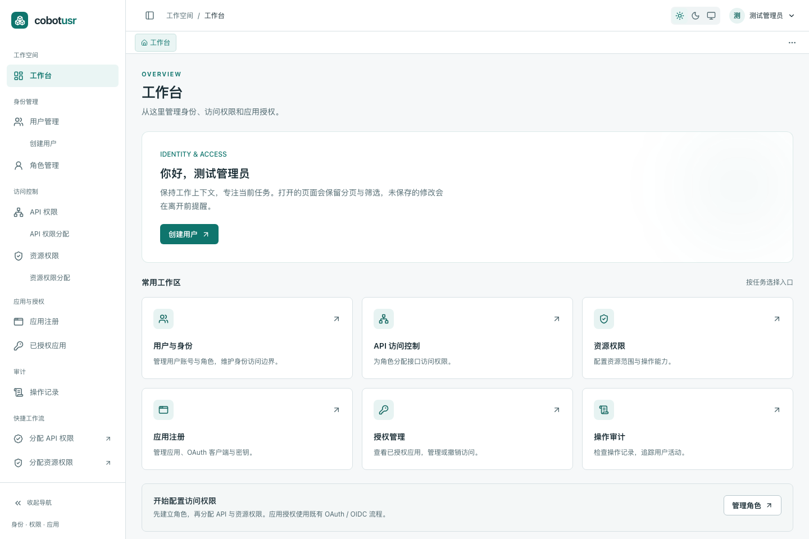
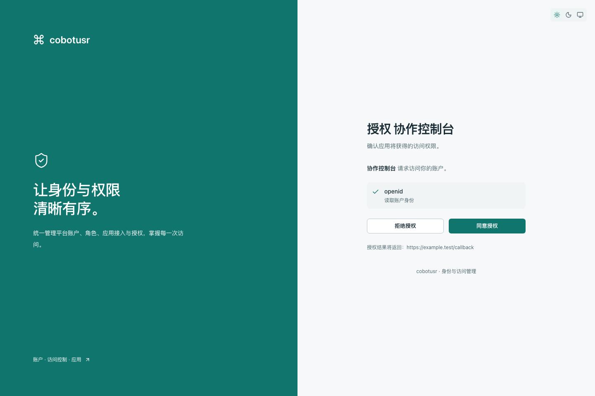
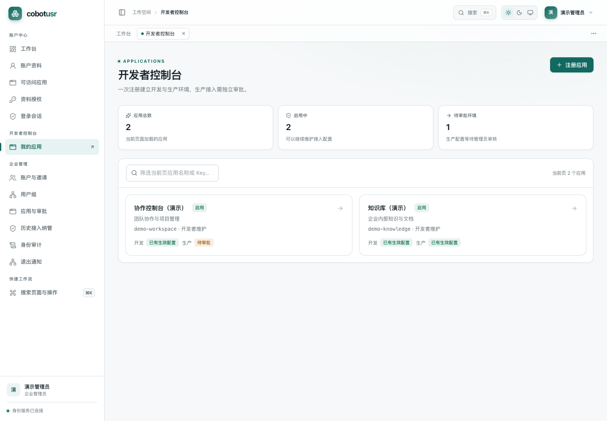
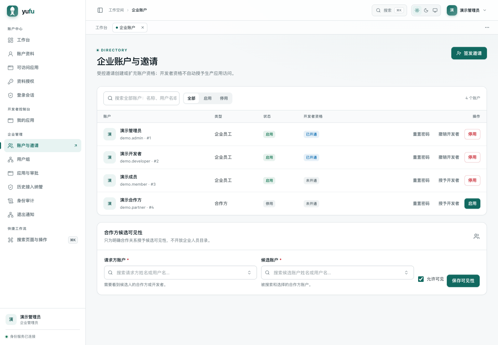
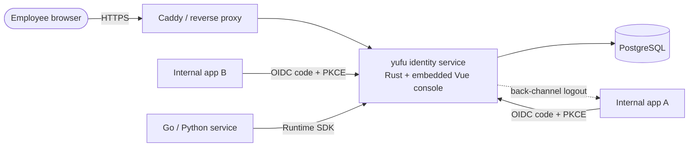

<div align="center">


# yufu

**Self-hosted identity and SSO for a single enterprise**

One Rust binary + PostgreSQL, one identity boundary for every internal app.

[](https://github.com/Bin-hy/yufu/actions/workflows/rust.yml)
[](https://github.com/Bin-hy/yufu/releases)
[](LICENSE)
[](https://yufu-sso.pages.dev/en/)

[**5-minute demo**](#quick-start) · [Documentation](https://yufu-sso.pages.dev/en/getting-started/) · [Console guide](https://yufu-sso.pages.dev/en/guides/console/) · [中文](README.md)

`Rust 2024` · `OpenID Connect` · `OAuth 2.0` · `PKCE S256` · `Vue 3` · `PostgreSQL` · `Go / Python SDK`

</div>

---

yufu is built for **single-enterprise, self-hosted** deployments: unified login, controlled app
onboarding, access assignment, and identity audit for internal applications. One Rust service hosts
the account center, developer console, and enterprise admin console; apps integrate over standard
OIDC. The Vue console can be embedded into a single binary, with PostgreSQL for persistence.

> It is not about shipping another login page. It is about drawing a clear identity boundary:
> who someone is, which apps they can enter, when access is revoked, and what every change
> leaves behind.

## Screenshots



> Captured from the Vue console with isolated demo data. Accounts, apps, counts, and session
> states are fictional.

<p align="center">
  
  
  
</p>
<p align="center"><sub>Consent · Developer console · Enterprise admin</sub></p>

## Why yufu

- **One issuer, one login.** A fixed issuer with OIDC Discovery. Sign in once and move across
  authorized apps without each app maintaining its own password store.
- **Explicit access, default deny.** App onboarding uses enterprise invitations and approval:
  development and production configuration are separate, production access needs an administrator's
  approval, and users only see apps explicitly assigned to them. Unsupported execution credentials
  fail closed.
- **Revocable credentials, auditable actions.** Refresh-token rotation with replay revocation,
  session termination per center or per app, RP-initiated logout and back-channel notifications;
  authorization, revocation, and administrative writes are audited.
- **One binary, keys stay with you.** The Rust service embeds the Vue console, so deployment is one
  binary plus PostgreSQL. Signing keys, database, and audit records remain under your control.
  The container runs as non-root with a read-only root filesystem.
- **Branding and login pages without code changes.** A super administrator can change the site
  name, logo, login cover, welcome copy, and footer filing information from the console. Changes
  take effect on refresh, with no rebuild, restart, or code change.

### Who it is for

| A good fit | Not a fit |
| --- | --- |
| A single enterprise with internal apps that need SSO | Multi-tenant or public SaaS identity |
| Self-hosting where you own keys and data | SAML / LDAP / SCIM federation |
| Approval-based app onboarding and access assignment | MFA / Passkey / social login |
| Standard OIDC instead of a private auth protocol | A public PDP decision API or general ReBAC |
| A small delivery and operations footprint | An out-of-the-box app marketplace |

If you want a self-controlled identity center for internal apps without adopting a full IAM
platform, yufu is the smaller option.

## Quick start

### Docker (recommended, about 5 minutes)

No Rust or Node.js installation and no hand-written configuration: on first start the image
renders its configuration from environment variables and generates an evaluation signing key.

```sh
git clone https://github.com/Bin-hy/yufu.git
cd yufu
docker compose -f deploy/docker/compose.demo.yaml up -d
```

Open <https://localhost:8443> and sign in with `admin` / `change-me-now`. The first start
creates the schema and runs migrations. Your browser will warn about Caddy's local CA; accept it
and continue.

> This compose file is for local evaluation only; its passwords and keys are public demo values.
> For production, use the reference stack in [`deploy/docker`](deploy/docker/README.md), replace
> the credentials and issuer, and mount your own signing key.

> **NTP prerequisite:** the service validates a trusted clock at startup, so the container must
> reach the configured NTP sources over UDP/123. If the log reports
> `NTP clock health could not be confirmed`, the network is blocking NTP; point
> `[security_clock]` at reachable sources, or diagnose with
> `yufu --config <path> --check-security-clock`.

### Build from source

Requirements:

- A Rust toolchain that supports Rust 2024 edition
- Node.js **≥ 22.23.4** and pnpm **10+**
- A Docker-compatible runtime for PostgreSQL

```sh
git clone https://github.com/Bin-hy/yufu.git
cd yufu
pnpm install --frozen-lockfile
pnpm build:web
docker compose up -d
cp conf/yufu.example.toml conf/yufu.local.toml
```

The root `compose.yaml` starts PostgreSQL only, on local port `5433` by default; replace the
default database credentials for any real deployment.

Edit `conf/yufu.local.toml` to set the database connection, the `[auth.super_admin]` account,
the `[oidc]` issuer and signing-key path, and the `[security_clock]` trusted time source.
See the [configuration reference](https://yufu-sso.pages.dev/en/reference/configuration/) for
every field.

```sh
cargo run --bin yufu --features webui -- \
  --config conf/yufu.local.toml \
  --allow-insecure-loopback-cookies
```

Open <http://127.0.0.1:4000>. Versioned database migrations run at startup; `--features webui`
embeds the `assets/web` build produced above. `--allow-insecure-loopback-cookies` is for local
HTTP only and requires both the listen address and issuer to be loopback. Production uses HTTPS
and Secure cookies by default.

For frontend development, run `pnpm dev:web`; Vite proxies API requests to the local identity
service.

## Capabilities

| Capability | What you get |
| --- | --- |
| **Unified identity and SSO** | Fixed issuer; OIDC Discovery, authorization code flow, PKCE S256, UserInfo, and token introspection |
| **Controlled app onboarding** | Separate development and production configuration, app member collaboration, configuration versions, and production approval |
| **Account and access governance** | Enterprise invitations, account eligibility, user groups, and app access assignment; access must be explicit |
| **Consent and sessions** | Users review and withdraw profile consent; terminate sessions per center or per app; refresh-token rotation and revocation |
| **Logout propagation and audit** | RP-initiated logout, back-channel logout notifications based on app capability, and audit of identity and authorization changes |
| **Site branding** | Site name, description, logo, favicon, login cover, welcome copy, footer filing and links; OIDC pages can override individually |
| **App integration** | Confidential web and public SPA references, Go / Python Runtime SDKs, and MCP access tokens |

### Three consoles

| Entry point | Audience | Main tasks |
| --- | --- | --- |
| **Account center** · `/account` | Enterprise members | Maintain profile, view accessible apps, manage consent and login sessions |
| **Developer console** · `/developer/apps` | Members with developer eligibility | Register and maintain apps, manage development/production configuration, submit for approval |
| **Enterprise admin** · `/admin/*` | Enterprise administrators (site branding: super administrator only) | Invite members, manage accounts and groups, approve apps, assign access, review audit and logout notifications, configure site branding |

Navigation follows account eligibility. Sign-in lands in the account center; the dashboard is at
`/dashboard`.

### Branding and login pages without code changes

A super administrator can edit these under **System settings → Site settings**
(`/admin/site-settings`):

| What | Details |
| --- | --- |
| **Site brand** | Site name, description, logo, favicon |
| **Standard login page** | Authentication cover, welcome title, welcome description |
| **OIDC login and consent pages** | Separate cover and copy; inherit the site configuration or override each item |
| **Footer** | Copyright text, filing number, filing link, and up to 10 custom links |

Saved changes take effect for other users on their next page load or refresh; no rebuild, restart,
or re-login is required. Configuration and images live in PostgreSQL, and both saving and resetting
are written to the identity audit log. Enterprise admins, developers, and members do not get this
entry point. See the [site branding operations guide](docs/operations/site-branding.md) for limits
and operations details.

## Integrate an application

### Let an AI agent do the onboarding

Have a coding agent perform "deploy yufu → register the app → validate parameters → generate
integration code" locally:

```bash
npx skills add Bin-hy/yufu --skill yufu-onboarding
```

Then tell the agent "deploy yufu and connect this project". It asks once about the integration
shape (web login or protect an existing API), performs a pinned local deployment and registration,
and reports the issuer, client id, secret file location, and next steps.

Non-interactive install:

```bash
npx skills add Bin-hy/yufu --skill yufu-onboarding -a claude-code --copy -y
```

`skills-lock.json` pins the skill to a commit; the yufu and Go SDK versions are pinned by
`assets/versions.env` inside the skill and do not float with the default branch. The skill is for
local integration, not production TLS, domains, or multi-host deployment; the client secret is
written only to a local file with mode 600.

### Standard OIDC

1. **Register an app.** An administrator grants developer eligibility; the developer registers an
   app with environment, client type, redirect URIs, and scopes.
2. **Approve and assign.** Production configuration needs administrator approval, and access is
   explicitly assigned to accounts or groups.
3. **Integrate OIDC.** Read endpoints from Discovery, complete authorization code + PKCE, and handle
   tokens and sessions according to the client type.
4. **Configure logout.** Add RP-initiated logout; apps with back-channel support register a callback
   and verify logout notifications.

Discovery endpoint:

```text
{issuer}/.well-known/openid-configuration
```

The center revokes local authorization before sending a back-channel notification. A `2xx` response
means the receiver accepted the notification; it does not prove that the app cleaned up its own
session. The integrating app still has to implement that part.

### SDKs

Python:

```python
import os
from yufu import Client

client = Client(
    issuer="https://id.example.com",
    client_id="web",
    client_secret=os.environ["OIDC_CLIENT_SECRET"],
    redirect_uri="https://app.example.com/callback",
    scopes=["openid", "profile", "email"],
)

auth = client.authorize_url()
# Store auth.state / auth.nonce / auth.code_verifier in the user's session
tokens = client.exchange_code(code, auth.code_verifier, redirect_uri=auth.redirect_uri)
claims = client.verify_id_token(tokens.id_token, nonce=auth.nonce)
```

The Go and Python SDKs consume the same language-neutral contract fixtures and expose the same
protocol behavior:

| Integration | Guide | Repository reference |
| --- | --- | --- |
| OIDC protocol and token semantics | [OIDC integration](https://yufu-sso.pages.dev/en/guides/oidc-integration/) | [Endpoints and tokens](https://yufu-sso.pages.dev/en/reference/endpoints/) |
| Confidential web app | [Web app guide](https://yufu-sso.pages.dev/en/guides/web-app/) | [examples/oidc-web](examples/oidc-web/README.md), built on `openid-client`, with a protected API |
| Public SPA | [SPA guide](https://yufu-sso.pages.dev/en/guides/spa/) | [examples/oidc-spa](examples/oidc-spa/README.md), built on `oidc-client-ts` |
| Go service | [Go SDK guide](https://yufu-sso.pages.dev/en/guides/go-sdk/) | [yufu-sdk-go](https://github.com/Bin-hy/yufu-sdk-go) · [live example](examples/sdk/go/README.md) |
| Python service | [Python SDK guide](https://yufu-sso.pages.dev/en/guides/python-sdk/) | [yufu-sdk-python](https://github.com/Bin-hy/yufu-sdk-python) · [PyPI](https://pypi.org/project/yufu-sdk/) |

The API prefix is `/api/v1`. App permission sync uses `/application/sync-permissions`; the legacy
`/enforce` route keeps returning a rejection and is not a public PDP decision API. MCP tokens must
carry the `aud` of a registered app, and the caller needs the corresponding `mcp:access`
permission.

## Architecture



## Packages and images

| Delivery | How to get it |
| --- | --- |
| Binary with embedded WebUI | [GitHub Releases](https://github.com/Bin-hy/yufu/releases), with `SHA256SUMS` |
| Container image | `ghcr.io/bin-hy/yufu` (`linux/amd64` / `linux/arm64`) |
| Source build | See "Build from source" above |

Release archives cover Linux x86_64 (GNU/glibc), Windows x86_64 (MSVC), macOS Intel, and macOS
Apple Silicon. See the [binary installation guide](docs/releases/installation.md) for unpacking,
configuration, platform requirements, and systemd setup.

## Operations

- **Service delivery:** one `yufu` binary with an optional embedded WebUI; a
  [systemd template](conf/yufu.service) is included.
- **Containers:** images are published at `ghcr.io/bin-hy/yufu`. Without a mounted configuration,
  the image renders one from environment variables and generates a signing key, so `docker run`
  is enough for evaluation. Production mounts its own `/etc/yufu/yufu.toml` and private key.
  See the reference stack in [`deploy/docker`](deploy/docker/README.md).
- **Persistence:** PostgreSQL stores accounts, apps, authorizations, sessions, and audit data;
  migrations run at startup.
- **Backup and recovery:** include the database, signing key, deployment configuration, and app
  credentials in the recovery plan; back up and rehearse before upgrades.
- **Upgrade compatibility:** historical business data and existing clients are not deleted
  automatically; legacy RBAC pages redirect to the new console, and legacy admin APIs remain for
  existing clients.
- **Health:** `/api/v1/health/ready` must return 200 with
  `security_clock_synchronized=true` before traffic is routed. A 503 on an unsynchronized auth
  clock is intentional.

See [production deployment](https://yufu-sso.pages.dev/en/operations/deployment/),
[container deployment](https://yufu-sso.pages.dev/en/operations/docker/), and
[security and backup](https://yufu-sso.pages.dev/en/operations/security/). For upgrades, recovery,
and capacity planning on an existing deployment, see the
[enterprise identity upgrade guide](docs/operations/enterprise-identity-upgrade.md).

## Repository layout

```text
yufu/
├── src/                      # yufu CLI and service entry point
├── yufu/                     # identity service, protocol endpoints, governance, migrations
├── libs/auth/                # shared authentication and security primitives
├── web/                      # Vue 3 console
├── examples/                 # web, SPA, and Go integration references
├── sdk/                      # language-neutral protocol contract fixtures
├── website/                  # Astro + Starlight bilingual documentation site
├── deploy/docker/            # Dockerfile, Compose, and Caddy entry point
├── conf/                     # configuration and deployment templates
├── tests/                    # isolated integration tests
└── docs/                     # design, acceptance, and operations records
```

## Development and validation

Rust integration tests use testcontainers to create an isolated PostgreSQL and require a
Docker-compatible runtime; they run serially.

<details>
<summary>Show the full validation and build commands</summary>

```sh
# Rust
cargo fmt --all -- --check
cargo clippy --workspace --all-targets --all-features -- -D warnings
cargo test --workspace --all-targets --all-features -- --test-threads=1
cargo test --workspace --doc --all-features
cargo machete
cargo audit

# Console and integration examples
pnpm --filter @yufu/web test
pnpm --filter @yufu/web check
pnpm --filter @yufu/web lint
pnpm check:examples
pnpm test:examples

# Release build: build the frontend first, then embed it
pnpm build:web
cargo build --bin yufu --features webui --release

# The standalone Go SDK lives at https://github.com/Bin-hy/yufu-sdk-go
# This repository keeps the Go integration example: offline contract tests and a live issuer run
(cd examples/sdk/go && go test ./... && go vet ./...)
(cd examples/sdk/go && ./run-integration.sh)  # requires Docker

# The standalone Python SDK lives at https://github.com/Bin-hy/yufu-sdk-python
# Contract tests read sdk/contract-fixtures from this repository
# Run `uv pip install -e '.[dev]'` in the Python SDK repository first
(cd ../yufu-sdk-python && pytest)

# Documentation site
pnpm check:website
pnpm build:website
```

</details>

Preview the site with `pnpm dev:website`; the build output is `website/dist`. Maintenance and
deployment notes are in [website/README.md](website/README.md). Release preparation, version
checks, and multi-platform packaging are documented in the
[packaging and release manual](docs/releases/packaging.md).

## Scope and status

**Deliberately out of scope:** multi-tenancy, a public app marketplace, external IdP federation,
SAML / LDAP / SCIM, MFA, and a directly consumable public PDP decision API. Developer eligibility
is granted by invitation; there is no public self-service registration.

**Current status:** v0.1.5 ships binary archives and multi-architecture container images. Some
capabilities are still marked "implemented, pending validation"; per-capability status and
limitations are tracked in [capabilities.json](docs/product/capabilities.json) and the
[product readiness record](docs/specs/product-readiness/verification.md). This README does not
present "implemented" as "accepted"; evaluate it against your own scenario before deployment.

## The name

yufu is the pinyin of **鱼符** (yúfú), a fish-shaped identity token worn by Tang dynasty officials.
The token was split in two: one half stayed at court, the other traveled with the official, and
only the matching halves counted. Gold, silver, and copper grades denoted different authority.

The object is the act of authentication itself: holding one half is not identity; the two halves
meeting is. The mark is therefore a fish split along its seam — **apart it is a credential,
together it is an identity**. The three grades are a reminder that knowing who you are is not
enough; the system also has to know how far you may go.

## Contributing

- Questions and suggestions: open a GitHub Issue.
- Security issues: do not open a public issue; report privately through the repository's Security
  page.
- Before submitting, make sure `cargo fmt`, `cargo clippy`, and the relevant tests pass. See
  "Development and validation" above.

## License

Released under the [Apache License 2.0](LICENSE), SPDX identifier `Apache-2.0`.

Copyright 2026 Bin-hy

You may use, modify, and distribute the project under the license terms. The license includes an
express patent grant and does not grant permission to use the project name or trademarks to
endorse derivative products.
