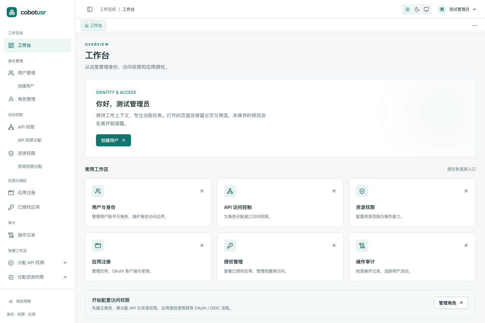

<div align="center">


# yufu

**企业统一身份与 SSO 平台**

统一账户、应用接入与访问治理，让内部应用共享清晰、可控的身份边界。

[下载 Release](https://github.com/Bin-hy/yufu/releases) · [官网](https://yufu-sso.pages.dev/) · [快速开始](https://yufu-sso.pages.dev/getting-started/) · [控制台指南](https://yufu-sso.pages.dev/guides/console/) · [English Docs](https://yufu-sso.pages.dev/en/)

Rust · Vue 3 · PostgreSQL · OpenID Connect · OAuth 2.0 · PKCE

</div>

---

yufu 面向**单企业、自托管**场景，为内部应用提供统一登录、受控接入、访问分配与身份审计。
一个 Rust 服务同时承载账户中心、开发者控制台和企业管理控制台，应用通过标准 OIDC 协议接入。
管理前端可嵌入单个二进制交付，持久化数据由 PostgreSQL 管理。

应用接入遵循企业邀约与审批流程：开发者维护应用配置，管理员审批生产接入并分配访问范围，
成员在获准范围内登录和使用应用。开发者资格、应用访问分配与用户资料同意分别管理。

## 为什么叫 yufu

yufu 是**鱼符**的拼音。唐代官员随身佩带鱼形的身份凭证，剖分为二：一半留在内廷，一半带在身上，
两半合上才算数。金、银、铜三品，对应不同的权级。

这个器物就是认证这个动作本身——持有一半不算身份，两半对上才算。所以标志是一条被中缝劈开的鱼：
**分开是凭证，合起来才是身份**。「三品」则提醒我们：认出你是谁还不够，还要知道你被允许走多远。

四条原则贯穿实现：

1. **一个身份，不是一堆账号。** 固定 issuer，一次登录进入所有被授权的应用，
   不要求每个应用各自维护一套密码。
2. **访问显式授予，默认拒绝。** 应用接入走企业邀约与审批，用户能进哪些应用必须被明确分配，
   不存在「注册即可见」；不受支持的执行凭据配置直接 fail closed。
3. **凭证可撤回，行为留痕。** 刷新令牌轮换、会话按中心或按应用分别终止、
   退出按应用能力投递后通道通知；每一次授权与撤销都进入审计。
4. **自托管，密钥在自己手里。** 单个 Rust 二进制加 PostgreSQL，管理前端可嵌入交付；
   签名私钥、数据库与审计记录都由部署方掌握。

边界同样写明白：不提供多租户、公开应用市场、外部 IdP 联邦、SAML / LDAP / SCIM 或 MFA。
把边界写在文档里，比让使用者自己试出来更诚实。

## 产品预览



> 当前 Vue 前端实截，使用隔离的演示数据；账户、应用、数量与会话状态均为虚构。
> 更多界面与操作说明见[控制台使用指南](https://yufu-sso.pages.dev/guides/console/)。

## 核心能力

| 能力 | 说明 |
| --- | --- |
| **统一身份与 SSO** | 固定 issuer，支持 OIDC Discovery、授权码流程、PKCE S256、UserInfo 与令牌内省 |
| **受控应用接入** | 开发与生产环境独立配置，支持应用成员协作、配置版本与生产审批 |
| **账户与访问治理** | 企业邀请、账户资格、用户组及应用访问分配；访问须显式授予 |
| **资料授权与会话管理** | 用户查看和撤回资料同意，管理中心及应用会话，支持刷新令牌轮换与撤销 |
| **退出联动与审计** | RP 发起退出、按应用环境能力投递后通道退出通知，以及身份与授权变更审计 |
| **应用集成** | 机密 Web 与公共 SPA 参考实现、Go Runtime SDK，以及 PDP 策略判断和 MCP 访问令牌 |

### 三个工作入口

| 入口 | 使用者 | 主要任务 |
| --- | --- | --- |
| **账户中心** · `/account` | 企业成员 | 维护个人资料、查看可访问应用、管理资料授权与登录会话 |
| **开发者控制台** · `/developer/apps` | 具备开发者资格的成员 | 注册与维护应用，管理开发/生产配置，提交审批 |
| **企业管理** · `/admin/*` | 企业管理员 | 邀请成员、管理账户与用户组、审批应用、分配访问、查看审计与退出通知 |

导航按账户资格显示。登录后默认进入账户中心，工作台位于 `/dashboard`。

## 下载与安装

[GitHub Releases](https://github.com/Bin-hy/yufu/releases) 提供内嵌 WebUI 的二进制安装包，无需在部署机器上安装 Rust 或 Node.js。
首次版本发布后可在该页面下载；运行服务仍需 PostgreSQL、部署配置和可信时钟来源。

| 平台 | 安装包（`<tag>` 例如 `v1.2.3`） |
| --- | --- |
| Linux x86_64 · GNU/glibc | `yufu-<tag>-x86_64-unknown-linux-gnu.tar.gz` |
| Windows x86_64 · MSVC | `yufu-<tag>-x86_64-pc-windows-msvc.zip` |
| macOS Intel | `yufu-<tag>-x86_64-apple-darwin.tar.gz` |
| macOS Apple Silicon | `yufu-<tag>-aarch64-apple-darwin.tar.gz` |

下载同版本 `SHA256SUMS` 核对安装包摘要。解包、配置、平台要求及 systemd 安装见[二进制安装说明](docs/releases/installation.md)。
从源码启动请按下面的快速开始操作。

## 快速开始

### 环境要求

- 支持 Rust 2024 edition 的 Rust 工具链
- Node.js **≥ 22.23.4**、pnpm **10+**（包含官网构建要求）
- Docker 兼容容器运行时，用于启动 PostgreSQL

### 1. 获取代码并构建前端

```sh
git clone https://github.com/Bin-hy/yufu.git
cd yufu
pnpm install --frozen-lockfile
pnpm build:web
```

### 2. 启动数据库并准备配置

```sh
docker compose up -d
cp conf/yufu.example.toml conf/yufu.local.toml
```

编辑 `conf/yufu.local.toml`，配置数据库连接、`[auth.super_admin]` 管理员账户、
`[oidc]` issuer 与签名密钥路径，以及 `[security_clock]` 可信时钟来源。
完整字段和示例见[快速开始](https://yufu-sso.pages.dev/getting-started/)与[配置参考](https://yufu-sso.pages.dev/reference/configuration/)。

`compose.yaml` 仅启动 PostgreSQL，默认本机端口为 `5433`；数据库默认凭据应按实际部署环境替换。

### 3. 启动身份服务

```sh
cargo run --bin yufu --features webui -- \
  --config conf/yufu.local.toml \
  --allow-insecure-loopback-cookies
```

打开 [http://127.0.0.1:4000](http://127.0.0.1:4000)，使用配置中的管理员账户登录。
启动时自动执行版本化数据库迁移；`--features webui` 嵌入前一步生成的 `assets/web` 前端产物。

`--allow-insecure-loopback-cookies` 仅用于本机 HTTP，要求监听地址与 issuer 均为 loopback。
生产部署使用 HTTPS 和默认 Secure Cookie。服务启动前检查认证时钟，运行期间可通过
`/api/v1/health/ready` 检查就绪状态，或使用 `--check-security-clock` 单独诊断。

开发前端可运行 `pnpm dev:web`，Vite 会将 API 请求代理到本机身份服务。

## 接入你的应用

1. **注册应用**：管理员授予开发者资格，开发者注册应用并配置环境、客户端类型、回调地址与 scope。
2. **审批与分配**：生产配置经管理员审批，并为账户或用户组明确分配应用访问。
3. **接入 OIDC**：从 Discovery 获取端点，完成授权码 + PKCE 流程，并按应用类型处理令牌与会话。
4. **配置退出联动**：接入 RP 发起退出；具备后通道能力的应用登记回调并验证退出通知。

协议发现入口：

```text
{issuer}/.well-known/openid-configuration
```

中心会在发送后通道通知前完成本地授权撤销。通知返回 `2xx` 表示接收方已接受，
不代表应用内部的会话清理已经完成；接入方仍需实现对应处理。

| 接入方式 | 文档 | 仓库参考 |
| --- | --- | --- |
| OIDC 协议与令牌语义 | [OIDC 接入](https://yufu-sso.pages.dev/guides/oidc-integration/) | [端点与令牌](https://yufu-sso.pages.dev/reference/endpoints/) |
| 机密 Web 应用 | [Web 接入指南](https://yufu-sso.pages.dev/guides/web-app/) | [examples/oidc-web](examples/oidc-web/README.md)，基于 `openid-client`，含独立保护 API |
| 公共 SPA | [SPA 接入指南](https://yufu-sso.pages.dev/guides/spa/) | [examples/oidc-spa](examples/oidc-spa/README.md)，基于 `oidc-client-ts` |
| Go 服务 | [Go SDK 指南](https://yufu-sso.pages.dev/guides/go-sdk/) | [sdk/go](sdk/go/README.md) · [联调示例](examples/sdk/go/README.md) |

API 默认前缀为 `/api/v1`。应用权限同步使用 `/application/sync-permissions`，
PDP 使用 `/enforce`。MCP 令牌必须指定已注册应用的 `aud`，调用者还需具有相应 `mcp:access` 权限。

## 部署与运维

- **服务交付**：单个 `yufu` 二进制，可嵌入 WebUI；[systemd 模板](conf/yufu.service)用于独立服务部署。
- **容器交付**：仓库提供 [`deploy/docker`](deploy/docker/README.md) 参考栈（PostgreSQL + 身份服务 + Caddy TLS），
  镜像从源码构建；项目不发布预构建镜像。
- **持久化**：PostgreSQL 保存账户、应用、授权、会话与审计数据，启动时执行数据库迁移。
- **备份恢复**：数据库、签名私钥、部署配置及应用凭据应一并纳入恢复计划，升级前执行备份与演练。
- **升级兼容**：历史业务数据和既有客户端不会自动删除；旧 RBAC 页面重定向到新控制台，后端旧管理接口为既有客户端保留兼容。

部署步骤见[生产部署](https://yufu-sso.pages.dev/operations/deployment/)、
[容器部署](https://yufu-sso.pages.dev/operations/docker/)和[安全与备份](https://yufu-sso.pages.dev/operations/security/)。
已有部署的升级、恢复与容量评估见[企业身份升级运维指南](docs/operations/enterprise-identity-upgrade.md)。

## 项目结构

```text
yufu/
├── src/                      # yufu CLI 与服务启动入口
├── yufu/                     # 身份服务、协议端点、治理与数据库迁移
├── libs/auth/                # 共享认证与安全能力
├── web/                      # Vue 3 控制台
├── sdk/go/                   # Go Runtime SDK
├── examples/                 # Web、SPA 与 Go 接入参考
├── website/                  # Astro + Starlight 中英双语官网
├── deploy/docker/            # 容器部署：Dockerfile、Compose 与 Caddy 入口
├── conf/                     # 配置与部署模板
├── tests/                    # 隔离集成测试
└── docs/                     # 设计、验收与运维记录
```

## 开发与验证

以下为开发检查命令；具体执行结果与验收状态请查阅对应记录。
Rust 集成测试通过 testcontainers 创建隔离 PostgreSQL，需要可用的 Docker 兼容运行时，串行执行。

<details>
<summary>展开完整验证与构建命令</summary>

```sh
# Rust
cargo fmt --all -- --check
cargo clippy --workspace --all-targets --all-features -- -D warnings
cargo test --workspace --all-targets --all-features -- --test-threads=1
cargo test --workspace --doc --all-features
cargo machete
cargo audit

# 控制台与接入示例
pnpm --filter @yufu/web test
pnpm --filter @yufu/web check
pnpm --filter @yufu/web lint
pnpm check:examples
pnpm test:examples

# 发布构建：先构建前端，再嵌入二进制
pnpm build:web
cargo build --bin yufu --features webui --release

# Go SDK：离线契约测试与真实 issuer 联调
(cd sdk/go && go test ./... && go vet ./...)
(cd examples/sdk/go && go test ./... && go vet ./...)
(cd examples/sdk/go && ./run-integration.sh)  # 需要 Docker

# 官网文档
pnpm check:website
pnpm build:website
```

Go 的 `go test ./...` 执行离线契约测试；真实 issuer 联调由独立脚本执行，缺少配置会失败而不会跳过。
官网本地预览使用 `pnpm dev:website`，构建输出为 `website/dist`，维护与部署说明见 [website/README.md](website/README.md)。

</details>

## Tag 打包发版

[Release workflow](.github/workflows/release.yml) 在推送版本 tag 后运行：版本预检 → 质量门禁 → 四平台构建与归档 → 校验附件 → 公开 GitHub Release。
每个包包含二进制、配置模板、安装说明及构建元数据；Linux 另附 systemd 模板。

### 准备版本

1. 将根 `Cargo.toml` 的 `[workspace.package].version` 改为本次版本，例如 `1.2.3` 或 `1.2.3-rc.1`。
2. 运行 `cargo check --workspace` 刷新 `Cargo.lock` 中三个 workspace 包的版本，检查锁文件 diff；不要只改 tag 或安装包名称。
3. 运行项目检查和下面的发布工具检查，提交版本变更及工作流，然后推送提交。

```sh
# 发布工具要求 Python 3.11+
python3 -m unittest discover -s scripts/tests -v
python3 scripts/release.py validate --tag v1.2.3

# 完成检查并提交后，创建附注 tag，只推送本次 tag
git tag -a v1.2.3 -m "Release v1.2.3"
git push origin v1.2.3
```

当前 workspace 版本为 `0.0.0`；示例 `v1.2.3` 需先完成对应版本变更，不能直接对当前版本打该 tag。
预发布示例使用 `1.2.3-rc.1` 与 `v1.2.3-rc.1`，也支持 `alpha.N` 和 `beta.N`；版本数字不允许多余前导零。

### 发布结果与重试

- 所有检查及四平台构建成功后，才创建或复用当前提交的 Release 草稿。
- 上传四个包和 `SHA256SUMS`，下载附件并校验完整性，通过后公开；预发布 tag 自动标记 prerelease。
- 失败时从 Actions 重新运行原 tag 工作流。同一提交的本流程草稿可重试，已公开版本不可覆盖；不要移动 tag 修复公开版本，使用新版本发布。
- 默认使用 `GITHUB_TOKEN`，仅最终发布 job 具有仓库内容写权限；不需要额外 PAT。若仓库策略限制写权限，须由维护者调整对应 Actions 策略。

本流程不部署官网，也不发布容器镜像，不为安装包签名或公证。
容器部署由仓库内 [`deploy/docker`](deploy/docker/README.md) 从源码构建镜像，见
[容器部署](https://yufu-sso.pages.dev/operations/docker/)。

手工构建、打包、校验与发版的完整步骤见[打包与发版操作手册](docs/releases/packaging.md)。

## 能力边界与项目进展

当前聚焦单企业、固定 issuer 的身份与应用接入，不提供多租户、公开应用市场、外部 IdP 联邦、
SAML、LDAP、SCIM 或 MFA。企业开发者通过邀约获得资格，不开放公开自助注册。

部署前请结合自身场景评估，不以功能列表代替验收结论。
