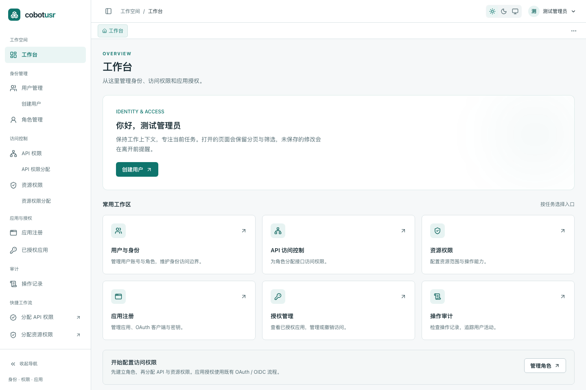
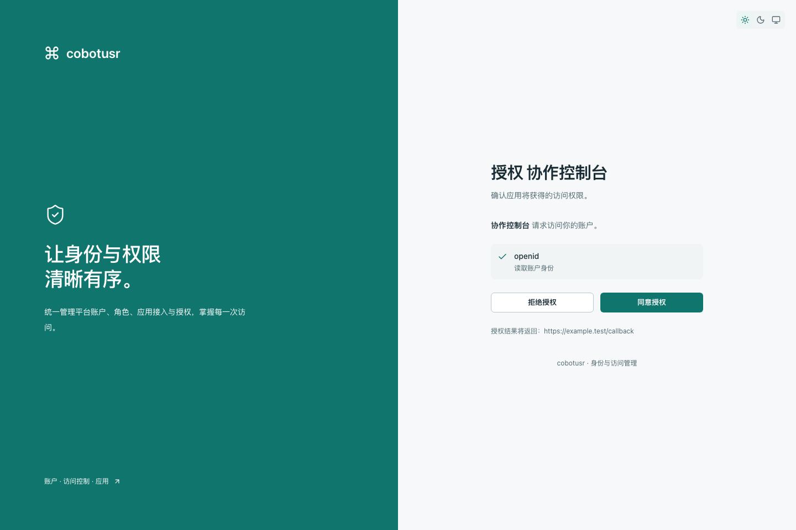
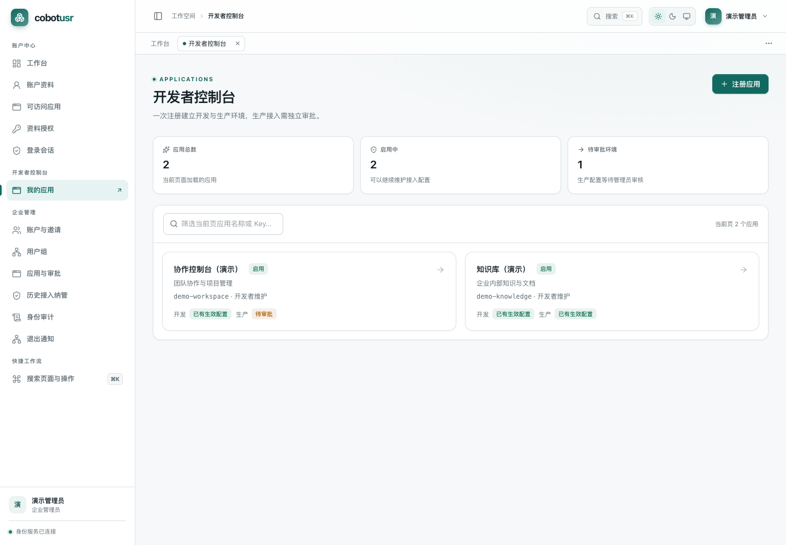
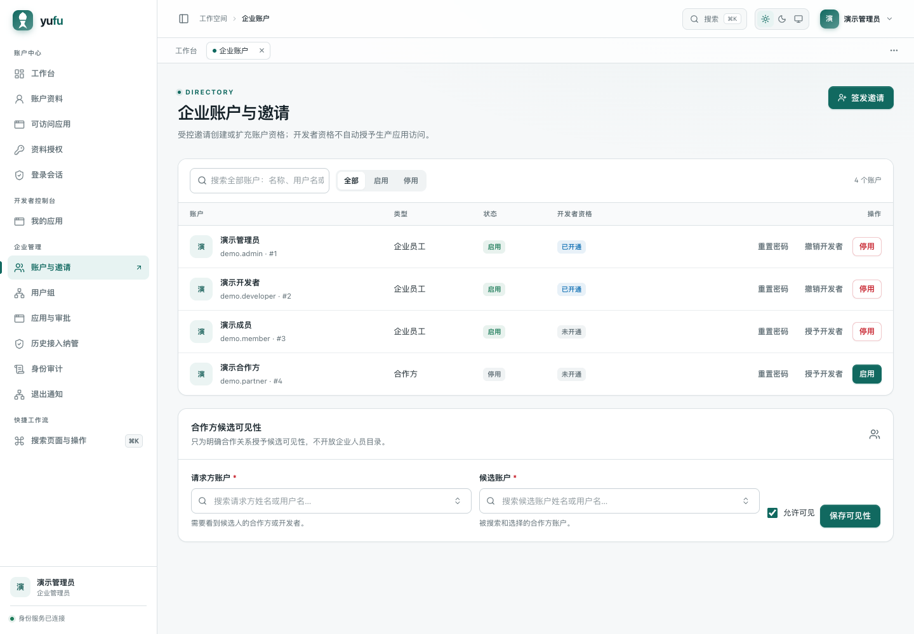
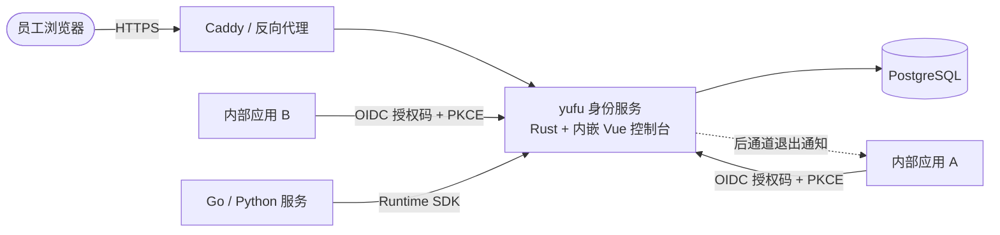

<div align="center">


# yufu · 鱼符

**单企业自托管统一身份与 SSO**

一个 Rust 二进制 + PostgreSQL，让内部应用共享同一个身份边界。

[](https://github.com/Bin-hy/yufu/actions/workflows/rust.yml)
[](https://github.com/Bin-hy/yufu/releases)
[](LICENSE)
[](https://yufu-sso.pages.dev/)

[**5 分钟试用**](#快速开始) · [完整文档](https://yufu-sso.pages.dev/getting-started/) · [控制台指南](https://yufu-sso.pages.dev/guides/console/) · [English](README.en.md)

`Rust 2024` · `OpenID Connect` · `OAuth 2.0` · `PKCE S256` · `Vue 3` · `PostgreSQL` · `Go / Python SDK`

</div>

---

yufu 面向**单企业、自托管**场景：为内部应用提供统一登录、受控接入、访问分配与身份审计。
一个 Rust 服务同时承载账户中心、开发者控制台和企业管理控制台，应用通过标准 OIDC 接入；
管理前端可嵌入单个二进制交付，数据由 PostgreSQL 管理。

> 它解决的不是「做一个登录页」，而是「划清身份边界」：谁是谁、能进哪个应用、
> 权限何时被撤销、每一次变更留下什么记录。

## 产品预览



> Vue 控制台实截，使用隔离的演示数据；账户、应用、数量与会话状态均为虚构。

<p align="center">
  
  
  
</p>
<p align="center"><sub>授权同意 · 开发者控制台 · 企业管理</sub></p>

## 为什么值得一试

- **一个 issuer，一次登录。** 固定 issuer，OIDC Discovery 自动发现端点；登录一次，
  在授权范围内跨应用免登录，内部应用不必各自维护一套密码。
- **访问显式授予，默认拒绝。** 应用接入走企业邀约与审批：开发与生产配置分离，
  生产接入需管理员审批，用户能进哪些应用必须被明确分配，不存在「注册即可见」；
  不受支持的执行凭据配置直接 fail closed。
- **凭证可撤回，行为留痕。** 刷新令牌轮换与重放撤销、按中心或按应用终止会话、
  RP 发起退出与后通道通知；授权、撤销与管理写入进入审计。
- **单二进制，密钥在自己手里。** Rust 服务内嵌 Vue 控制台，部署只需一个二进制 + PostgreSQL；
  签名私钥、数据库与审计记录都由部署方掌握。容器以非 root、只读根文件系统运行。
- **品牌和登录页开箱可改。** 超级管理员在控制台修改网站名称、Logo、登录封面、欢迎文案与
  页脚备案信息，保存后刷新即生效，不需要改代码、重新构建或重启服务。

### 适合谁，不适合谁

| 适合 | 不适合 |
| --- | --- |
| 单企业、内部应用需要统一登录 | 需要多租户或对外 SaaS 身份服务 |
| 希望自托管，密钥和数据自己掌握 | 需要 SAML / LDAP / SCIM 联邦 |
| 需要应用接入审批与访问分配 | 需要 MFA / Passkey / 社交登录 |
| 想用标准 OIDC，不想写私有认证 | 需要公开 PDP 决策 API 或通用 ReBAC |
| 希望交付体积小、运维面小 | 需要开箱即用的应用市场 |

如果你只需要一个给内部应用用的、能自己掌控的身份中心，而不想引入一整套 IAM 平台，
yufu 是一个更小的选择。

## 快速开始

### Docker（推荐，约 5 分钟）

不需要安装 Rust 或 Node.js，也不需要手写配置：镜像首次启动会从环境变量生成配置，
并签发评估用签名密钥。

```sh
git clone https://github.com/Bin-hy/yufu.git
cd yufu
docker compose -f deploy/docker/compose.demo.yaml up -d
```

打开 <https://localhost:8443>，用 `admin` / `change-me-now` 登录。首次启动会自动建库并执行迁移。
浏览器会提示 Caddy 本地 CA 的自签名证书，接受后继续。

> 该 compose 只用于本机评估，密码与密钥都是公开的演示值。生产部署请使用
> [`deploy/docker`](deploy/docker/README.md) 的参考栈，替换密码与 issuer，并挂载自己的签名私钥。

> **NTP 前提**：服务启动时会校验可信时钟，容器需要能访问配置的 NTP 来源（UDP/123）。
> 若日志出现 `NTP clock health could not be confirmed`，说明当前网络阻断了 NTP；
> 请在 `[security_clock]` 中换成可达的来源，或用
> `yufu --config <path> --check-security-clock` 单独诊断。

### 从源码构建

环境要求：

- 支持 Rust 2024 edition 的 Rust 工具链
- Node.js **≥ 22.23.4**、pnpm **10+**
- Docker 兼容容器运行时，用于启动 PostgreSQL

```sh
git clone https://github.com/Bin-hy/yufu.git
cd yufu
pnpm install --frozen-lockfile
pnpm build:web
docker compose up -d
cp conf/yufu.example.toml conf/yufu.local.toml
```

根目录 `compose.yaml` 只启动 PostgreSQL，默认本机端口为 `5433`；数据库默认凭据应按实际部署环境替换。

编辑 `conf/yufu.local.toml`，配置数据库连接、`[auth.super_admin]` 管理员账户、
`[oidc]` issuer 与签名密钥路径，以及 `[security_clock]` 可信时钟来源。
完整字段见[配置参考](https://yufu-sso.pages.dev/reference/configuration/)。

```sh
cargo run --bin yufu --features webui -- \
  --config conf/yufu.local.toml \
  --allow-insecure-loopback-cookies
```

打开 <http://127.0.0.1:4000>。启动时自动执行版本化数据库迁移；`--features webui`
嵌入前一步生成的 `assets/web` 前端产物。`--allow-insecure-loopback-cookies`
仅用于本机 HTTP，要求监听地址与 issuer 均为 loopback；生产使用 HTTPS 与默认 Secure Cookie。

开发前端可运行 `pnpm dev:web`，Vite 会把 API 请求代理到本机身份服务。

## 核心能力

| 能力 | 你能得到什么 |
| --- | --- |
| **统一身份与 SSO** | 固定 issuer；OIDC Discovery、授权码流程、PKCE S256、UserInfo 与令牌内省 |
| **受控应用接入** | 开发与生产环境独立配置，应用成员协作、配置版本与生产审批 |
| **账户与访问治理** | 企业邀请、账户资格、用户组及应用访问分配；访问须显式授予 |
| **资料授权与会话** | 用户查看和撤回资料同意；按中心或按应用终止会话；刷新令牌轮换与撤销 |
| **退出联动与审计** | RP 发起退出、按应用能力投递后通道退出通知，以及身份与授权变更审计 |
| **站点品牌** | 网站名称、简介、Logo、浏览器图标、登录封面、欢迎文案、页脚备案与链接；OIDC 页面可独立覆盖 |
| **应用集成** | 机密 Web 与公共 SPA 参考实现、Go / Python Runtime SDK、MCP 访问令牌 |

### 三个工作入口

| 入口 | 使用者 | 主要任务 |
| --- | --- | --- |
| **账户中心** · `/account` | 企业成员 | 维护个人资料、查看可访问应用、管理资料授权与登录会话 |
| **开发者控制台** · `/developer/apps` | 具备开发者资格的成员 | 注册与维护应用，管理开发/生产配置，提交审批 |
| **企业管理** · `/admin/*` | 企业管理员（站点品牌仅超级管理员） | 邀请成员、管理账户与用户组、审批应用、分配访问、查看审计与退出通知、配置站点品牌 |

导航按账户资格显示。登录后默认进入账户中心，工作台位于 `/dashboard`。

### 品牌与登录页，不用改代码

超级管理员在「系统设置 → 站点设置」（`/admin/site-settings`）可以直接修改：

| 可配置项 | 说明 |
| --- | --- |
| **全站品牌** | 网站名称、简介、Logo、浏览器图标 |
| **普通登录页** | 认证封面、欢迎标题、欢迎说明 |
| **OIDC 登录与授权页** | 独立封面与文字；可逐项继承全站配置，也可单独覆盖 |
| **页脚信息** | 版权文字、备案号、备案链接，以及最多 10 个自定义链接 |

保存后其他用户下次打开或刷新页面即可生效，不需要重新构建、重启服务或重新登录。
配置和图片统一保存在 PostgreSQL，保存与恢复默认都会写入身份审计。
普通企业管理员、开发者和成员没有该入口。完整限制与运维说明见
[站点品牌与认证页面配置](docs/operations/site-branding.md)。

## 接入你的应用

### 让 AI Agent 帮你接入

让编码 agent 在本机完成「部署 yufu → 注册应用 → 校验参数 → 生成接入代码」：

```bash
npx skills add Bin-hy/yufu --skill yufu-onboarding
```

安装后对 agent 说一句「部署 yufu 并接入这个项目」，它只会追问一次接入形态
（Web 登录 / 保护已有 API），随后执行固定版本的本地部署与注册，并输出 issuer、
client id、secret 文件位置和下一步文档。

非交互安装：

```bash
npx skills add Bin-hy/yufu --skill yufu-onboarding -a claude-code --copy -y
```

安装后 `skills-lock.json` 固定到具体提交；部署的 yufu 版本与 Go SDK 版本由 Skill 内的
`assets/versions.env` 固定，不随默认分支浮动。该 Skill 面向本机联调，不涉及生产 TLS、
域名或多机部署；client secret 只写入权限 600 的本地文件。

### 标准 OIDC 接入

1. **注册应用**：管理员授予开发者资格，开发者注册应用并配置环境、客户端类型、回调地址与 scope。
2. **审批与分配**：生产配置经管理员审批，并为账户或用户组明确分配应用访问。
3. **接入 OIDC**：从 Discovery 获取端点，完成授权码 + PKCE 流程，并按应用类型处理令牌与会话。
4. **配置退出联动**：接入 RP 发起退出；具备后通道能力的应用登记回调并验证退出通知。

协议发现入口：

```text
{issuer}/.well-known/openid-configuration
```

中心会在发送后通道通知前完成本地授权撤销。通知返回 `2xx` 表示接收方已接受，
不代表应用内部的会话清理已经完成；接入方仍需实现对应处理。

### 用 SDK 少写胶水代码

Python：

```python
import os
from yufu import Client

client = Client(
    issuer="https://id.example.com",
    client_id="web",
    client_secret=os.environ["OIDC_CLIENT_SECRET"],
    redirect_uri="https://app.example.com/callback",
    scopes=["openid", "profile", "email"],
)

auth = client.authorize_url()
# 把 auth.state / auth.nonce / auth.code_verifier 存进用户会话
tokens = client.exchange_code(code, auth.code_verifier, redirect_uri=auth.redirect_uri)
claims = client.verify_id_token(tokens.id_token, nonce=auth.nonce)
```

Go 与 Python SDK 消费同一套语言无关的协议契约夹具，行为保持一致：

| 接入方式 | 文档 | 仓库参考 |
| --- | --- | --- |
| OIDC 协议与令牌语义 | [OIDC 接入](https://yufu-sso.pages.dev/guides/oidc-integration/) | [端点与令牌](https://yufu-sso.pages.dev/reference/endpoints/) |
| 机密 Web 应用 | [Web 接入指南](https://yufu-sso.pages.dev/guides/web-app/) | [examples/oidc-web](examples/oidc-web/README.md)，基于 `openid-client`，含独立保护 API |
| 公共 SPA | [SPA 接入指南](https://yufu-sso.pages.dev/guides/spa/) | [examples/oidc-spa](examples/oidc-spa/README.md)，基于 `oidc-client-ts` |
| Go 服务 | [Go SDK 指南](https://yufu-sso.pages.dev/guides/go-sdk/) | [yufu-sdk-go](https://github.com/Bin-hy/yufu-sdk-go) · [联调示例](examples/sdk/go/README.md) |
| Python 服务 | [Python SDK 指南](https://yufu-sso.pages.dev/guides/python-sdk/) | [yufu-sdk-python](https://github.com/Bin-hy/yufu-sdk-python) · [PyPI](https://pypi.org/project/yufu-sdk/) |

API 默认前缀为 `/api/v1`。应用权限同步使用 `/application/sync-permissions`；
旧 `/enforce` 保留拒绝响应，不提供可直接接入的公开 PDP 决策 API。
MCP 令牌必须指定已注册应用的 `aud`，调用者还需具有相应 `mcp:access` 权限。

## 架构



## 安装包与镜像

| 交付方式 | 获取方式 |
| --- | --- |
| 二进制（内嵌 WebUI） | [GitHub Releases](https://github.com/Bin-hy/yufu/releases)，附 `SHA256SUMS` |
| 容器镜像 | `ghcr.io/bin-hy/yufu`（`linux/amd64` / `linux/arm64`） |
| 源码构建 | 见上方「从源码构建」 |

Release 安装包覆盖 Linux x86_64（GNU/glibc）、Windows x86_64（MSVC）、macOS Intel 与
macOS Apple Silicon。解包、配置、平台要求及 systemd 安装见
[二进制安装说明](docs/releases/installation.md)。

## 部署与运维

- **服务交付**：单个 `yufu` 二进制，可嵌入 WebUI；[systemd 模板](conf/yufu.service)用于独立服务部署。
- **容器交付**：镜像发布在 `ghcr.io/bin-hy/yufu`。不挂载配置时按环境变量生成配置并签发密钥，
  `docker run` 即可评估；生产环境挂载自己的 `/etc/yufu/yufu.toml` 与私钥。
  参考栈见 [`deploy/docker`](deploy/docker/README.md)。
- **持久化**：PostgreSQL 保存账户、应用、授权、会话与审计数据，启动时执行数据库迁移。
- **备份恢复**：数据库、签名私钥、部署配置及应用凭据应一并纳入恢复计划，升级前执行备份与演练。
- **升级兼容**：历史业务数据和既有客户端不会自动删除；旧 RBAC 页面重定向到新控制台，
  后端旧管理接口为既有客户端保留兼容。
- **健康检查**：`/api/v1/health/ready` 返回 200 且 `security_clock_synchronized=true`
  才应接入流量；认证时钟未同步时返回 503，这是设计行为。

部署步骤见[生产部署](https://yufu-sso.pages.dev/operations/deployment/)、
[容器部署](https://yufu-sso.pages.dev/operations/docker/)和
[安全与备份](https://yufu-sso.pages.dev/operations/security/)。
已有部署的升级、恢复与容量评估见
[企业身份升级运维指南](docs/operations/enterprise-identity-upgrade.md)。

## 项目结构

```text
yufu/
├── src/                      # yufu CLI 与服务启动入口
├── yufu/                     # 身份服务、协议端点、治理与数据库迁移
├── libs/auth/                # 共享认证与安全能力
├── web/                      # Vue 3 控制台
├── examples/                 # Web、SPA 与 Go 接入参考
├── sdk/                      # 语言无关的协议契约夹具
├── website/                  # Astro + Starlight 中英双语官网
├── deploy/docker/            # 容器部署：Dockerfile、Compose 与 Caddy 入口
├── conf/                     # 配置与部署模板
├── tests/                    # 隔离集成测试
└── docs/                     # 设计、验收与运维记录
```

## 开发与验证

Rust 集成测试通过 testcontainers 创建隔离 PostgreSQL，需要可用的 Docker 兼容运行时，串行执行。

<details>
<summary>展开完整验证与构建命令</summary>

```sh
# Rust
cargo fmt --all -- --check
cargo clippy --workspace --all-targets --all-features -- -D warnings
cargo test --workspace --all-targets --all-features -- --test-threads=1
cargo test --workspace --doc --all-features
cargo machete
cargo audit

# 控制台与接入示例
pnpm --filter @yufu/web test
pnpm --filter @yufu/web check
pnpm --filter @yufu/web lint
pnpm check:examples
pnpm test:examples

# 发布构建：先构建前端，再嵌入二进制
pnpm build:web
cargo build --bin yufu --features webui --release

# 独立 Go SDK 在 https://github.com/Bin-hy/yufu-sdk-go 维护
# 本仓库保留 Go 接入示例：离线契约测试与真实 issuer 联调
(cd examples/sdk/go && go test ./... && go vet ./...)
(cd examples/sdk/go && ./run-integration.sh)  # 需要 Docker

# 独立 Python SDK 在 https://github.com/Bin-hy/yufu-sdk-python 维护
# 契约测试读取本仓库的 sdk/contract-fixtures
# 先在 Python SDK 仓库执行 uv pip install -e '.[dev]'
(cd ../yufu-sdk-python && pytest)

# 官网文档
pnpm check:website
pnpm build:website
```

</details>

官网本地预览使用 `pnpm dev:website`，构建输出为 `website/dist`，维护与部署说明见
[website/README.md](website/README.md)。发版流程、版本预检与多平台打包见
[打包与发版操作手册](docs/releases/packaging.md)。

## 设计边界与当前状态

**明确不做**：多租户、公开应用市场、外部 IdP 联邦、SAML / LDAP / SCIM、MFA、
以及可直接接入的公开 PDP 决策 API。企业开发者通过邀约获得资格，不开放公开自助注册。

**当前状态**：v0.1.4 已发布二进制安装包与多架构容器镜像。部分能力仍标记为
「已实现待验收」，逐项状态与限制见 [capabilities.json](docs/product/capabilities.json)
和[产品可用性验收记录](docs/specs/product-readiness/verification.md)。
README 不把「已实现」表述为「已验收」；部署前请结合自身场景评估。

## 关于名字

yufu 是**鱼符**的拼音。唐代官员随身佩带鱼形的身份凭证，剖分为二：一半留在内廷，
一半带在身上，两半合上才算数；金、银、铜三品，对应不同的权级。

这个器物就是认证这个动作本身——持有一半不算身份，两半对上才算。标志因此是一条被中缝劈开的鱼：
**分开是凭证，合起来才是身份**。「三品」则提醒我们：认出你是谁还不够，还要知道你被允许走多远。

## 参与贡献

- 问题与建议：欢迎提交 GitHub Issue。
- 安全问题：请不要公开提交 issue，通过仓库的 Security 页面私下报告。
- 提交前请确保 `cargo fmt`、`cargo clippy` 与相关测试通过；开发命令见上方「开发与验证」。

## 开源协议

本项目以 [Apache License 2.0](LICENSE) 发布，SPDX 标识为 `Apache-2.0`。

Copyright 2026 Bin-hy

在遵守许可证条款的前提下，可自由使用、修改与分发。该许可证包含明确的专利授权，
同时不授予使用项目名称或商标为衍生产品背书的权利。
