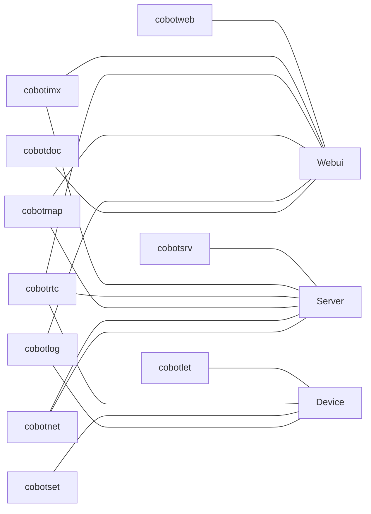

# cobotrix

CoBotrix (Co-Robotics Matrix) 协熵云枢

一个针对智能设备的云平台框架，通常为远程智能设备，比如 Robotics。

提供统一的网络通信，统一的 API 和用户权限和设备管理

## 运行

运行依赖 **cobotnil 不需要 mqtt broker 依赖，目前内置了一个 mqtt broker**

```bash
# docker compose up -d
```

运行集群 (启动一个 `Server` 和 三个 `Device`)

```bash
cargo run -- -c conf/cobotnil
```

## 项目结构

采用服务和启动器分离模式，大部份情况代码会运行在三种不同类型的机器上（比如：Server，Client，Device）

部分组件会同时存在不同类型的机器上，比如 Map（地图）在 Server，Client 上，Net（网络）在 Server，Device 上




### 目录说明

- 云平台
  - `cobotweb` 云服务前端代码
  - `cobotsrv` 命令灵感来自 Linux 各发行版提供的 `/srv/` 路径，云端服务端后端
  - `cobotlet` 命令灵感来自 `kubelet`，运行在各 device 上的通信服务，主要负责和 `cobotsrv` 通信
- 核心组件
  - `cobotimx` Instant Messaging eXchange（即时消息交换平台）
  - `cobotrtc` 实时交互音视频（基于 `Live777`）
  - `cobotmap` 地图服务
  - `cobotnet` 基于 WireGuard 配合 ICE 通过云平台辅助启动一个 P2P VPN 来实现大量数据交互（类似 Tailscale）
  - `_cobotkvm` `TODO` KVM 扩展
- 开发部署工具链
  - `cobotnil` 和 Live777 的 `livenil` 一样，只在 开发/测试 模式里使用，快速启动一个集群
  - `cobotset` 通用设备初始化设置工具
  - `cobotlog` 通用设备服务异步日志管理
  - `cobotdoc` 文档
  - `cobotxxx` 遵守命名规则 `cobot` + `xxx`

## API 说明

```bash
/remote/<Device Name>/<Module Name>
```


`<Device Name>` 就是全局唯一的命名，`<Module Name>` 为个项目自定义名称，通常为 HTTP 一级子路径


### 内置云模块

对内置云模块名称特殊处理（通常 `<Module Name>` 由 `Device` 提供）。调用者无法感知是云模块还是边缘模块

```bash
/remote/<Device Name>/rtc
```

## `CoBotSrv` 和 `CoBotLet` 的通信说明

使用 Net4mqtt 来完成反向代理，依赖 Mqtt Broker

Net4mqtt 工作原理参考 [Live777/Net4mqtt](https://live777.pages.dev/zh/guide/net4mqtt)

**Net4mqtt 主要用于保障核心通信，无状态水平扩容，CoBotSrv 和 CoBotLet 实例数量比 `M:N`。不适合大规模数据传输和高性能网络**

