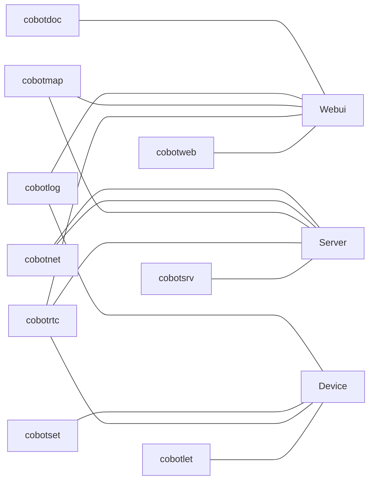

# cobotrix

CoBotrix (Co-Robotics Matrix) 协熵云枢

一个针对智能设备的云平台框架，通常为远程智能设备，比如 Robotics。

提供统一的网络通信，统一的 API 和用户权限和设备管理

## 运行

运行依赖 **cobotnil 不需要 mqtt broker 依赖，目前内置了一个 mqtt broker**

```bash
# docker compose up -d
```

运行集群 (启动一个 `Server` 和 三个 `Device`)

```bash
cargo run -- -c conf/cobotnil
```

## 项目结构

采用服务和启动器分离模式，大部份情况代码会运行在三种不同类型的机器上（比如：Server，Client，Device）

部分组件会同时存在不同类型的机器上，比如 Map（地图）在 Server，Client 上，Net（网络）在 Server，Device 上




### 目录说明

- 云平台
  - `cobotweb` 云服务前端代码
  - `cobotsrv` 命令灵感来自 Linux 各发行版提供的 `/srv/` 路径，云端服务端后端
  - `cobotlet` 命令灵感来自 `kubelet`，运行在各 device 上的通信服务，主要负责和 `cobotsrv` 通信
- 核心组件
  - `cobotrtc` 实时交互音视频（基于 `Live777`）
  - `cobotmap` 地图服务
  - `cobotnet` 基于 WireGuard 配合 ICE 通过云平台辅助启动一个 P2P VPN 来实现大量数据交互（类似 Tailscale）
  - `_cobotkvm` `TODO` KVM 扩展
- 开发部署工具链
  - `cobotnil` 和 Live777 的 `livenil` 一样，只在 开发/测试 模式里使用，快速启动一个集群
  - `cobotset` 通用设备初始化设置工具
  - `cobotlog` 通用设备服务异步日志管理
  - `cobotdoc` 文档
  - `cobotxxx` 遵守命名规则 `cobot` + `xxx`

## API 说明

```bash
/remote/<Device Name>/<Module Name>
```


`<Device Name>` 就是全局唯一的命名，`<Module Name>` 为个项目自定义名称，通常为 HTTP 一级子路径


### 内置云模块

对内置云模块名称特殊处理（通常 `<Module Name>` 由 `Device` 提供）。调用者无法感知是云模块还是边缘模块

```bash
/remote/<Device Name>/rtc
```

## `CoBotSrv` 和 `CoBotLet` 的通信说明

使用 Net4mqtt 来完成反向代理，依赖 Mqtt Broker

Net4mqtt 工作原理参考 [Live777/Net4mqtt](https://live777.pages.dev/zh/guide/net4mqtt)

**Net4mqtt 主要用于保障核心通信，无状态水平扩容，CoBotSrv 和 CoBotLet 实例数量比 `M:N`。不适合大规模数据传输和高性能网络**

## OIDC 实现

### 设计目标

为 CoBotrix 平台提供标准的 OpenID Connect 身份认证能力，支持：

- **Authorization Code + PKCE** 流程 — 面向前端 (cobotweb) 和第三方集成
- **Client Credentials** 流程 — 面向 M2M (cobotlet → cobotsrv) 机器间认证
- **Refresh Token** 轮换 — 安全的无感续期
- **RSA 签名** — ID Token 使用 RS256 签名，符合 OIDC 标准验证流程

### 整体架构

```
┌─────────────┐     ┌──────────────────────────────────────────────────┐
│  cobotweb   │     │                  cobotsrv                        │
│  (Vue SPA)  │────▶│                                                  │
└─────────────┘     │  ┌─────────────┐  ┌──────────┐  ┌────────────┐  │
                    │  │  OIDC Route  │  │ Auth Lib │  │  SeaORM    │  │
┌─────────────┐     │  │             │  │          │  │  Entities  │  │
│  cobotlet   │────▶│  │ authorize   │  │ Token    │  │            │  │
│  (Device)   │     │  │ token       │  │ Manager  │  │ oauth_     │  │
└─────────────┘     │  │ userinfo    │  │          │  │ client     │  │
                    │  │ revoke      │  │ IdToken  │  │ scope      │  │
┌─────────────┐     │  │ introspect  │  │ Signer   │  │ token      │  │
│ Third-party │────▶│  │ jwks        │  │ (RSA)    │  │ auth_code  │  │
│   Client    │     │  │ discovery   │  │          │  │            │  │
└─────────────┘     │  └─────────────┘  └──────────┘  └────────────┘  │
                    │                                                  │
                    │                  PostgreSQL                       │
                    └──────────────────────────────────────────────────┘
```

### 实现思路 (分层说明)

#### 1. 数据层 — Entity + Migration

四张核心表，通过 SeaORM 管理：

| 表名 | 作用 | 关键字段 |
|------|------|----------|
| `oauth_client` | 注册的 OAuth 客户端 | `client_id` (唯一), `client_secret_hash` (bcrypt), `redirect_uris`, `allowed_scopes`, `grant_types` |
| `oauth_scope` | 可用的 scope 定义 | `name` (唯一, 如 openid/profile/email), `description` |
| `oauth_token` | 已发放的 token 记录 | `access_token`, `id_token`, `refresh_token` (唯一), `revoked`, 过期时间 |
| `oauth_authorization_code` | 授权码 (持久化到 DB) | `code` (唯一), `user_id`, PKCE 信息, `used`, `expires_at` |

**设计决策：**
- 授权码持久化到 DB 而非内存 → 支持多实例水平扩展 (无状态 cobotsrv)
- Token 记录包含 `revoked` 字段 → 支持主动撤销和刷新轮换
- `client_secret_hash` 使用 bcrypt → 注册时返回明文 secret 一次，之后只存哈希

#### 2. 认证层 — libs/auth

`libs/auth` 提供 JWT 签发与验证，OIDC 扩展了两个核心能力：

**IdTokenClaims** — ID Token 的 JWT 载荷：
```rust
pub struct IdTokenClaims<T> {
    pub iss: String,         // 签发者
    pub sub: T,              // 用户标识 (泛型，支持 i32 / String)
    pub aud: Option<String>, // 客户端 client_id
    pub iat: u64,            // 签发时间
    pub exp: u64,            // 过期时间
    pub nonce: Option<String>, // 防重放
    pub at_hash: Option<String>, // access_token 的 SHA-256 左半部分
}
```

**IdTokenSigner** — RSA / HMAC 双模签名器：
```rust
// 优先使用 RSA (RS256)
let signer = IdTokenSigner::from_rsa_pem(pem_bytes, expire_secs)?;
// 回退到 HMAC (HS256)
let signer = IdTokenSigner::from_hmac(secret, expire_secs);

// 签发 ID Token
signer.sign_id_token(user_id, issuer, audience, nonce, access_token)?;
// 导出 JWKS JSON (仅 RSA 模式可用)
signer.jwks_json(); // -> Option<String>
```

**RSA 密钥管理：** 启动时自动加载或生成 2048-bit RSA 密钥对，保存到 `conf/oidc_rsa_private.pem`，可通过 `auth.rsa_private_key_path` 配置自定义路径。

#### 3. 路由层 — OIDC Endpoints

分为三组路由，按认证要求挂载：

##### 公开端点 (无需认证)

| 方法 | 路径 | 作用 | 规范 |
|------|------|------|------|
| `GET` | `/.well-known/openid-configuration` | OIDC Discovery | RFC 8414 |
| `GET` | `/.well-known/jwks.json` | RSA 公钥 (JWK Set) | RFC 7517 |
| `POST` | `/oidc/token` | Token 端点 (统一入口) | RFC 6749 |
| `POST` | `/oidc/revoke` | Token 撤销 | RFC 7009 |
| `POST` | `/oidc/introspect` | Token 内省 | RFC 7662 |

##### 认证端点 (需要用户登录)

| 方法 | 路径 | 作用 |
|------|------|------|
| `GET` | `/api/v1/oidc/authorize` | 授权码发放 (Authorization Code + PKCE) |
| `GET` | `/api/v1/oidc/userinfo` | 用户信息 (scope 驱动返回字段) |

##### 管理端点 (需要认证 + 管理员)

| 方法 | 路径 | 作用 |
|------|------|------|
| `POST` | `/api/v1/oidc/client` | 注册 OAuth 客户端 (返回 client_secret) |
| `POST` | `/api/v1/oidc/scope` | 添加自定义 scope |
| `GET`  | `/api/v1/oidc/scope` | 列出所有 scope |

#### 4. 授权流程详解

##### Authorization Code + PKCE 流程

```
   Client                   cobotsrv                    DB
     │                         │                         │
     │  GET /authorize         │                         │
     │  ?client_id=...         │                         │
     │  &code_challenge=...    │                         │
     │  &code_challenge_method │                         │
     │  =S256                  │                         │
     ├────────────────────────▶│  验证 client_id          │
     │                         │  验证 redirect_uri       │
     │                         │  验证 scope              │
     │                         │  生成 code               │
     │                         ├────────────────────────▶│ INSERT auth_code
     │  302 redirect_uri       │                         │
     │  ?code=xxx&state=yyy    │                         │
     │◀────────────────────────┤                         │
     │                         │                         │
     │  POST /oidc/token       │                         │
     │  grant_type=            │                         │
     │   authorization_code    │                         │
     │  &code=xxx              │                         │
     │  &code_verifier=...     │                         │
     │  &client_id=...         │                         │
     │  &client_secret=...     │                         │
     ├────────────────────────▶│  验证 client_secret      │
     │                         │  (bcrypt)               │
     │                         ├────────────────────────▶│ take_code (标记 used)
     │                         │  验证 PKCE              │
     │                         │  (S256/plain)           │
     │                         │  签发 access_token (JWT) │
     │                         │  签发 id_token (RS256)   │
     │                         │  生成 refresh_token      │
     │                         ├────────────────────────▶│ INSERT oauth_token
     │  {access_token,         │                         │
     │   id_token,             │                         │
     │   refresh_token}        │                         │
     │◀────────────────────────┤                         │
```

##### Client Credentials 流程 (M2M)

```
   cobotlet                 cobotsrv
     │                         │
     │  POST /oidc/token       │
     │  grant_type=            │
     │   client_credentials    │
     │  &client_id=...         │
     │  &client_secret=...     │
     │  &scope=...             │
     ├────────────────────────▶│  验证 client_secret
     │                         │  检查 grant_types 包含 client_credentials
     │                         │  验证 scope 允许
     │                         │  签发 access_token (JWT, sub=client_id)
     │  {access_token}         │
     │◀────────────────────────┤  (无 id_token, 无 refresh_token)
```

##### Refresh Token 轮换

```
   Client                   cobotsrv                    DB
     │                         │                         │
     │  POST /oidc/token       │                         │
     │  grant_type=            │                         │
     │   refresh_token         │                         │
     │  &refresh_token=old_rt  │                         │
     │  &client_id=...         │                         │
     │  &client_secret=...     │                         │
     ├────────────────────────▶│  验证 client_secret      │
     │                         ├────────────────────────▶│ 查找 old_rt (未撤销)
     │                         │  检查未过期              │
     │                         │  检查 client_id 一致     │
     │                         ├────────────────────────▶│ 撤销 old_rt (revoked=true)
     │                         │  签发新 access_token     │
     │                         │  签发新 id_token         │
     │                         │  生成新 refresh_token    │
     │                         ├────────────────────────▶│ INSERT 新 token 记录
     │  {access_token,         │                         │
     │   id_token,             │                         │
     │   new_refresh_token}    │                         │
     │◀────────────────────────┤                         │
```

> 轮换策略：每次刷新都撤销旧 refresh_token 并发放新的，防止 token ���露后被反复使用

#### 5. 安全设计

| 机制 | 说明 |
|------|------|
| **PKCE** | 强制 S256 / plain，防止授权码拦截攻击 |
| **Client Secret** | bcrypt 哈希存储，注册时仅返回明文一次 |
| **RS256 签名** | ID Token 使用 RSA 非对称签名，第三方可通过 JWKS 验证 |
| **Refresh Token 轮换** | 每次使用后旧 token 立即撤销 |
| **授权码一次性** | DB 中 `used` 字段标记，防止重放 |
| **授权码 5 分钟过期** | 短时效，减少泄露风险 |
| **Token 撤销** | 支持主动撤销 access_token 和 refresh_token |
| **Client Grant 限制** | `grant_types` 字段控制客户端可用的授权方式 |
| **Scope 校验** | 请求 scope 必须在客户端 `allowed_scopes` 范围内且在系统中注册 |

#### 6. 配置

`cobotsrv.toml` 中 OIDC 相关配置：

```toml
[auth]
secret = "your-hmac-secret"       # HMAC 密钥 (access_token / refresh_token 签名)
exp_seconds = 7200                # access_token 过期时间 (秒)
refresh_exp_seconds = 604800      # refresh_token 过期时间 (秒)
rsa_private_key_path = "conf/oidc_rsa_private.pem"  # RSA 私钥路径 (可选, 不设则自动生成)

[http]
public = "https://your-domain.com" # 用于 OIDC Discovery 中的 issuer
```

#### 7. 标准合规

支持的 OIDC/OAuth 规范：

- **OpenID Connect Core 1.0** — Discovery, Authorization Code, ID Token, UserInfo
- **RFC 6749** — OAuth 2.0 Authorization Framework
- **RFC 7636** — PKCE (Proof Key for Code Exchange)
- **RFC 7517** — JSON Web Key (JWK) / JWKS endpoint
- **RFC 7009** — Token Revocation
- **RFC 7662** — Token Introspection
- **RFC 6750** — Bearer Token Usage

#### 8. 文件结构

```
cobotsrv/src/
├── route/
│   ├── oidc.rs              # OIDC 核心端点 (discovery, authorize, token, revoke, introspect, userinfo)
│   └── oidc_admin.rs        # 管理端点 (client 注册, scope 管理)
├── entity/
│   ├── oauth_client.rs      # 客户端实体 (secret 验证, scope/grant 检查)
│   ├── oauth_scope.rs       # scope 实体
│   ├── oauth_token.rs       # token 实体 (撤销, 查找)
│   └── oauth_authorization_code.rs  # 授权码实体 (一次性消费, 过期清理)
├── migration/
│   ├── m20260331_000001_create_oauth_client.rs
│   ├── m20260331_000002_create_oauth_scope.rs
│   ├── m20260331_000003_create_oauth_token.rs
│   └── m20260331_000004_create_oauth_authorization_code.rs
└── seed/
    └── m20260331_000001_seed_oidc_scopes.rs  # 预置标准 OIDC scope

libs/auth/src/
├── claims.rs          # IdTokenClaims 结构体
└── token_manager.rs   # IdTokenSigner (RSA/HMAC 双模���名, JWKS 导出)
```

