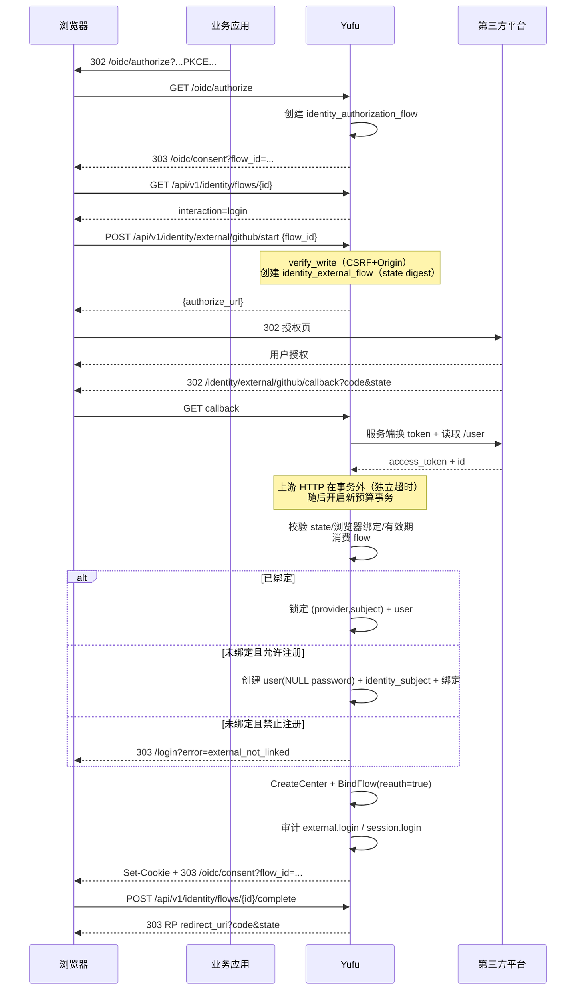
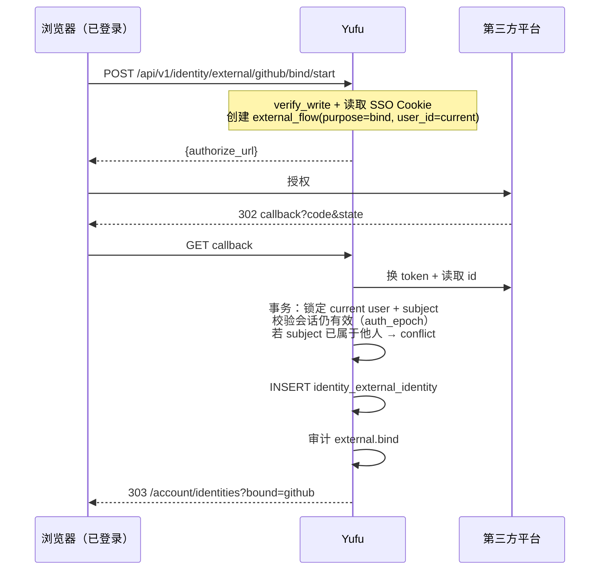
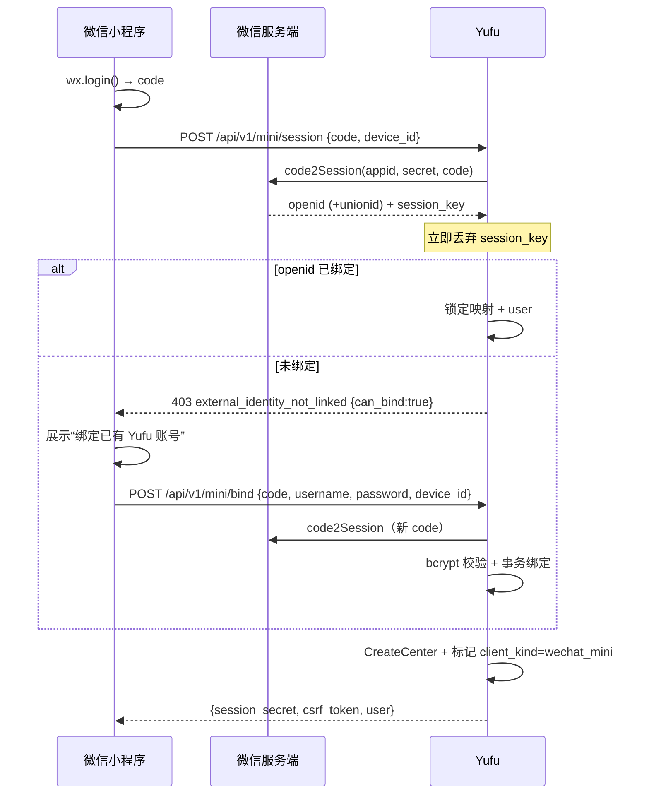
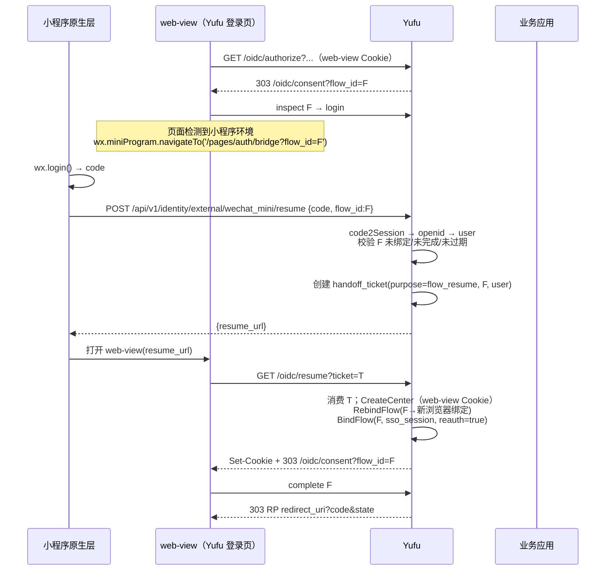

# Yufu 外部身份认证与社交登录架构设计

> 状态：历史设计稿；当前实施范围以 `docs/specs/external-identity-federation/spec.md` 为准
> 适用代码基线：`main` @ `520ef9a`（2026-11-27 工作区）
> 范围：GitHub、QQ、微信小程序、微信网页 OAuth 的接入设计；不改变 Yufu 作为唯一 OIDC Provider 的定位。
>
> **2026-11-27 范围修正**：Yufu 不开发官方微信小程序，也不实现 `wx.login`、`/mini/*`、handoff/resume 或公众号网页 OAuth。当前实施范围为：
> - P1/P2：数据模型、Secret 底座、GitHub 登录/绑定（已完成）
> - P3：**微信开放平台网站应用扫码登录**（已完成，fake Provider 验收）
> - P4：QQ OAuth（已完成，fake Provider 验收）
> - P5：管理端 Provider 配置与登录统计（已完成）
> - P6：安全回归、测试与文档（已完成代码/自动化验收；微信/QQ 真实联调待资质）
>
> 本文中涉及小程序、`/mini/*`、handoff/resume、公众号 OAuth 的段落属于历史设计，不再是当前交付范围。

---

## 0. 结论摘要

### 0.1 当前 Yufu 的实际架构

Yufu 是一个 **单 Rust 二进制 + PostgreSQL + 内嵌 Vue 3 控制台** 的认证中心：

- 进程入口 `src/yufu.rs` → `yufu::serve_with_security_clock`（`yufu/src/lib.rs:273`）。
- 业务库 `yufu` crate 按 `domain / entity / service / route / migration` 分层；共享安全原语在 `libs/auth` crate。
- 所有身份写入走**统一的身份事务边界**：`IdentityUnitOfWork` + `execute_identity`（`yufu/src/service/identity/transaction.rs`），事务内通过 `IdentityWrite` 枚举表达写命令，由 `PgSecurityTransaction` 分派到 `repository_*.rs`。
- 浏览器会话是 `identity_sso_session` 表中的一行，凭据是 `HttpOnly` Cookie 中的 32 字节不透明 secret；`identity_subject(issuer, sub)` 中的 `sub` 被数据库约束为 `user_id::text`（`yufu/src/migration/m20261109_000001_identity_accounts.rs:46-55`）。
- OIDC 授权入口 `/oidc/authorize`（`yufu/src/route/oidc.rs:240`）由 `AuthorizationService` 创建 `identity_authorization_flow`；需要登录时重定向到 SPA `/oidc/consent?flow_id=...`；SPA 用 `POST /api/v1/identity/login` 完成密码登录并把 flow 绑定到新会话；随后 `POST /api/v1/identity/flows/{id}/complete` 签发一次性 authorization code；`/oidc/token` 完成换取。
- 管理配置目前以 TOML（`yufu/src/config.rs`、`config_identity.rs`、`conf/yufu.example.toml`）为主；站点品牌等可变配置已采用 `site_settings` JSONB + revision 的管理端模式，但**没有任何可逆加密/密钥托管机制**。
- 审计统一写入 `identity_audit_event`（`yufu/src/migration/m20261109_000003_identity_sessions.rs:157`），由事务内 `append_audit` 产生，`action` 为自由文本。
- 测试：Rust 集成测试使用一次性 PostgreSQL 容器（`tests/yufu/common.rs`），前端为 Vitest 单测 + Playwright 企业 SSO E2E。

### 0.2 本次改造目标

在不改变下游 OIDC 接入方式的前提下，新增“第三方身份 → Yufu 本地用户 → 原有 SSO 会话 → 原有 OIDC 授权”的认证前置层：

1. 用户可以用 GitHub / QQ / 微信小程序身份登录 Yufu。
2. 已登录用户可以在账户中心绑定/解绑第三方身份。
3. 微信小程序作为 Yufu 官方身份管理客户端，能完成微信登录、首次绑定、身份与会话管理，并能安全衔接原有 OIDC 授权事务。
4. 每种登录方式可独立启用/禁用；Provider Secret 只在服务端使用。

### 0.3 明确不改变的架构边界

| 边界 | 结论 |
|---|---|
| OIDC Discovery / `/oidc/token` / `/oidc/userinfo` / JWKS | 不改协议、不改路径、不改 claim 语义 |
| 已有 Client 的接入方式（Authorization Code + PKCE S256） | 不改；下游应用无感知 |
| `issuer` 与 `sub` 映射 | 不改；`sub` 仍是 `user_id` 字符串，第三方 OpenID 绝不进入 `sub` |
| 用户/角色/权限/应用/准入/审计模型 | 不重做；只新增外部身份映射与会话元数据 |
| 单二进制 + Docker | 保持；不引入独立网关、消息队列或微信云开发 |
| 浏览器会话安全模型 | 保持 Cookie + CSRF + Origin + 安全时钟 + 2 秒事务预算 |
| Email 语义 | 不把未验证 Email 作为账号合并依据 |

### 0.4 推荐技术方案（一句话）

**新增独立的“外部身份域”**：`identity_external_identity`（身份映射）+ `identity_external_flow`（上游认证事务）+ `identity_external_provider`（管理端配置与加密 Secret）+ `identity_session_client`（浏览器/小程序会话元数据）+ `identity_handoff_ticket`（小程序→网页的一次性衔接票据）；用 `ExternalIdentityAdapter` 抽象隔离 GitHub/QQ/微信差异；认证成功后**复用现有 `CreateCenter` + `BindFlow`** 进入原有会话与 OIDC 流程。

### 0.5 尚待确认的外部平台条件

| 平台 | 个人主体 | 关键前置条件 | 状态 |
|---|---|---|---|
| GitHub OAuth App | 可以 | 固定回调 URL、`user:email` scope；无需企业审核 | 可先行 |
| QQ 互联网站应用 | 可注册个人开发者，但网站应用需 ICP 备案域名且回调与备案一致；审核 1–3 个工作日 | 域名备案、QQ 登录按钮规范 | 需实测/确认部署域名 |
| 微信小程序 | 个人主体可注册并发布，`wx.login`/`code2Session` 可用；部分类目与能力需企业主体或微信认证 | 小程序类目、业务域名、AppID/AppSecret | 需确认类目与认证要求 |
| 微信网页 OAuth（公众号） | 个人订阅号不可用 | 仅已认证服务号；网页授权域名需备案 | 不建议第一阶段 |
| 微信开放平台网站应用（PC 扫码） | 个人不可申请 | 企业主体 + 开发者资质认证（约 300 元/年） | 第二阶段、企业专属 |

> 外部平台政策会变化，以上以 2026-11 公开文档为准；正式实施前需由项目所有者完成账号与资质核验。

---

## 1. Phase 1：代码库调研（基于真实代码）

### 1.1 进程、模块与依赖

```text
src/yufu.rs                     CLI / 配置加载 / security clock 装配
└── yufu (lib)                  yufu/src/lib.rs
    ├── config.rs               TOML 配置与校验
    ├── config_identity.rs      身份策略/生命周期/签名密钥
    ├── domain/identity/        纯领域类型（无 DB）
    ├── entity/                 SeaORM 实体
    ├── migration/ + seed/      SeaORM 迁移与权限种子
    ├── service/identity/       身份用例、事务、仓储适配
    ├── service/security/       令牌/凭据/安全事务
    └── route/                  Axum 路由与传输适配
libs/auth                      JWT、CSRF、预算、凭据、策略等共享原语
web/                           Vue 3 控制台（Vite，构建后 rust-embed 进二进制）
```

关键事实：

- `Cargo.toml` workspace 成员为 `.`、`yufu`、`libs/auth`；`reqwest` 已是 `yufu` 的直接依赖，但当前只用于登出通知（`service/identity/logout_transport.rs`）。
- `AppState`（`yufu/src/lib.rs:541`）持有 `Config`、数据库连接、`TokenManager`、`IdTokenSigner`、可选 `security_clock`。新增 Provider Registry 应挂在这里或按请求构造。
- 启动顺序：校验身份策略 → 加载/生成 RSA 签名密钥 → 连接数据库 → 执行迁移 → 初始化 provider issuer → 初始化 superadmin → 启动 workers（`yufu/src/lib.rs:284-494`）。

### 1.2 用户与认证相关表

| 表 | 关键列/约束 | 代码 |
|---|---|---|
| `user` | `id INTEGER PK`、`username UNIQUE`、`password TEXT NULL`、`auth_epoch`、`identity_revision`、`enabled`、`person_kind`、`email`、`email_verified_at` | `yufu/src/entity/user.rs`；`m20251016_140448_create_user_table.rs`；`m20261109_000001_identity_accounts.rs` |
| `identity_provider` | 单例 `id=1`，固定 `issuer` | `entity/identity_provider.rs`；`service/identity/repository_account.rs:20` |
| `identity_subject` | `(issuer, sub) PK`；`user_id UNIQUE`；`CHECK (sub = user_id::text)` | `entity/identity_subject.rs`；迁移同上 |
| `identity_sso_session` | 根会话：`id UUID`、`user_id`、`subject`、`secret_digest BYTEA UNIQUE`、`auth_epoch`、`authenticated_at/expires_at/revoked_at` | `m20261109_000003_identity_sessions.rs:34` |
| `identity_authorization_flow` | OIDC 授权事务：`request_payload`、`environment_id`、`config_version_id`、`browser_proof_digest`、`browser_binding_digest`、`bound_sso_session_id`、`reauth_completed_at`、`completed_at` | 同上 `:58` |
| `identity_action_flow` | 邀请/重置/登出确认动作 | 同上 `:75` |
| `identity_oidc_rp_session` | 下游 RP 会话与 `protocol_sid`、`nonce` | 同上 `:91` |
| `identity_audit_event` | `actor_id`、`action`、`object_kind/id`、`result`、`change_summary`、`commit_marker` | 同上 `:157` |
| `security_session` / `security_credential` | 令牌/刷新族/凭据注册 | `service/security/repository.rs` |
| `site_settings` | JSONB 文档 + `revision` 的管理端配置范式（不含密钥） | `m20261117_000001_site_branding.rs` |

**重要约束**：`identity_subject` 的 `CHECK (sub = user_id::text)` 决定了**绝不能**把 GitHub id、QQ openid、微信 openid 放进 `identity_subject`。外部身份必须新建映射表。

### 1.3 登录页面与登录 API

- 页面：`web/src/pages/login/index.vue` → `web/src/components/workspace/login-form.vue`。
- OIDC 登录/授权页：`web/src/pages/oidc-consent/index.vue`。当 `inspectFlow` 返回 `interaction === 'login'` 时渲染同一个 `LoginForm`（`oidc` 模式）。
- 登录 API：`POST /api/v1/identity/login`（`yufu/src/route/identity_browser.rs:187`），请求体 `{username,password,flow_id?}`。
- 传输层先做 `browser::verify_write`（CSRF double-submit + 精确 Origin，`yufu/src/service/identity/browser.rs:320`），再调用 `SsoService::authenticate_password`。
- 登录成功后设置 `__Host-yufu-sso`（开发环境 `yufu-dev-sso`）Cookie 与 CSRF Cookie，返回 `session_response`（`yufu/src/route/account.rs:108`）。

**改造点**：登录表单增加“第三方登录”按钮；按钮不直接跳转，而是先 `POST` 一个 start 接口（需要 CSRF/Origin），由服务端生成 state 与授权 URL。

### 1.4 Session 创建与验证

- 创建：`SsoService::authenticate_password`（`service/identity/sso.rs:76`）在事务中：
  1. 锁定用户（`IdentityLockKey::User`）与 flow；
  2. 复核密码哈希与 `auth_epoch`；
  3. 构造 `BrowserSessionSnapshot`（`domain/identity/session.rs:14`）；
  4. `IdentityWrite::CreateCenter(root)` 写入 `identity_sso_session`（`repository_session.rs:73`）；
  5. 如果有 OIDC flow：`IdentityWrite::BindFlow { reauthenticated: true }`；
  6. 写 `session.login` 审计；
  7. 返回 `cookie_secret`，传输层写 Cookie。
- 验证：`SsoService::authenticate_browser` → `RestoreBrowser`，`root.validate(&account, now)` 同时校验 `auth_epoch`、`expires_at`、`revoked_at`、`principal.subject == user_id`（`domain/identity/session.rs:25`）。
- 撤销：`SessionService::revoke_personal`（`service/identity/session.rs:23`）按中心/RP/用户范围撤销，并写 `session.revoke` 审计 + 登出 outbox。

**复用结论**：外部登录成功后必须走同一 `CreateCenter`，这样会话 TTL、`auth_epoch`、撤销、审计、下游 RP 会话全部自动一致。

### 1.5 OIDC Authorization Endpoint 与授权事务生命周期

1. 下游应用发起 `GET /oidc/authorize?client_id&redirect_uri&response_type=code&scope&state&nonce&code_challenge&code_challenge_method=S256`（`yufu/src/route/oidc.rs:240`）。
2. `identity_authorization::authorize`（`yufu/src/route/identity_authorization.rs:57`）：
   - 解析 query → `AuthorizationParameters`；
   - 读取/创建匿名浏览器绑定 Cookie；
   - `AuthorizationService::authorize`（`service/identity/authorization.rs:71`）在事务中：
     - 加载目标应用/环境/配置版本并校验 redirect URI 精确匹配；
     - 校验 scope 子集、客户端类型（SPA 必须 PKCE）、应用启用；
     - 判断登录/同意/直接签发；
     - 需要交互时创建 `identity_authorization_flow`，返回 `RequireLogin` 或 `RequireConsent`；
   - 传输层写独立的 flow proof Cookie（`__Host-yufu-flow-<id>`），303 到 `/oidc/consent?flow_id=...`。
3. SPA `inspectFlow`（`GET /api/v1/identity/flows/{id}`）读取摘要；`interaction=login` 时显示登录。
4. 密码登录携带 `flow_id`，事务内 `BindFlow` 绑定新中心会话；`reauth_completed_at` 被设置，满足 `prompt=login` / `max_age`。
5. SPA `POST /api/v1/identity/flows/{id}/complete` → `AuthorizationService::complete`：
   - 复核 flow proof、浏览器绑定、版本、会话；
   - 处理同意；
   - `issue`：创建 RP session、授权码（一次性 digest）、`CompleteFlow`、`authorization.issue` 审计。
6. 下游用 `/oidc/token` 换取，生命周期在 `service/security/lifecycle.rs`。

**外部登录的接入点**：在“需要登录”之后、`BindFlow` 之前，用第三方认证结果替代密码认证。其余步骤不变。

### 1.6 用户身份与 Subject 映射

- `stable_principal(issuer, user_id)` 生成 `PrincipalRef`，`sub = user_id.to_string()`（`domain/identity/account.rs:209`）。
- `identity_sso_session` 通过 `(issuer, subject)` 外键绑定 `identity_subject`，数据库再次强制 `subject = user_id::text`。
- ID Token / UserInfo 的 `sub` 也来自同一 principal（`service/security/lifecycle.rs`、`route/identity_userinfo.rs`）。

**结论**：外部身份只作为“认证凭据”，认证完成后映射到 `user_id`；对下游永远只暴露 Yufu 的 `sub`。

### 1.7 PostgreSQL Migration 机制

- SeaORM migration，显式顺序在 `yufu/src/migration/mod.rs:41`；历史迁移 + seed 迁移 + 安全迁移分段追加。
- 迁移使用原生 SQL（`execute_unprepared`），`down` 明确回滚；已有部署要求迁移 ID 可识别、启动不得静默清理历史数据（`CLAUDE.md`）。
- 新增迁移应追加在末尾，采用 additive DDL；不得修改已发布迁移文件。

### 1.8 账户中心页面结构

- 路由：`web/src/router/routes.ts`，`/account`、`/account/apps`、`/account/consents`、`/account/sessions`。
- 页面：`web/src/pages/account/views/{profile,apps,consents,sessions}.vue`。
- API：`web/src/pages/account/api/index.ts`，统一走 `identityRequest`（Cookie 模式）。
- 后端：`yufu/src/route/account.rs` 的 `/account/session`、`/account/profile`、`/account/password`、`/account/sessions/{id}/revoke`、`/account/logout-all`。
- 现有页面均使用 `PageHeader / DataState / panel / section-stack` 等控制台组件，新增“第三方身份”页应沿用同一套。

### 1.9 系统配置与 Secret 管理

- 静态配置：`Config`（`config.rs`）从 TOML 读取；`[auth].secret`、`[auth.super_admin].password` 等为明文配置；RSA 私钥从文件读取（`config_identity.rs:187`）。
- 管理端可变配置：`site_settings`（JSONB + revision + `updated_by`），路由 `/api/v1/admin/site-settings`（`route/site_settings.rs`），写操作同样要求 `verify_write` + 管理员操作授权。
- **当前没有**：可逆加密、KMS/密钥环、Provider Secret 的数据库存储。只有 `SecretDigest`（SHA-256）用于不可逆校验（`domain/identity/account.rs:182`）。
- 日志脱敏：`redact_access_token` 对 `identity/account/developer/admin/oidc` 路径直接丢弃 query；`should_skip_body_logging` 跳过敏感端点（`lib.rs:75-171`）。

### 1.10 审计系统

- 写入：事务内 `append_audit(&AuditEvent)`（`service/identity/repository.rs:267`），`AuditEvent` 包含 `actor_id/action/object_kind/object_id/result/reason/change_summary/commit_marker`。
- 查询：`AuditService::search`（`service/identity/audit.rs`）+ `repository_audit.rs`；管理端 `/admin/audit-events`。
- 现有动作示例：`session.login`、`session.reauthenticate`、`session.revoke`、`authorization.issue`、`authorization.deny`、`consent.grant`。
- 新动作可直接复用自由文本：`external.login`、`external.bind`、`external.unbind`、`external_provider.update`、`session.handoff`。

### 1.11 当前测试架构

- Rust：`tests/yufu/routes/*.rs`，`IdentityFixture::start()` 启动一次性 PostgreSQL + 真实 HTTP 服务；覆盖授权、浏览器、令牌、登出、审计、迁移升级等。
- 前端：`web/tests/unit/*.test.ts`（Vitest）+ `web/tests/e2e/enterprise-sso-*.spec.ts`（Playwright）。
- 约束：数据库测试串行；浏览器套件独立 job；完整 Rust 测试会重写品牌截图，提交前需恢复（项目记忆）。

### 1.12 架构适配性评估

| 评估项 | 结论 |
|---|---|
| 是否适合本次改造 | **适合**。OIDC 核心与认证方式已经解耦：认证只需产出 `user_id` + 新 `identity_sso_session`，再 `BindFlow`。 |
| 是否需要重写核心认证 | **不需要**。只增加“会话前认证适配器”和新表；不改 token/authorize 协议。 |
| 主要侵入点 | `IdentityWrite` 枚举与仓储分派、`AppState` 注册表、登录页/账户中心/管理端 UI、登录回调路由、限流与密钥管理。 |
| 主要风险 | 上游 HTTP 不能进入 2 秒事务预算；Secret 需要新增可逆加密；小程序与 web-view 的 Cookie/`wx.login` 边界；QQ/微信资质。 |

---

## 2. Phase 2：可行性分析

### 2.1 总览

| 方案 | 协议本质 | 稳定身份 | 个人主体 | 平台审核 | 第一阶段 |
|---|---|---|---|---|---|
| GitHub 登录 | OAuth 2.0（**不是 OIDC**） | 数值 `id` | 可以 | 无企业审核；回调 URL 固定 | 是 |
| QQ 登录 | OAuth 2.0（**不是 OIDC**） | `openid`（同应用内稳定） | 可注册个人开发者，但网站应用受 ICP/审核限制 | 1–3 个工作日 | 是（需域名资质） |
| 微信小程序登录 | 微信专有 `wx.login` + `code2Session` | `openid`（同小程序内稳定） | 可以（类目/认证待确认） | 小程序发布审核 | 是（重点） |
| 微信网页 OAuth | 微信 OAuth 2.0 变体 | `openid` / `unionid` | **不可用**（仅认证服务号） | 微信认证 + 域名备案 | 否 |
| 微信 PC 扫码 | 微信开放平台网站应用 | `openid` / `unionid` | **不可用**（企业主体） | 企业认证（约 300 元/年） | 否（后续） |

### 2.2 GitHub OAuth 登录

- **官方 API**
  - 授权：`GET https://github.com/login/oauth/authorize?client_id&redirect_uri&scope=read:user user:email&state&code_challenge&code_challenge_method=S256`
  - 换 token：`POST https://github.com/login/oauth/access_token`（`Accept: application/json`），参数 `client_id/client_secret/code/redirect_uri`（如使用 PKCE 再加 `code_verifier`）
  - 用户：`GET https://api.github.com/user`，稳定唯一标识为数值字段 `id`（不是 `login`，也不是 `email`）
  - 邮箱：`GET https://api.github.com/user/emails`，只取 `primary=true && verified=true`
- **申请条件**：任意 GitHub 账号可创建 OAuth App；需要 Homepage URL 与 Authorization callback URL；无需企业审核。生产回调必须是 HTTPS（localhost 可用于开发）。
- **所需配置**：`client_id`、`client_secret`、固定回调 `https://<issuer>/identity/external/github/callback`、scope `read:user user:email`。
- **技术难点**
  1. GitHub 不是 OIDC：没有 ID Token、没有 `nonce`、没有 JWKS；不能按 OIDC 校验。
  2. `email` 可能为空或未验证；`login` 可改名；必须用数值 `id` 作为 `provider_subject`。
  3. GitHub 当前文档建议 PKCE；部分旧版 Enterprise Server 不支持 `code_challenge`，因此适配器需把 PKCE 作为能力开关。
  4. token 端点默认返回表单，必须显式请求 JSON。
- **安全风险**：state CSRF、回调参数注入、开放重定向、token 泄漏到日志、邮箱合并劫持。均通过 state + 固定回调 + 服务端换 token + 禁止 email 合并解决。
- **个人主体**：可以。
- **审核**：无人工审核；但 OAuth App 的用户授权页会显示应用名与权限，需真实填写。

### 2.3 QQ 登录

- **官方 API**
  - 授权：`GET https://graph.qq.com/oauth2.0/authorize?response_type=code&client_id=<APPID>&redirect_uri=<encoded>&state=<opaque>&scope=get_user_info`
  - 换 token：`GET https://graph.qq.com/oauth2.0/token?grant_type=authorization_code&client_id&client_secret&code&redirect_uri&fmt=json`
  - 身份：`GET https://graph.qq.com/oauth2.0/me?access_token&fmt=json` → `client_id` + `openid`（部分应用类型返回 `unionid`）
  - 资料：`GET https://graph.qq.com/user/get_user_info?access_token&oauth_consumer_key=<APPID>&openid=<OPENID>`
- **申请条件**：QQ 互联开发者注册（支持公司/个人，需实名与人脸核验）；创建“网站应用”；网站地址与回调地址必须完成 ICP 备案，且备案信息与平台填写一致；审核 1–3 个工作日；必须按腾讯规范放置“QQ 登录”按钮。
- **所需配置**：`APPID`、`APPKEY`（Client Secret）、固定回调 `https://<issuer>/identity/external/qq/callback`、scope `get_user_info`。
- **技术难点**
  1. 返回格式可能是 JSONP/`callback(...)` 包裹，必须兼容解析并拒绝异常结构。
  2. `openid` 是应用维度标识；`unionid` 只在满足条件时返回，不能假定存在。
  3. 域名备案与回调域名强绑定；自托管/海外域名可能无法通过审核（国际域名需邮件申请）。
  4. 腾讯会校验登录按钮 UI 规范。
- **安全风险**：state CSRF、开放重定向、JSONP 注入、token 泄漏、用昵称/邮箱合并。
- **个人主体**：可注册个人开发者；但“网站应用”需要 ICP 备案域名与站点审核，实际可行性取决于部署域名与主体资质，需实测。
- **审核**：有，1–3 个工作日；驳回需按理由整改或申诉。

### 2.4 微信小程序登录

- **官方 API**
  - 小程序端：`wx.login()` → 临时 `code`（一次性，约 5 分钟有效）
  - 服务端：`GET https://api.weixin.qq.com/sns/jscode2session?appid=<AppID>&secret=<AppSecret>&js_code=<code>&grant_type=authorization_code`
  - 返回：`openid`、`session_key`、`unionid`（仅绑定开放平台时）、`errcode/errmsg`
- **申请条件**：注册小程序（个人/企业/个体户等主体）；获取 AppID/AppSecret；配置服务器域名（HTTPS）；发布需审核。个人主体可发布，但部分类目、支付、手机号快速验证等能力需要企业主体或微信认证。
- **所需配置**：小程序 `AppID`、`AppSecret`（仅服务端）、`code2Session` 出网、业务域名（若使用 web-view）。
- **技术难点**
  1. `session_key` 绝不能下发客户端，也不应持久化；本设计只保存 `openid`/`unionid`。
  2. `code` 一次性且短时；重放会返回 `40163 code been used`，必须由服务端一次性消费并做幂等。
  3. 小程序原生层能调用 `wx.login()`，**web-view 内的普通 HTTPS 页面不能**；因此小程序登录与网页 OIDC 之间需要一次性衔接票据（见 3.7）。
  4. 个人主体类目选择与认证要求需以微信后台为准。
- **安全风险**：code 重放、AppSecret 泄漏、session_key 泄漏、设备会话被盗、首次绑定被劫持、自动建号被滥用。
- **个人主体**：可以注册并发布；登录能力本身可用。涉及支付/手机号等能力时不行。
- **审核**：小程序发布审核；类目资质要求因类目而异。

### 2.5 微信网页 OAuth（公众号）

- **官方 API**
  - 授权：`GET https://open.weixin.qq.com/connect/oauth2/authorize?appid&redirect_uri&response_type=code&scope=snsapi_base|snsapi_userinfo&state=...#wechat_redirect`
  - 换 token：`GET https://api.weixin.qq.com/sns/oauth2/access_token?appid&secret&code&grant_type=authorization_code`
  - 用户信息：`GET https://api.weixin.qq.com/sns/userinfo?access_token&openid&lang=zh_CN`
- **申请条件**：仅**已认证服务号**可用；订阅号（含个人）不支持；网页授权域名必须备案并配置在公众号后台。
- **结论**：个人主体不可行；第一阶段不做。若未来企业部署需要，作为独立适配器 `wechat_web`，不与小程序混用。
- **PC 扫码**：微信开放平台“网站应用”仅企业/组织可申请，需开发者资质认证（约 300 元/年），使用 `snsapi_login` 二维码流程；后续独立适配器 `wechat_qr`。

### 2.6 第三方身份绑定与登录的可行性

| 能力 | 可行性 | 关键前提 |
|---|---|---|
| 已登录用户绑定 GitHub/QQ | 高 | 绑定事务必须复用当前中心会话并二次校验；第三方 subject 全局唯一 |
| 已登录用户绑定微信 | 高 | 小程序原生 `wx.login` 或 web-view 桥接；首次绑定需验证 Yufu 密码 |
| 未绑定用户用第三方登录 | 高，但受注册策略限制 | 默认不自动建号；提示先密码登录再绑定 |
| 防止同一第三方身份绑定多个 Yufu 用户 | 高 | 数据库唯一约束 `(provider_key, provider_subject)` + 冲突返回 |
| 防止仅凭 Email 合并 | 高 | 代码路径不提供 email 匹配；审计记录拒绝原因 |
| 解绑不影响其他登录方式 | 高 | 解绑只删映射；不 bump `auth_epoch`；校验至少保留一种凭据 |
| 小程序与 OIDC 衔接 | 中高 | 需要一次性 resume/handoff 票据；web-view Cookie 行为需真机验证 |

---

## 3. Phase 3：架构设计

### 3.1 改造后的整体架构

```text
                         ┌─────────────────────────────────────────┐
                         │              Yufu 单二进制               │
                         │                                         │
  GitHub OAuth ─────────▶│  route/identity_external (start/callback)│
  QQ OAuth     ─────────▶│            │                            │
  微信小程序 code ───────▶│            ▼                            │
                         │  service/identity/external              │
                         │  ├── registry (enable/config)           │
                         │  ├── adapters: github / qq / wechat_mini│
                         │  ├── flow  (state / PKCE / nonce)       │
                         │  └── link  (bind / unbind / policy)     │
                         │            │                            │
                         │            ▼                            │
                         │  identity_external_identity (provider,  │
                         │  subject) ──▶ user_id                   │
                         │            │                            │
                         │            ▼                            │
                         │  原有 CreateCenter + BindFlow            │
                         │  identity_sso_session / flow / code      │
                         │            │                            │
                         │            ▼                            │
                         │  原有 OIDC Provider (/oidc/authorize,    │
                         │  /oidc/token, /oidc/userinfo, JWKS)      │
                         └────────────┬────────────────────────────┘
                                      │ 标准 OIDC（不变）
                        ┌─────────────┼─────────────┐
                        ▼             ▼             ▼
                    Project A     Project B     Project C
```

**分层原则**

1. **传输层**只做 Cookie/CSRF/Origin、参数解析、重定向；不直接访问第三方。
2. **适配器层**只负责“把某个平台的一次授权变成 `ExternalIdentity`”；不碰用户表、不建会话。
3. **身份链接层**负责 `(provider_key, provider_subject) → user_id` 的查询/绑定/解绑与注册策略。
4. **会话层**复用原有 `CreateCenter` / `BindFlow`，保证 `auth_epoch`、TTL、撤销、审计与密码登录一致。
5. **OIDC 层**完全不变；第三方登录只是“在登录页替代密码输入”。

### 3.2 核心认证时序

#### 3.2.1 第三方登录（OIDC 流程中）



#### 3.2.2 绑定第三方账号



#### 3.2.3 微信小程序登录



#### 3.2.4 小程序 → 网页 OIDC 的安全衔接



> `RebindFlow` 只在 flow **尚未绑定会话且未完成** 时允许，并把浏览器绑定更新为当前 web-view 的匿名绑定，同时**轮换 flow proof**（生成新的 proof secret、更新 `browser_proof_digest`、重新下发 `__Host-yufu-flow-<id>` Cookie）。这解决 web-view 实例间 Cookie 不保证共享的问题：新 web-view 即使没有旧的 flow proof，也能通过 resume 获得新 proof 继续 inspect/complete。票据一次性、60 秒、绑定 flow+user+auth_epoch，并写 `authorization.flow_rebind` 审计。

### 3.3 数据模型

新增 5 张表，均为 additive；不改 `identity_subject`、`identity_sso_session`、OIDC 相关表。

#### 3.3.1 `identity_external_provider`

```sql
CREATE TABLE identity_external_provider (
    provider_key TEXT PRIMARY KEY
        CHECK (provider_key IN ('github','qq','wechat_mini','wechat_web','wechat_qr')),
    family TEXT NOT NULL CHECK (family IN ('github','qq','wechat')),
    enabled BOOLEAN NOT NULL DEFAULT FALSE,
    client_id TEXT NOT NULL DEFAULT '' CHECK (length(client_id) <= 256),
    -- v1.<key_version>.<nonce>.<ciphertext>；AEAD，密钥来自环境变量而非数据库
    secret_ciphertext TEXT,
    secret_key_version INTEGER NOT NULL DEFAULT 1 CHECK (secret_key_version > 0),
    -- 非敏感配置：endpoint 覆盖（测试/企业版）、scope、callback 路径等
    config JSONB NOT NULL DEFAULT '{}'::jsonb CHECK (jsonb_typeof(config) = 'object'),
    revision BIGINT NOT NULL DEFAULT 0 CHECK (revision >= 0),
    updated_by INTEGER REFERENCES "user"(id) ON DELETE SET NULL,
    updated_at BIGINT NOT NULL CHECK (updated_at >= 0),
    CHECK (NOT enabled OR (client_id <> '' AND secret_ciphertext IS NOT NULL))
);
```

- 迁移时插入 5 行 `enabled=false`、`client_id=''`、`secret_ciphertext=NULL` 的已知 Provider，便于管理端展示；不包含任何开发 Secret。
- `enabled` 的数据库约束保证“启用即配置完整”；应用层在读取时仍会再次校验。

#### 3.3.2 `identity_external_identity`

```sql
CREATE TABLE identity_external_identity (
    id UUID PRIMARY KEY,
    user_id INTEGER NOT NULL REFERENCES "user"(id) ON DELETE RESTRICT,
    provider_key TEXT NOT NULL REFERENCES identity_external_provider(provider_key) ON DELETE RESTRICT,
    provider_subject TEXT NOT NULL CHECK (length(provider_subject) BETWEEN 1 AND 255),
    provider_union_id TEXT CHECK (provider_union_id IS NULL OR length(provider_union_id) <= 255),
    display_name TEXT CHECK (display_name IS NULL OR length(display_name) <= 200),
    avatar_url TEXT CHECK (avatar_url IS NULL OR avatar_url ~ '^https://'),
    created_at BIGINT NOT NULL CHECK (created_at >= 0),
    updated_at BIGINT NOT NULL CHECK (updated_at >= created_at),
    last_login_at BIGINT CHECK (last_login_at IS NULL OR last_login_at >= created_at),
    UNIQUE (provider_key, provider_subject),
    UNIQUE (user_id, provider_key)
);
CREATE INDEX identity_external_user ON identity_external_identity(user_id);
CREATE INDEX identity_external_union ON identity_external_identity(provider_key, provider_union_id)
    WHERE provider_union_id IS NOT NULL;
```

设计说明：

- `(provider_key, provider_subject)` 全局唯一 → 同一第三方身份不能绑定多个 Yufu 用户。
- `(user_id, provider_key)` 唯一 → 第一阶段每个用户每种登录方式只保留一个身份，UI 与解绑语义简单；未来如需多账号可移除该约束。
- `provider_subject` 不进入 `sub`、不进入 `user_id`，只作为映射键。
- `provider_union_id` 仅记录，不用于自动合并；同一微信用户跨小程序/网页可能出现两条记录，由用户显式绑定到同一账号。
- 解绑采用物理删除；历史由 `identity_audit_event` 保留（`external.unbind`，含 provider/subject 的哈希或脱敏标识）。

#### 3.3.3 `identity_external_flow`

```sql
CREATE TABLE identity_external_flow (
    id UUID PRIMARY KEY,
    provider_key TEXT NOT NULL REFERENCES identity_external_provider(provider_key) ON DELETE RESTRICT,
    purpose TEXT NOT NULL CHECK (purpose IN ('login','bind')),
    state_digest BYTEA NOT NULL UNIQUE CHECK (octet_length(state_digest) = 32),
    browser_binding_digest BYTEA NOT NULL CHECK (octet_length(browser_binding_digest) = 32),
    user_id INTEGER REFERENCES "user"(id) ON DELETE RESTRICT,
    -- 保留期清理会删除旧的 OIDC flow；外部 flow 只保留历史关联，故 SET NULL
    oidc_flow_id UUID REFERENCES identity_authorization_flow(id) ON DELETE SET NULL,
    nonce TEXT CHECK (nonce IS NULL OR length(nonce) <= 256),
    -- 上游 PKCE verifier / 其他短时秘密的 AEAD 密文
    secret_ciphertext TEXT,
    created_at BIGINT NOT NULL CHECK (created_at >= 0),
    expires_at BIGINT NOT NULL CHECK (expires_at > created_at),
    consumed_at BIGINT CHECK (consumed_at IS NULL OR (consumed_at >= created_at AND consumed_at < expires_at)),
    CHECK (purpose <> 'bind' OR user_id IS NOT NULL)
);
CREATE INDEX identity_external_flow_pending
    ON identity_external_flow(browser_binding_digest, expires_at) WHERE consumed_at IS NULL;
CREATE INDEX identity_external_flow_oidc ON identity_external_flow(oidc_flow_id);
```

- `state` 原文只返回给浏览器/小程序；数据库只存 SHA-256 digest，与现有 `identity_authorization_flow.browser_proof_digest` 的做法一致。
- `browser_binding_digest` 绑定匿名浏览器 Cookie，防止把回调结果塞给另一个浏览器。
- `purpose=bind` 必须带 `user_id`；完成时再次校验当前会话。
- `oidc_flow_id` 用于登录后继续原授权事务；中心直接登录时为空。

#### 3.3.4 `identity_session_client`

```sql
CREATE TABLE identity_session_client (
    sso_session_id UUID PRIMARY KEY REFERENCES identity_sso_session(id) ON DELETE CASCADE,
    kind TEXT NOT NULL CHECK (kind IN ('browser','wechat_mini')),
    device_id TEXT CHECK (device_id IS NULL OR length(device_id) <= 128),
    device_label TEXT CHECK (device_label IS NULL OR length(device_label) <= 200),
    created_at BIGINT NOT NULL CHECK (created_at >= 0),
    last_seen_at BIGINT CHECK (last_seen_at IS NULL OR last_seen_at >= created_at)
);
```

- 不修改 `identity_sso_session` 与 `BrowserSessionSnapshot`；缺失行按 `browser` 处理。
- 账户中心“登录会话”可 join 此表显示“来源：浏览器 / 微信小程序”。
- 小程序会话仍是普通 `identity_sso_session`，因此撤销、TTL、`auth_epoch` 全部复用。

#### 3.3.5 `identity_handoff_ticket`

```sql
CREATE TABLE identity_handoff_ticket (
    id UUID PRIMARY KEY,
    secret_digest BYTEA NOT NULL UNIQUE CHECK (octet_length(secret_digest) = 32),
    purpose TEXT NOT NULL CHECK (purpose IN ('session','flow_resume')),
    sso_session_id UUID NOT NULL REFERENCES identity_sso_session(id) ON DELETE CASCADE,
    user_id INTEGER NOT NULL REFERENCES "user"(id) ON DELETE RESTRICT,
    auth_epoch BIGINT NOT NULL CHECK (auth_epoch >= 0),
    -- flow_resume：关联待恢复的 OIDC flow；flow 被保留期清理时票据一并失效
    oidc_flow_id UUID REFERENCES identity_authorization_flow(id) ON DELETE CASCADE,
    -- session：由服务端根据 application/environment 解析 launch URL，不接受客户端 URL
    application_id INTEGER REFERENCES application(id) ON DELETE RESTRICT,
    environment_id UUID REFERENCES identity_app_environment(id) ON DELETE RESTRICT,
    -- 仅允许站内路径（可选，用于回到指定页面）；不允许任意外部 URL
    next_path TEXT CHECK (next_path IS NULL OR (length(next_path) <= 2048 AND next_path LIKE '/%')),
    created_at BIGINT NOT NULL CHECK (created_at >= 0),
    expires_at BIGINT NOT NULL CHECK (expires_at > created_at),
    consumed_at BIGINT CHECK (consumed_at IS NULL OR (consumed_at >= created_at AND consumed_at < expires_at)),
    CHECK ((purpose = 'session' AND oidc_flow_id IS NULL AND application_id IS NOT NULL AND environment_id IS NOT NULL) OR
           (purpose = 'flow_resume' AND oidc_flow_id IS NOT NULL AND application_id IS NULL AND environment_id IS NULL))
);
CREATE INDEX identity_handoff_pending ON identity_handoff_ticket(expires_at) WHERE consumed_at IS NULL;
```

- `session`：小程序已登录，为 web-view 换取浏览器会话。
- `flow_resume`：小程序已登录，为已存在的 OIDC flow 恢复登录。
- `next_path` 只允许站内绝对路径；对外部应用启动 URL 采用应用表校验后的完整 URL，不直接信任请求。

#### 3.3.6 为什么不复用 `identity_subject` / `identity_authorization_flow`

| 候选 | 结论 |
|---|---|
| `identity_subject` | 数据库 CHECK 强制 `sub = user_id::text`；第三方 subject 会破坏 OIDC `sub` 语义。禁止。 |
| `identity_authorization_flow` | 它代表下游 OIDC 授权事务，有 `environment_id/config_version_id`；绑定/小程序恢复没有这些字段。新增上游 flow 表，避免污染。 |
| `security_credential` | 它注册 JWT/刷新凭据，不承载外部身份映射；语义不符。 |
| `site_settings` | 可存非敏感配置，但不能存可逆 Secret，也没有 per-provider revision；新增专用表。 |

### 3.4 外部 Provider 抽象

#### 3.4.1 类型

```rust
// yufu/src/domain/identity/external.rs
#[derive(Clone, Copy, Debug, PartialEq, Eq, Serialize, Deserialize)]
#[serde(rename_all = "snake_case")]
pub enum ExternalProviderKey {
    GitHub,
    Qq,
    WechatMini,
    WechatWeb,
    WechatQr,
}

#[derive(Clone, Copy, Debug, PartialEq, Eq)]
pub enum ExternalPurpose {
    Login,
    Bind,
}

#[derive(Clone, Debug)]
pub struct ExternalIdentity {
    pub provider_key: ExternalProviderKey,
    /// GitHub 数值 id / QQ openid / 微信 openid；绝不等于 Yufu user_id
    pub subject: String,
    pub union_id: Option<String>,
    pub display_name: Option<String>,
    pub avatar_url: Option<String>,
    pub email: Option<String>,
    pub email_verified: bool,
}
```

#### 3.4.2 适配器接口

```rust
// yufu/src/service/identity/external/adapter.rs
pub struct BeginContext<'a> {
    pub callback_uri: &'a str,
    pub state: &'a str,
    pub nonce: Option<&'a str>,
    pub code_challenge: Option<&'a str>,
    pub config: &'a ExternalProviderConfig, // client_id + 非敏感 config
}

pub enum BeginOutcome {
    /// 浏览器类：返回第三方授权 URL；secret_payload 是需要随 flow 加密保存的上游秘密
    Redirect { authorize_url: String, secret_payload: Option<SecretToken> },
    /// 原生类：不能由浏览器直接发起，客户端需调用指定原生 API
    Native { hint: NativeHint },
}

pub struct CompleteContext<'a> {
    pub code: &'a str,
    pub code_verifier: Option<&'a SecretToken>,
    pub nonce: Option<&'a str>,
    pub config: &'a ExternalProviderConfig,
    pub http: &'a ExternalHttpClient,
}

#[async_trait::async_trait]
pub trait ExternalIdentityAdapter: Send + Sync {
    fn key(&self) -> ExternalProviderKey;
    fn capabilities(&self) -> AdapterCapabilities;

    async fn begin(&self, ctx: BeginContext<'_>) -> Result<BeginOutcome, IdentityError>;

    /// 浏览器回调：用 code 换 token 并拉取稳定身份
    async fn complete(&self, ctx: CompleteContext<'_>) -> Result<ExternalIdentity, IdentityError>;

    /// 小程序/原生：用平台临时 code 换取稳定身份；默认不支持
    async fn complete_native(
        &self,
        _ctx: NativeCompleteContext<'_>,
    ) -> Result<ExternalIdentity, IdentityError> {
        Err(IdentityError::InvalidInput)
    }
}

pub struct AdapterCapabilities {
    pub pkce: bool,
    pub nonce: bool,
    pub native: bool,
    pub union_id: bool,
}
```

设计要点：

1. **协议与平台解耦**：`OAuth2Adapter` 负责通用 authorize/token 调用与错误映射；`GitHubProfile`、`QqProfile`、`WechatWebProfile` 只描述端点、scope、身份解析。小程序实现 `complete_native`，`begin` 返回 `Native`。未来 OIDC Provider 增加 `OidcUpstreamProfile`，在 `complete` 中校验 `iss/aud/exp/nonce/signature`。
2. **适配器不写库**：只做 HTTP 与解析，返回 `ExternalIdentity`，便于单元测试和替换。
3. **能力声明**：GitHub `pkce=true, nonce=false`；QQ `pkce=false, nonce=false`；微信 `native=true`（mini）/`pkce=false`（web）；未来 OIDC `nonce=true`。
4. **禁止用户控制 URL**：端点来自代码常量或管理员配置的固定值；不拼接任意 `redirect_uri`。`ExternalHttpClient` 禁止重定向、禁用代理、设置 5 秒超时、生产只允许 HTTPS；测试可像 `logout_transport` 一样通过显式 loopback fixture 访问本地 fake Provider，生产构建不提供该开关。
5. **错误归一化**：上游错误统一映射为 `IdentityError`（`Unauthenticated` / `AccessDenied` / `DependencyUnavailable`），不把上游 message 返回给浏览器。

#### 3.4.3 注册表与配置读取

```rust
// yufu/src/service/identity/external/registry.rs
pub struct ExternalIdentityRegistry {
    adapters: BTreeMap<ExternalProviderKey, Arc<dyn ExternalIdentityAdapter>>,
    configs: BTreeMap<ExternalProviderKey, ExternalProviderConfig>,
}

impl ExternalIdentityRegistry {
    pub async fn load(db: &DatabaseConnection, secrets: &SecretCipher) -> Result<Self, IdentityError>;
    pub fn public_catalog(&self) -> Vec<PublicProvider>; // 只含 enabled 且配置完整
    pub fn adapter(&self, key: ExternalProviderKey) -> Result<&dyn ExternalIdentityAdapter, IdentityError>;
}
```

- 在 `AppState` 中持有 `Arc<RwLock<ExternalIdentityRegistry>>`；管理端保存配置后刷新；启动时加载。
- 每次登录请求都从注册表取适配器，不在请求中查配置表（避免把数据库查询塞进上游 HTTP 路径）。
- `public_catalog` 只返回 `{key, family, label, mode, enabled}`，绝不返回 `client_id`/Secret。

### 3.5 登录流程设计

#### 3.5.1 入口与 API

| 步骤 | 接口 | 认证 |
|---|---|---|
| 读取可用登录方式 | `GET /api/v1/identity/external/providers` | 公开，无敏感字段 |
| 发起登录 | `POST /api/v1/identity/external/{key}/start` | CSRF + Origin；可选 `flow_id` |
| 第三方回调 | `GET /identity/external/{key}/callback?code&state` | state + 浏览器绑定 Cookie |
| 完成 OIDC | 原有 `POST /api/v1/identity/flows/{id}/complete` | 原有 flow proof |

`start` 请求体：

```json
{ "purpose": "login", "flow_id": "可选，OIDC 授权 flow" }
```

服务端流程：

1. `verify_write`（复用 `browser::verify_write`）。
2. 读取注册表；Provider 必须 `enabled` 且配置完整。
3. 读取匿名浏览器绑定（`read_browser_binding`）。
4. 生成 32 字节 `state`；计算 digest；创建 `identity_external_flow`。
5. 调用适配器 `begin`，返回 `authorize_url`。
6. 返回 `{authorize_url}`；前端 `window.location.assign`。

#### 3.5.2 回调与完成

回调处理器（无 API 前缀，便于第三方直接跳转）：

```text
GET /identity/external/{provider_key}/callback?code=...&state=...
```

1. 解析 `provider_key`；拒绝未知/未启用。
2. 用 `state` digest 读取 `identity_external_flow`；校验：
   - `purpose=login`；
   - `browser_binding_digest` 与当前匿名 Cookie 一致；
   - 未过期、未消费；
   - 若带 `oidc_flow_id`，该 OIDC flow 仍 pending、未绑定其他会话。
3. **事务外**调用适配器 `complete`（换 token + 拉身份），使用 5 秒独立超时；无论成功失败都不把上游 token 写入数据库或日志。
4. 用 `SecurityBudget::new(clock)` 开启**新的 2 秒写预算**，执行一个 `ExternalLoginUnit`：
   - 再次读取 flow 并**原子消费**（`UPDATE ... SET consumed_at=$now WHERE id=$1 AND consumed_at IS NULL`）；
   - 锁定 `IdentityLockKey::ExternalIdentity(key, subject)`、`User(user_id)`、`OidcFlow(id)`、`Center(id)`；
   - 查询 `identity_external_identity`；
   - 已绑定 → 取 `user_id`，校验账号 `enabled`；
   - 未绑定：
     - `RegistrationPolicy::Disabled`（默认）→ 写 `external.login` denied 审计，返回 `external_not_linked`；
     - `InviteOnly` → 仅当 flow 由邀请流程携带 `user_id` 时允许（第一阶段不启用）；
     - `Open` → 创建外部账号（见 3.5.3）；
   - 若已有中心会话：按密码登录同样的方式撤销旧中心/RP 会话（`Revoke(CurrentCenter)` + logout outbox），避免会话固定；
   - 创建新 `BrowserSessionSnapshot` → `CreateCenter`；
   - 若有 `oidc_flow_id` → `BindFlow { reauthenticated: true }`（外部认证是新鲜认证，满足 `prompt=login`/`max_age`）；
   - 更新 `last_login_at`；
   - 审计 `external.login` + `session.login`（或 `session.reauthenticate`）；
   - 返回 `cookie_secret` + flow id。
5. 传输层设置 SSO/CSRF Cookie（`browser::authenticated_cookies`），303 到：
   - 有 OIDC flow：`/oidc/consent?flow_id=...`（SPA 自动 inspect/complete）；
   - 中心登录：`/account` 或 `redirect` 参数。

错误路径：

- 第三方返回 `error=access_denied`：消费 external flow，写 denied 审计，303 回登录页并显示“已取消授权”。
- state 不匹配/过期/已消费：400/410，不泄露原因；写 failure 审计。
- 上游不可用：503，保留 OIDC flow 可重试；external flow 消费或过期，用户可重新点击。

#### 3.5.3 未绑定账号策略

配置：

```toml
[external_identity]
enabled = false                 # 全局开关，默认关闭
registration = "disabled"       # disabled | invite_only | open
flow_ttl_seconds = 600
http_timeout_millis = 5000
```

- **disabled（默认）**：不自动建号；返回 `external_identity_not_linked`，前端提示：
  “该 GitHub 账号尚未绑定 Yufu。请先用 Yufu 账号登录，在账户中心完成绑定后再使用第三方登录。”
- **invite_only**：仅允许通过邀请流程创建的外部账号绑定；第一阶段不开放。
- **open**：创建 `user` 行：
  - `password = NULL`（无法密码登录；`load_password_account` 会因 `password` 为空返回 `Unauthenticated`，已确认 `repository_pg.rs:508-529`）；
  - `username` 由服务端生成（如 `gh_<subject hash 前 12 位>`，冲突重试）；
  - `person_kind` 取配置默认（默认 `collaborator`，不授予 developer/admin）；
  - 插入 `identity_subject(issuer, sub=user_id::text)`（满足外键与 CHECK）；
  - 插入 `identity_external_identity`；
  - 审计 `external.account_create`。
- **绝不**按昵称、未验证 Email、`login` 名合并；代码路径中不存在 Email 匹配分支。

### 3.6 绑定与解绑流程

#### 3.6.1 绑定

- 入口：账户中心“第三方身份”页 → `POST /api/v1/identity/external/{key}/bind/start`。
- 前置：必须已有有效 SSO Cookie；`verify_write` 通过；`purpose=bind`、`user_id=current`。
- 回调：适配器返回 `ExternalIdentity` 后，在事务中：
  1. 锁定 `User(current)`、`Center`、`ExternalIdentity(key, subject)`；
  2. 重新加载当前会话并校验 `auth_epoch`（防止会话在授权期间失效）；
  3. 查询 `(key, subject)`：
     - 属于当前用户 → 幂等成功（更新 `display_name/avatar_url`）；
     - 属于其他用户 → `Conflict`，不泄露对方账号；
     - 不存在 → 插入；
  4. 若当前用户已绑定同 `provider_key` 的另一身份 → `Conflict`（第一阶段一账号一平台）；前端提示先解绑旧身份；
  5. 审计 `external.bind`（`object_id` 使用身份 id，`change_summary` 含 provider 与 subject 的哈希前缀）；
  6. 303 `/account/identities?bound=<key>`。
- 绑定**不会**改变当前会话，也不会 bump `auth_epoch`。

#### 3.6.2 解绑

- 接口：`POST /api/v1/account/identities/{id}/unbind`（CSRF + Origin）。
- 事务：
  1. 读取当前 actor（`authenticate_current_actor`）；
  2. 锁定 `User` + 身份行；
  3. 校验身份属于当前用户；
  4. 计算剩余可用凭据：
     - `user.password IS NOT NULL`（可作为密码登录）；
     - 其他 `identity_external_identity` 行数；
     - 若总数为 0 → `Conflict`（`last_credential`），拒绝；
  5. 删除映射；审计 `external.unbind`；
  6. **不** bump `auth_epoch`，**不**撤销现有会话；返回 `{unbound:true}`。
- 账户中心提示：“解绑后该第三方账号将无法登录 Yufu；如这是最后一个登录方式，需先设置密码或绑定其他身份。”
- 可选增强（建议后续）：解绑前要求输入密码或重新认证，降低会话被劫持后的破坏。

### 3.7 微信小程序交互设计

#### 3.7.1 定位与边界

小程序是 **Yufu 官方身份管理客户端**，不是 OIDC Provider，也不维护第二套用户体系：

- 它只做三件事：微信身份认证、Yufu 账号会话管理、第三方身份绑定管理。
- 它不签发 Yufu 的 OIDC Token；业务应用仍通过标准 OIDC 接入 Yufu。
- 它不保存 `session_key`、不保存 Provider Secret、不保存 Yufu 密码。

#### 3.7.2 会话模型

- 小程序登录成功后，Yufu 创建普通 `identity_sso_session`，但 secret 通过 JSON 返回，存入 `wx.setStorageSync`，而不是 Cookie。
- 小程序请求头：`X-Yufu-Mini-Session: <secret>`；`identity_session_client.kind='wechat_mini'` 标记来源。
- 独立路由前缀 `/api/v1/mini/*`，**不**让该 secret 访问浏览器 `/account/*` 路由；避免第二条凭据路径污染现有 Cookie 语义。
- CSRF：会话创建响应返回绑定到 root digest 的 CSRF token；所有写操作要求 `X-CSRF-Token`。虽然 header secret 本身不具备浏览器自动携带特性，仍保留该防护以覆盖小程序内 XSS/重放。
- 会话可在账户中心“登录会话”中看到，并可单独撤销；小程序也可调用 `/mini/sessions` 撤销。

#### 3.7.3 接口

| 接口 | 说明 |
|---|---|
| `POST /api/v1/mini/session` | `{code, device_id, device_label?}` → 已绑定则返回 `{session_secret, csrf_token, user}`；未绑定返回 `403 external_identity_not_linked` + `{can_bind:true}` |
| `POST /api/v1/mini/bind` | `{code, username, password, device_id}` → 校验密码 + 绑定微信 + 返回会话 |
| `GET /api/v1/mini/account` | 当前账号资料 |
| `GET /api/v1/mini/identities` | 已绑定第三方身份列表 |
| `POST /api/v1/mini/identities/{id}/unbind` | 解绑 |
| `GET /api/v1/mini/sessions` | 中心会话列表（含 device_label） |
| `POST /api/v1/mini/sessions/{id}/revoke` | 撤销会话 |
| `POST /api/v1/mini/logout` | 撤销当前小程序会话 |
| `POST /api/v1/mini/handoff` | 生成一次性 web-view 会话衔接票据 |
| `POST /api/v1/identity/external/wechat_mini/resume` | 原生桥接页调用：`wx.login` code + `flow_id` → resume 票据 URL |

#### 3.7.4 首次绑定

1. 小程序 `wx.login()` 获取 code。
2. `POST /mini/session`；Yufu `code2Session` 得到 openid；查映射不存在。
3. 返回 `external_identity_not_linked`，小程序展示绑定表单（Yufu 用户名 + 密码）。
4. 用户提交；小程序重新 `wx.login()` 获取新 code（旧 code 已消费）。
5. `POST /mini/bind`；Yufu bcrypt 校验密码（事务外），事务内锁定用户与 `(wechat_mini, openid)`，确认 openid 未被他人绑定，插入映射，创建会话，审计 `external.bind` + `session.login`。
6. 密码只在 TLS 请求体中出现，不落盘、不写日志。

#### 3.7.5 与 OIDC 授权事务的衔接（重点）

**问题本质**：`wx.login()` 只能在**小程序原生层**调用；web-view 里的普通 HTTPS 页面没有该 API。业务应用在 web-view 中发起 `/oidc/authorize` 时，Yufu 只能看到 web-view 的 Cookie，看不到小程序身份。

**方案：一次性 resume 票据 + 受控 flow 重绑定**

1. web-view 中的 Yufu 登录页检测小程序环境（`wx.miniProgram.getEnv`），显示“使用微信登录”。
2. 页面调用 `wx.miniProgram.navigateTo('/pages/auth/bridge?flow_id=F')`。
3. 原生桥接页 `wx.login()` → `POST /api/v1/identity/external/wechat_mini/resume {code, flow_id:F}`（无 Cookie，code 即证明）。
4. Yufu：
   - `code2Session` → openid；
   - 查映射得到 `user_id`；未绑定则返回 `external_identity_not_linked`（原生页引导绑定后再试）；
   - 校验 flow F：存在、`purpose=login`、未完成、未过期、**`bound_sso_session_id IS NULL`**；
   - 生成一次性 `handoff_ticket(purpose='flow_resume', oidc_flow_id=F, user_id, auth_epoch)`；
   - 返回 `https://<issuer>/oidc/resume?ticket=<one-time>`。
5. 原生页打开新的 web-view 指向 resume URL（或 `navigateBack` 后由原页面跳转）。
6. `/oidc/resume`：
   - 校验票据 digest、未过期、未消费、`auth_epoch` 与当前用户一致；
   - 读取当前 web-view 的匿名浏览器绑定；
   - 确保当前请求已有匿名浏览器绑定 Cookie（没有则按 `anonymous_challenge` 的方式创建）；
   - 事务内：消费票据 → `CreateCenter`（新的浏览器会话 Cookie）→ 若 F 仍未绑定则 `RebindFlow`（更新 `browser_binding_digest` 与 `browser_proof_digest`）→ `BindFlow(F, sso_session, reauth=true)` → 审计 `session.handoff` + `authorization.flow_rebind`；
   - 下发新的 `__Host-yufu-flow-F` proof Cookie 和 SSO Cookie；
   - 303 `/oidc/consent?flow_id=F`。
7. 后续完全走原有 OIDC 流程。

**为什么可以重绑定**：F 在重绑定前**没有绑定任何 SSO 会话**，因此不转移任何既有权限；票据是一次性、60 秒、绑定 flow+user+auth_epoch 的强证明。重绑定只改变“哪个浏览器完成这次登录”，并留下审计。若 F 已经绑定或完成，则拒绝，要求重新从应用发起。

**若 web-view 实例间 Cookie 共享**：resume 请求会自然携带原 binding，`RebindFlow` 写入相同值，无副作用。若不共享：重绑定使流程仍可完成。两种行为都需要真机验证，并在发布前记录验证结果。

**不支持的做法**：

- 不在 web-view 页面里直接调用 `wx.login()`（不存在）。
- 不把小程序 code 当作 Yufu 的 OIDC authorization code。
- 不让小程序签发 OIDC Token。
- 不依赖微信云开发。

#### 3.7.6 小程序打开业务应用（handoff）

1. 小程序调用 `GET /api/v1/mini/apps` 获取当前用户可访问应用及 launch URL（复用现有准入与 `account/apps` 逻辑）。
2. 用户点击应用 → `POST /api/v1/mini/handoff {application_id, environment_id}`。
3. Yufu 校验该用户对该应用/环境有准入，生成 `handoff_ticket(purpose='session', application_id, environment_id)`；**不保存客户端传入的 URL**。
4. 小程序打开 `https://<issuer>/oidc/handoff?ticket=...`。
5. `/oidc/handoff` 消费票据，创建浏览器会话，服务端重新读取该应用/环境的 launch URL，303 跳转；业务应用随后发起标准 OIDC，Yufu 已有会话，直接进入 consent/issue。

**安全约束**：launch URL 由服务端从应用配置读取并再次校验准入；绝不接受客户端传入的任意 URL。`next_path` 只用于站内路径，不用于外部应用跳转。

### 3.8 配置与 Secret 管理

#### 3.8.1 两层配置

| 层 | 内容 | 存放 |
|---|---|---|
| 部署配置 | 全局开关、注册策略、flow/http TTL、默认 callback base | TOML `[external_identity]` |
| 管理端配置 | per-provider `client_id`、加密 Secret、非敏感 endpoint/scope、启用状态、revision | `identity_external_provider` 表 |

- 运行时以数据库为准；TOML 不保存任何 Provider Secret（避免开发配置进入生产）。
- 迁移只插入 `enabled=false` 的空行；管理员在控制台填写后才生效。
- 可选 bootstrap（后续）：从环境变量读取 Provider 配置，仅在行不存在时插入，**永不覆盖**已有 Secret（与 `bootstrap_clients` 的“不覆盖”原则一致）。

#### 3.8.2 Secret 加密

- 新增 `SecretCipher`（`service/identity/external/secret.rs`）：
  - 算法：AES-256-GCM（新增 `aes-gcm` 依赖）或 `ring::aead`；
  - 主密钥：环境变量 `YUFU_EXTERNAL_SECRET_KEY`（base64，32 字节），**不写入数据库、不写入镜像、不打印**；
  - 密文格式：`v1.<key_version>.<nonce_b64>.<ciphertext_b64>`；
  - AAD：`provider_key|key_version`，防止密文跨 Provider 搬运；
  - 启动时若存在任何 `secret_ciphertext` 但主密钥缺失/长度错误 → **fail closed**，服务不启动；
  - 无任何 Secret 时允许启动，但所有 Provider 视为未配置。
- 读取时只在内存中解密到 `SecretToken`，实现 `Debug` 脱敏，不进入 `AppState` 的序列化、不进入日志、不返回 API。
- 管理端读取返回：`secret_configured: true/false`、`secret_updated_at`、`secret_last4`（可选），绝不返回完整值。
- 轮换：`POST /admin/external-providers/{key}/secret` 写入新密文并递增 revision；可选支持主密钥版本轮换（重新加密所有行）。

#### 3.8.3 启用条件

```text
enabled == true
AND client_id 非空
AND secret_ciphertext 非空（可解密）
AND 该 Provider 必需的非敏感配置完整（如微信小程序 AppID）
```

任一不满足 → 不出现在登录页；管理端显示“未配置/已禁用”原因。数据库 CHECK 与运行时检查双重保证。

#### 3.8.4 管理端接口

| 接口 | 权限 | 说明 |
|---|---|---|
| `GET /api/v1/admin/external-providers` | `ExternalProviderRead` | 列表、配置状态、revision、最近更新时间 |
| `PUT /api/v1/admin/external-providers/{key}` | `ExternalProviderConfigure` | 更新 client_id、非敏感 config、enabled；可同时写 secret（只写不回显） |
| `POST /api/v1/admin/external-providers/{key}/secret` | `ExternalProviderConfigure` | 单独轮换 Secret |
| `GET /api/v1/admin/external-providers/stats?from&to` | `ExternalProviderRead` | 从 `identity_audit_event` 聚合登录成功/失败数 |

新增 `IdentityOperation` 变体并 seed 权限；写操作必须 `verify_write` + 管理员授权 + `external_provider.update` 审计（`change_summary` 不含 Secret）。

### 3.9 数据库迁移方案

- 新迁移：`yufu/src/migration/m20261127_000001_external_identity.rs`
  - 创建 5 张表、索引、CHECK；
  - 插入 5 行已知 Provider（`enabled=false`，无 Secret）；
  - `down` 按依赖逆序 drop；不触碰 OIDC 表。
- 新 seed：`yufu/src/seed/m20261127_000002_external_identity_operations.rs`
  - 注册 `ExternalProviderRead/Configure` 操作与管理员权限；
  - 只在新升级时注册，不覆盖已有授权（沿用现有 seed 规则）。
- `yufu/src/migration/mod.rs` 末尾追加两个迁移，保持历史顺序与可回滚性。
- 清理：`identity_authorization_flow` 会被 `service/identity/repository_cleanup.rs` 按保留期删除，因此：
  - `identity_external_flow.oidc_flow_id` 使用 `ON DELETE SET NULL`；
  - `identity_handoff_ticket.oidc_flow_id` 使用 `ON DELETE CASCADE`；
  - 将 `identity_external_flow`（已消费或过期）与 `identity_handoff_ticket`（已消费或过期）加入同一清理命令，避免新表无限增长。
- 兼容性：
  - 全部 additive；旧版本二进制忽略新表；
  - 不修改 `identity_subject` 的 CHECK；
  - 不修改 `identity_sso_session` 结构；
  - 不修改 `oauth_client` / `oauth_authorization_code` / `security_*`；
  - 升级演练：在上一版本数据库快照上执行 `Migrator::up`，验证 OIDC Discovery/Token/既有会话不受影响。

### 3.10 安全威胁分析

#### 3.10.1 威胁与缓解

| # | 威胁 | 攻击方式 | 缓解 |
|---|---|---|---|
| 1 | 登录 CSRF | 诱导已登录用户点击第三方 start，把自己的第三方身份登进受害者浏览器 | start 必须是 `POST` + `verify_write`（签名 CSRF + 精确 Origin）；回调再校验浏览器绑定 |
| 2 | 绑定 CSRF / 劫持 | 未认证或他人会话把攻击者的 GitHub 绑到受害者账号 | 绑定 start 必须已有 SSO 会话；完成时锁定并重载 `auth_epoch`；不提供未认证绑定入口 |
| 3 | state 固定/重放 | 复用 state 或把回调塞给另一个浏览器 | state 32 字节随机、只存 digest、一次性消费、绑定匿名浏览器 Cookie、10 分钟 TTL |
| 4 | 上游 OIDC nonce | 重放 ID Token | 当前 GitHub/QQ/微信均非 OIDC，不使用 ID Token；未来 OIDC 适配器强制 `nonce` + `iss/aud/exp` + JWKS 验签 |
| 5 | 授权码拦截 | 窃取上游 code 换 token | 服务端换 token；GitHub 支持 PKCE 时启用 S256；QQ/微信无 PKCE，依赖 TLS + 固定回调 + 短时 code |
| 6 | 授权码重放 | 重复使用 code | 上游 code 一次性；本地 external flow `state` 一次性；消费用条件 UPDATE |
| 7 | 回调 URL 篡改/开放重定向 | 修改 `redirect_uri` 把 code 带到攻击者站点 | 回调 URL 由服务端固定为 `issuer + /identity/external/{key}/callback`；不接受请求参数；第三方后台登记同一 URL |
| 8 | 第三方身份重复绑定 | 同一 GitHub id 绑到两个 Yufu 用户 | 数据库 `UNIQUE(provider_key, provider_subject)`；冲突返回 `Conflict`，不泄露对方 |
| 9 | 账号合并劫持 | 用相同昵称/未验证 Email 自动合并 | 代码路径无 Email/昵称匹配；默认不自动建号；必须显式登录后绑定 |
| 10 | 小程序 code 重放 | 重复提交同一个 `wx.login` code | code 一次性、约 5 分钟；服务端每次调用 `code2Session`；失败映射为通用错误；审计失败 |
| 11 | session_key 泄漏 | 把 `session_key` 返回客户端/落库 | 适配器解析后立即丢弃；不写 DB、不写日志、不返回 |
| 12 | Provider Secret 泄漏 | DB 备份、日志、API 回显 | AEAD 加密 + 外部主密钥；API 只回显 `configured/last4`；`SecretToken` Debug 脱敏；日志跳过 `/admin/external-providers` |
| 13 | 登录暴力尝试/上游滥用 | 反复触发 start/callback 或 code 交换 | 进程内固定窗口限流（key = provider + 浏览器绑定/设备 + 目的）；全局 Provider 并发上限；上游 5 秒超时；失败审计 |
| 14 | 解绑导致失联 | 解绑最后一个登录方式 | 事务内计算剩余凭据（密码 + 其他外部身份）；为 0 时拒绝；UI 提示 |
| 15 | 解绑后的会话 | 解绑后旧会话仍有效 | 解绑不 bump `auth_epoch`、不撤销会话（与“不影响其他登录方式”一致）；提供“退出全部会话”入口；如判定凭据泄漏，用户主动撤销 |
| 16 | 会话固定 | 外部登录复用攻击者预置会话 | 外部登录总是创建新 `identity_sso_session` 并撤销旧中心会话（与密码登录一致） |
| 17 | Provider 混淆（mix-up） | 把 A 平台的 code 发给 B 适配器 | flow 行记录 `provider_key`；回调按路径选择适配器并校验 flow.provider；token 端点固定常量 |
| 18 | SSRF | 通过配置把请求指向内网 | 端点来自代码常量/管理员配置；`ExternalHttpClient` 禁止重定向、禁用代理、只允许 HTTPS；不拼接用户 URL |
| 19 | Token/敏感参数进日志 | code/state/secret 出现在访问日志 | 现有 `redact_access_token` 对 `identity/oidc` 路径丢弃 query；新增 `state/code` 到敏感键；`should_skip_body_logging` 覆盖 external 端点 |
| 20 | Referrer 泄漏 | 回调 URL/票据通过 Referer 外泄 | 所有敏感响应 `Referrer-Policy: no-referrer`（现有 `protected_headers`）；票据一次性、60 秒 |
| 21 | 小程序设备 secret 被盗 | 本地存储被读取 | 仅存于小程序安全存储；可随时在会话页撤销；绑定 `device_id`；不赋予管理权限 |
| 22 | handoff 票据重放 | 截获 resume/handoff URL | digest 存储、一次性消费、60 秒、绑定 user/auth_epoch/flow；flow 必须未绑定未完成；resume 同时轮换 flow proof；审计 |
| 23 | 上游故障/超时 | 第三方不可用拖垮请求 | 独立 5 秒超时；事务外调用；失败不消耗 OIDC flow；返回 503 可重试 |
| 24 | 并发首次登录 | 两个请求同时创建同一外部账号 | `(provider_key, subject)` 唯一 + 锁 key + 事务重试（`execute_identity` 最多 3 次） |
| 25 | 未验证邮箱提权 | 用未验证邮箱找回/合并 | 外部邮箱只展示，不作为身份键；`email_verified=false` 明确标记；不参与密码重置 |

#### 3.10.2 与现有安全预算的关系

`SecurityBudget` 最大 2 秒（`libs/auth/src/security/budget.rs:11`），而第三方 HTTP 可能超过 2 秒。因此：

- **start**：无上游 HTTP，使用请求预算。
- **callback/resume**：先在请求预算内完成 state/浏览器绑定校验；上游 HTTP 用独立 `tokio::time::timeout(5s)`；写事务用 `SecurityBudget::new(clock)` 重新开始 2 秒预算。
- 绝不能把上游 HTTP 放进 `execute_identity` 的事务内，否则会长时间持有行锁并突破预算。
- 上游失败不得留下“已消费但未完成”的 half-state：先 HTTP，成功后才消费 flow；若 HTTP 成功但写事务失败，flow 仍未消费，用户可重试（上游 code 已用，需重新授权；这是可接受的失败模式）。

#### 3.10.3 限流设计

- 现有代码没有通用限流器（已确认无 `rate limit` 实现）。新增轻量 `ExternalRateLimiter`：
  - 进程内固定窗口（默认 60 秒），key = `provider_key + purpose + (browser_binding_digest | device_id)`；
  - 默认：start 20 次/分钟、callback 20 次/分钟、mini session 10 次/分钟、bind 5 次/分钟；
  - 全局上游并发信号量（默认 32），防止第三方故障拖垮 Tokio；
  - 超限返回 `429`（`IdentityError::CapacityExceeded` 映射为 503 也可，但 429 更准确；需在 `AppError` 增加分支或复用 503）。
- 单二进制部署下进程内限流足够；未来多副本再引入共享存储。文档明确该限制。
- 不按 IP 限流：当前代码没有可信代理/IP 提取（无 `ConnectInfo`/`X-Forwarded-For` 处理），盲目信任 header 会被伪造。使用浏览器绑定/设备标识作为桶键。

### 3.11 API 变更清单

#### 3.11.1 公开/浏览器

| 方法 | 路径 | 认证 | 说明 |
|---|---|---|---|
| GET | `/api/v1/identity/external/providers` | 无 | 可用登录方式（无敏感字段） |
| POST | `/api/v1/identity/external/{key}/start` | CSRF+Origin | 发起登录；body `{flow_id?, purpose:"login"}` |
| GET | `/identity/external/{key}/callback` | state+Cookie | 第三方回调；303 |
| POST | `/api/v1/identity/external/{key}/bind/start` | SSO+CSRF | 发起绑定 |
| GET | `/api/v1/account/identities` | SSO | 已绑定身份列表 |
| POST | `/api/v1/account/identities/{id}/unbind` | SSO+CSRF | 解绑 |
| POST | `/api/v1/identity/external/wechat_mini/resume` | code | 小程序桥接：code + flow_id → resume URL |
| GET | `/oidc/resume?ticket=` | 票据 | 恢复 OIDC flow；303 |
| GET | `/oidc/handoff?ticket=` | 票据 | 小程序打开业务应用；303 |

`wechat_mini` 不使用浏览器 `/start` 跳转：catalog 返回 `mode="native"`，前端展示小程序引导；小程序原生层直接调用 `/mini/session`。`/start` 对 `wechat_mini` 返回 `InvalidInput`，避免误把小程序 code 当 OAuth code。

#### 3.11.2 小程序

| 方法 | 路径 | 认证 |
|---|---|---|
| POST | `/api/v1/mini/session` | 微信 code |
| POST | `/api/v1/mini/bind` | 微信 code + 密码 |
| GET | `/api/v1/mini/account` | mini session |
| GET | `/api/v1/mini/identities` | mini session |
| POST | `/api/v1/mini/identities/{id}/unbind` | mini session + CSRF |
| GET | `/api/v1/mini/sessions` | mini session |
| POST | `/api/v1/mini/sessions/{id}/revoke` | mini session + CSRF |
| POST | `/api/v1/mini/logout` | mini session + CSRF |
| GET | `/api/v1/mini/apps` | mini session |
| POST | `/api/v1/mini/handoff` | mini session + CSRF |

#### 3.11.3 管理端

| 方法 | 路径 | 权限 |
|---|---|---|
| GET | `/api/v1/admin/external-providers` | `ExternalProviderRead` |
| PUT | `/api/v1/admin/external-providers/{key}` | `ExternalProviderConfigure` |
| POST | `/api/v1/admin/external-providers/{key}/secret` | `ExternalProviderConfigure` |
| GET | `/api/v1/admin/external-providers/stats` | `ExternalProviderRead` |

**不变**：`/.well-known/openid-configuration`、`/.well-known/jwks.json`、`/oidc/authorize`、`/oidc/token`、`/oidc/userinfo`、`/oidc/revoke`、`/oidc/introspect`、`/oidc/end-session` 的路径与语义。

### 3.12 前端设计

#### 3.12.1 登录页

- `web/src/components/workspace/login-form.vue`：
  - 挂载时 `GET /identity/external/providers`；
  - 在密码表单下方渲染可用 Provider 按钮；
  - GitHub / QQ / 微信网页 OAuth：点击 → `POST /identity/external/{key}/start` → `window.location.assign(authorize_url)`；
  - 微信小程序：浏览器无法调用 `wx.login`，按钮只展示“使用 Yufu 小程序登录”的说明/静态小程序码（`config.mini_qr_url`），不伪造网页 OAuth；若未配置小程序码则隐藏；
  - 保留 `flow_id`，使登录后回到同一 OIDC flow；
  - 未启用的 Provider 不渲染；请求失败不阻塞密码登录。
- `/oidc/consent` 的 `interaction=login` 复用同一组件，自动获得第三方按钮。
- 错误页：`/login?error=external_not_linked&provider=github`，提示“先登录后绑定”，不显示第三方原始错误。

#### 3.12.2 账户中心

- 新路由：`/account/identities`，导航标题“第三方身份”。
- 新页面：`web/src/pages/account/views/identities.vue`。
- 内容：
  - 每个 Provider 一张卡片：图标、名称、已绑定账号的 `display_name`/脱敏 subject、绑定时间、最近登录时间；
  - “绑定”按钮 → 调用 bind start；
  - “解绑”按钮 → 二次确认（说明后果）；最后一个凭据时禁用并提示先设置密码；
  - 沿用 `PageHeader / panel / DataState / UiButton`，不引入新 UI 框架。
- API 客户端：`web/src/pages/account/api/identities.ts`，使用 `identityRequest`。

#### 3.12.3 管理控制台

- 新路由：`/admin/external-providers`，权限 `administrator` 或更细的 `ExternalProviderConfigure`。
- 新页面：`web/src/pages/admin/views/external-providers.vue`。
- 每个 Provider 一行/卡片：
  - 启用开关；
  - Client ID / AppID；
  - Client Secret / AppSecret：密码输入，占位显示“已配置（末四位 ****）”，只写不回显；
  - 回调地址展示（只读，复制）；
  - 非敏感 config（scope、endpoint 覆盖，高级折叠）；
  - revision 冲突提示（与 site settings 一致）。
- 统计卡片：近 24h/7d 成功/失败数、主要错误码；数据来自 `/admin/external-providers/stats`。
- 所有写操作走 `verify_write`，失败展示 `request_id`，不展示 Secret。

#### 3.12.4 微信小程序（独立仓库）

- 页面：
  - `pages/login`：`wx.login` + `/mini/session`；
  - `pages/bind`：首次绑定 Yufu 账号；
  - `pages/home`：账号概览；
  - `pages/identities`：绑定列表/解绑；
  - `pages/sessions`：会话与设备；
  - `pages/apps`：可访问应用 + handoff 打开；
  - `pages/auth/bridge`：供 web-view 跳转的原生登录桥接页。
- 不在小程序内保存密码；会话 secret 存 `wx.setStorageSync`；退出时清除并调用 `/mini/logout`。
- 不使用微信云开发；所有请求直连 Yufu HTTPS。

---

## 4. Phase 4：分阶段实施计划

> 原则：每个阶段都可独立合并、独立验收；默认关闭，不改变现有 OIDC 行为；先有模型与安全底座，再逐平台开放。

### 4.1 阶段总览

| 阶段 | 主题 | 可独立验收 | 依赖 |
|---|---|---|---|
| P1 | 身份模型、Provider 抽象、Secret 底座 | 是 | 无 |
| P2 | GitHub 登录 + 绑定/解绑 + 登录页 | 是 | P1 |
| P3 | 微信小程序登录、绑定、会话、OIDC 衔接 | 是 | P1（P2 可并行） |
| P4 | QQ 登录 | 是 | P1（复用 P2 流程） |
| P5 | 账户中心完善 + 管理控制台 + 统计 | 是 | P1/P2/P3/P4 |
| P6 | 安全测试、升级演练、发布 | 是 | P2–P5 |

### 4.2 P1：身份模型与 Provider 抽象

**目标**：把所有表、类型、加密、注册表、审计动作准备好；不出现任何登录入口。

- **涉及文件**
  - 新增 `yufu/src/domain/identity/external.rs`
  - 新增 `yufu/src/service/identity/external/{mod,adapter,registry,secret,http,rate_limit}.rs`
  - 新增 `yufu/src/service/identity/repository_external.rs`
  - 修改 `yufu/src/service/identity/mod.rs`、`repository.rs`（trait + `IdentityWrite`）、`repository_pg.rs`（分派）
  - 修改 `yufu/src/entity/mod.rs` + 新增 5 个 entity 文件
  - 新增迁移/种子；修改 `yufu/src/migration/mod.rs`
  - 修改 `yufu/src/config.rs` + `config_identity.rs`（`[external_identity]`）
  - 修改 `yufu/src/lib.rs`（`AppState` 注册表）
- **数据库**：5 张表 + 索引 + 5 行 disabled Provider + 2 个操作权限 seed。
- **API**：`GET /api/v1/identity/external/providers`（此时返回空）；`GET /api/v1/admin/external-providers`（只读）。
- **前端**：无可见入口。
- **测试**
  - 迁移 up/down；在旧库快照上升级；
  - SecretCipher：加密/解密/AAD/篡改/主密钥缺失 fail-closed；
  - 注册表：禁用/缺 Secret 不出现在 catalog；
  - 类型校验：provider_key、purpose、state digest；
  - 审计动作注册。
- **验收标准**
  - `cargo test` 全绿；OIDC E2E 无变化；
  - 默认配置下登录页与现有行为完全一致；
  - 无 Secret 入库；无主密钥时若配置了 Secret 则启动失败。
- **风险**：`IdentityWrite` 枚举新增变体会触及多处 `match`；建议先集中在一个新文件，减少 diff。

### 4.3 P2：GitHub 登录与绑定

**目标**：GitHub 作为第一个端到端 Provider，验证抽象与 OIDC 衔接。

- **涉及文件**
  - 新增 `service/identity/external/github.rs`
  - 新增 `route/identity_external.rs`（start/callback/bind start/identities/unbind）
  - 修改 `route/mod.rs`、`lib.rs`（挂载无前缀回调与 API 路由）
  - 修改 `web/src/components/workspace/login-form.vue`
  - 新增 `web/src/pages/account/views/identities.vue` + `web/src/pages/account/api/identities.ts`
  - 修改 `web/src/router/routes.ts`
  - 修改 `conf/yufu.example.toml`（注释示例）
- **数据库**：无新增（使用 P1 表）。
- **API**：`providers/start/callback/bind/identities/unbind`。
- **前端**：登录按钮；账户中心身份页（列表 + 解绑）；绑定入口。
- **测试**
  - 本地 fake GitHub 服务器（authorize/token/user/emails）；
  - state 不匹配、过期、重放、跨浏览器绑定；
  - 未绑定 + disabled → `external_not_linked`；
  - 同一 subject 绑定第二个用户 → conflict；
  - 解绑最后一个凭据 → 拒绝；
  - 登录后 OIDC flow 继续、`reauth=true` 满足 `prompt=login`；
  - 审计 `external.login/bind/unbind`；
  - 不使用 Email 匹配（构造相同 email 的不同 id，验证不合并）。
- **验收标准**
  - 使用真实 GitHub OAuth App 完成一次登录与一次绑定；
  - 下游业务应用不改代码、不感知；
  - 登录页仅显示已配置的 Provider；
  - 账号中心可解绑，非最后凭据。
- **风险**：GitHub PKCE 在旧 Enterprise 不支持 → 配置开关；`email` 为空 → 只展示不合并。

### 4.4 P3：微信小程序登录与 OIDC 衔接

**目标**：小程序原生登录、首次绑定、会话管理、handoff/resume 全部可用。

- **涉及文件**
  - 新增 `service/identity/external/wechat_mini.rs`
  - 新增 `route/identity_mini.rs`（`/api/v1/mini/*` + resume）
  - 新增 `route/identity_handoff.rs`（`/oidc/handoff`、`/oidc/resume`）
  - 新增 `service/identity/external/handoff.rs`
  - 修改 `repository_session.rs`（`RebindFlow`、`TagSessionClient`）
  - 修改 `web/src/pages/oidc-consent/index.vue`（小程序环境检测 + `wx.miniProgram.navigateTo`）
  - 独立小程序仓库（页面与 API 客户端）
- **数据库**：使用 P1 的 `identity_session_client`、`identity_handoff_ticket`、`identity_external_flow`。
- **API**：`/mini/*`、`resume`、`handoff`。
- **前端**：小程序页面；web-view 桥接提示。
- **测试**
  - fake `code2Session`（成功/无效 code/errcode/超时）；
  - code 重放；session_key 不出现在响应/DB/日志；
  - 未绑定 → 绑定流程 → 会话；
  - 会话撤销后请求 401；
  - resume：flow 未绑定可恢复；已绑定/已完成拒绝；
  - handoff：票据一次性、60 秒、越权应用拒绝；
  - 真机清单：web-view Cookie 是否共享、resume 是否成功、JSSDK navigateTo 是否可用。
- **验收标准**
  - 真机（开发版/体验版）完成微信登录、绑定、解绑、会话查看；
  - 从小程序打开一个 OIDC 应用并完成登录；
  - Yufu 账户中心能看到小程序会话与第三方身份；
  - `session_key` 全程不离开服务端。
- **风险**：web-view 实例 Cookie 行为、微信审核/类目、`wx.miniProgram` API 版本；需真机验证并保留降级提示。

### 4.5 P4：QQ 登录

**目标**：复用 P2 流程接入 QQ；处理 JSONP/错误结构。

- **涉及文件**
  - 新增 `service/identity/external/qq.rs`
  - 管理端配置（P5 页面可先手工 SQL/配置）
  - fake QQ 测试服务器
- **数据库**：无新增。
- **API**：复用 `{key}=qq`。
- **前端**：登录页按钮自动出现（catalog 驱动）。
- **测试**：JSONP 解析、缺 openid、授权取消、state 重放、回调错误、审核按钮规范不影响后端。
- **验收标准**：QQ 互联应用审核通过、ICP 域名匹配；真实 QQ 登录与绑定成功。
- **风险**：域名备案/主体资质；`unionid` 不稳定；接口返回格式变化。

### 4.6 P5：账户中心与管理控制台完善

**目标**：让管理员可配置/启停 Provider；用户可完整管理身份；提供成功率与异常视图。

- **涉及文件**
  - 新增 `service/identity/external/admin.rs`、`route/external_admin.rs`
  - 修改 `domain/identity/operation.rs`、`seed`（P1 已 seed，可在此启用 UI）
  - 新增 `web/src/pages/admin/views/external-providers.vue`
  - 新增 `web/src/pages/admin/api/external-providers.ts`
  - 修改导航/路由
- **数据库**：无新增；使用 `identity_external_provider`。
- **API**：管理端 CRUD/secret/stats。
- **前端**：配置页、secret 只写、回调地址复制、统计卡片。
- **测试**：权限、revision 冲突、Secret 不回显、禁用后登录页消失、统计口径。
- **验收标准**：管理员可完成 GitHub/QQ/微信配置并启用；Secret 从不出现在响应/日志；统计与审计一致。
- **风险**：Secret 输入 UX、误禁用正在使用的 Provider（需二次确认）。

### 4.7 P6：安全测试与发布

- **范围**
  - 全量威胁矩阵回归（3.10 表）；
  - Playwright：登录页按钮、绑定、解绑、OIDC 继续；
  - Rust：并发首次登录、重放、限流、上游超时、迁移升级；
  - 依赖审计（新增 `aes-gcm`）、Secret 扫描；
  - 文档：部署/配置/小程序接入/运维手册；
  - 发布说明与回滚方案。
- **验收标准**
  - 所有 CI 绿；升级演练通过；回滚到上一版本不丢数据；
  - 默认关闭时零行为变化；
  - 安全评审无高危未决项。

### 4.8 可选后续（不在本次范围）

- 微信网页 OAuth（认证服务号）与 PC 扫码（企业开放平台）；
- 通用 OIDC 上游 Provider（Google/Microsoft/企业 IdP），复用 `OidcUpstreamAdapter`；
- 多身份/多账号 per provider；
- 管理端强制解绑、身份风险评分、登录地理/设备风控；
- 共享限流存储（多副本部署）。

---

## 5. 汇报：对六个问题的直接回答

### 5.1 当前架构是否适合这次改造

**适合，且不需要更换技术栈。** 原因：

1. OIDC 授权与“用户如何认证”已经分离：`AuthorizationService` 只关心 `BrowserSessionSnapshot` 与 flow，不关心密码来源。
2. 会话创建是单点：`SsoService::authenticate_password` 内部只需 `CreateCenter` + `BindFlow`，外部登录可以复用同一写路径。
3. `sub` 由 `stable_principal` 统一生成，外部身份天然被挡在 `sub` 之外，符合“下游无感知”。
4. 审计、CSRF、Origin、安全时钟、撤销、登出 outbox 都是现成的横切能力。

不适配的点只有四个，且都是增量：`IdentityWrite` 闭集枚举、无 Secret 加密、无限流、无上游 HTTP 适配层。

### 5.2 是否需要调整现有核心认证架构

**不需要重写，需要 7 处增量调整：**

| # | 调整 | 位置 | 影响面 |
|---|---|---|---|
| 1 | `IdentityWrite` 增加外部身份/flow/handoff 变体 | `service/identity/repository.rs:564` | 编译期穷尽检查，改动集中在分派处 |
| 2 | `IdentityLockKey` 增加 `ExternalIdentity(provider,subject)` | `repository.rs:275` | 只影响新事务 |
| 3 | 新增 `RebindFlow`（同时轮换 flow proof）写命令 | `repository_session.rs` | 仅 `/oidc/resume` 使用，条件严格 |
| 4 | 新增 `SecretCipher` + 主密钥 | 新文件 | 不触碰现有 `auth.secret` |
| 5 | 新增 `ExternalRateLimiter` | 新文件 | 仅 external/mini 路由 |
| 6 | `AppState` 增加 Provider 注册表 | `lib.rs:541` | 启动时加载，运行时可刷新 |
| 7 | `IdentityError` 增加固定码：`external_identity_not_linked`、`last_credential`、`external_state_invalid` | `domain/identity/error.rs` | 前端可区分，不泄露上游细节 |

**不调整**：`identity_subject`、`identity_sso_session`、`identity_authorization_flow`、OIDC Discovery/Token/UserInfo/JWKS、令牌签发与撤销。

### 5.3 推荐最终技术方案

1. **五张新表**：Provider 配置、外部身份映射、上游认证 flow、会话来源、handoff 票据。
2. **一个适配器接口**：`ExternalIdentityAdapter`，GitHub/QQ/微信小程序各自实现；OIDC 上游作为未来扩展。
3. **认证后复用原会话**：`CreateCenter` + `BindFlow(reauth=true)`，绝不另建用户体系。
4. **Secret 只存密文**：AES-256-GCM + 环境主密钥；API 只回显“已配置”。
5. **默认关闭、显式启用**：迁移只插入 disabled 空行；管理员配置后才出现在登录页。
6. **小程序独立仓库 + 服务端 `/mini/*`**：原生会话用 header secret；web-view 用一次性 handoff/resume 票据衔接 OIDC。
7. **默认不自动建号**：未绑定先提示登录后绑定；彻底禁止 Email 合并。

### 5.4 需要优先解决的技术问题

| 优先级 | 问题 | 为什么优先 | 建议 |
|---|---|---|---|
| P0 | 上游 HTTP 与 2 秒事务预算冲突 | 直接把 GitHub/微信调用放进事务会长时间持锁并超时 | 事务外调用 + 独立 5 秒超时 + 写事务新预算 |
| P0 | Secret 可逆存储与主密钥托管 | 没有主密钥就无法安全实现管理端配置 Secret | `YUFU_EXTERNAL_SECRET_KEY` + AEAD；缺失即 fail-closed |
| P0 | 小程序与 web-view 的 Cookie/`wx.login` 边界 | 决定“小程序登录 + OIDC”是否可用 | resume 票据 + 受控 flow 重绑定；真机验证 Cookie |
| P1 | 外部身份唯一性与绑定劫持 | 数据正确性与账号安全 | `(provider_key, subject)` 唯一 + 完成时重载会话 |
| P1 | 未绑定/注册策略 | 产品默认行为与滥用面 | 默认 `disabled`，不自动建号 |
| P1 | 限流与可观测性 | 防止暴力尝试与上游故障扩散 | 进程内固定窗口 + 全局并发上限 + `external.*` 审计 |
| P2 | QQ/微信资质与域名 | 决定能否上线 | 先完成账号/备案/类目核验，再排期 |

### 5.5 分阶段实施计划（摘要）

| 阶段 | 交付 | 验收 |
|---|---|---|
| P1 | 模型 + 抽象 + 加密 + 审计 + 迁移 | 默认零行为变化；迁移/加密/注册表单测 |
| P2 | GitHub 登录 + 绑定/解绑 + 登录页 + 账户页 | 真实 GitHub 登录，下游不改 |
| P3 | 微信小程序 + 首次绑定 + 会话 + handoff/resume | 真机完成登录与 OIDC 衔接 |
| P4 | QQ 登录 | 审核通过后真实登录 |
| P5 | 管理控制台 + 统计 + Secret 轮换 | 管理员可配置/启停，Secret 不回显 |
| P6 | 安全测试 + 升级演练 + 发布 | 全量回归、回滚演练、无高危 |

### 5.6 预计涉及的核心文件与数据库变更

**新增文件（主要）**

```text
yufu/src/domain/identity/external.rs
yufu/src/service/identity/external/{mod,adapter,registry,secret,http,rate_limit,handoff}.rs
yufu/src/service/identity/external/{github,qq,wechat_mini}.rs
yufu/src/service/identity/repository_external.rs
yufu/src/route/{identity_external,identity_mini,identity_handoff,external_admin}.rs
yufu/src/migration/m20261127_000001_external_identity.rs
yufu/src/seed/m20261127_000002_external_identity_operations.rs
web/src/pages/account/views/identities.vue
web/src/pages/account/api/identities.ts
web/src/pages/admin/views/external-providers.vue
web/src/pages/admin/api/external-providers.ts
```

**修改文件（主要）**

```text
yufu/src/service/identity/repository.rs        IdentityWrite / IdentityLockKey / trait
yufu/src/service/identity/repository_pg.rs     分派
yufu/src/service/identity/repository_session.rs CreateCenter / BindFlow / RebindFlow
yufu/src/service/identity/mod.rs               模块导出
yufu/src/service/identity/sso.rs               可抽出共享的“建立中心会话”单元
yufu/src/entity/mod.rs                         新 entity
yufu/src/migration/mod.rs                      追加迁移
yufu/src/seed/mod.rs                           追加权限 seed
yufu/src/config.rs / config_identity.rs        [external_identity]
yufu/src/lib.rs                                AppState / 路由挂载
yufu/src/route/mod.rs                          路由注册
web/src/components/workspace/login-form.vue     第三方按钮
web/src/pages/oidc-consent/index.vue            小程序环境桥接
web/src/router/routes.ts                        /account/identities、/admin/external-providers
conf/yufu.example.toml                          注释示例（无 Secret）
```

**数据库变更**

```text
+ identity_external_provider      (provider_key PK, secret_ciphertext, revision, enabled)
+ identity_external_identity      (UNIQUE(provider_key, provider_subject), UNIQUE(user_id, provider_key))
+ identity_external_flow          (state_digest, browser_binding_digest, purpose, oidc_flow_id, consumed_at)
+ identity_session_client         (sso_session_id PK, kind, device_id/label)
+ identity_handoff_ticket         (secret_digest, purpose, sso_session_id, oidc_flow_id, consumed_at)
+ seed: ExternalProviderRead / ExternalProviderConfigure 权限
无 ALTER 现有 OIDC / subject / session 表
```

---

## 6. 待确认事项（进入实施前）

1. **生产域名与备案**：QQ 网站应用需要 ICP 备案且与回调域名一致；微信网页 OAuth 也需要备案域名。Yufu 的生产 `issuer` 是否已确定？
2. **微信小程序主体/类目**：个人主体是否可接受？计划选择哪个服务类目？是否需要微信认证（个人约 30 元、机构约 300 元，以后台为准）？
3. **注册策略**：第一阶段是否保持 `disabled`（推荐），还是允许 `open` 自动创建外部账号？
4. **主密钥托管**：是否接受通过环境变量 `YUFU_EXTERNAL_SECRET_KEY` 注入 32 字节主密钥？若不接受，需要改为“Secret 仅在 TOML/环境变量，管理端只做启停”。
5. **一账号一平台**：是否接受 `UNIQUE(user_id, provider_key)`（第一阶段简化）；还是允许同一用户绑定多个 GitHub 账号？
6. **小程序仓库位置**：独立仓库还是本 monorepo 的子目录？本设计假设独立仓库，仅约定 API。
7. **管理端配置时机**：P1/P2 是否先用手工 SQL/配置，P5 再做 UI；还是 P2 就要求管理端可配置？
8. **PC 扫码/微信网页 OAuth**：确认不在第一阶段；若未来要做，需企业主体与认证服务号。
9. **桌面微信登录**：第一阶段只有微信小程序，桌面浏览器无法调用 `wx.login`。是否接受桌面登录页仅展示小程序码/引导（不提供网页微信 OAuth），待企业资质后再做 PC 扫码？

---

## 7. 证据索引（代码路径）

| 主题 | 证据 |
|---|---|
| 服务入口 | `yufu/src/lib.rs:273` `serve_with_security_clock`；`:284` `serve_internal`；`:541` `AppState` |
| OIDC Discovery/路由 | `yufu/src/route/oidc.rs:208` `get_public_routes`；`:240` `/oidc/authorize` |
| 授权入口 | `yufu/src/route/identity_authorization.rs:57` `authorize`；`:194` `complete` |
| 授权服务 | `yufu/src/service/identity/authorization.rs:71` `authorize`；`:99` `complete`；`:556` `issue` |
| 密码登录/会话 | `yufu/src/service/identity/sso.rs:76` `authenticate_password`；`:250` 新 secret；`:265` `CreateCenter`；`:267` `BindFlow` |
| 会话写入 | `yufu/src/service/identity/repository_session.rs:73` `CreateCenter`；`:132` `BindFlow`；`:140` `CompleteFlow` |
| 会话校验 | `yufu/src/domain/identity/session.rs:14` `BrowserSessionSnapshot`；`:25` `validate` |
| Subject 映射 | `yufu/src/domain/identity/account.rs:209` `stable_principal`；`:213` `user_id.to_string()` |
| Subject 表约束 | `yufu/src/migration/m20261109_000001_identity_accounts.rs:46-55` `identity_subject` + `CHECK(sub=user_id::text)` |
| 会话/授权/审计表 | `yufu/src/migration/m20261109_000003_identity_sessions.rs:34/58/157` |
| CSRF/Origin | `yufu/src/service/identity/browser.rs:320` `verify_write`；`:401` `authenticated_cookies` |
| 事务重试 | `yufu/src/service/identity/transaction.rs:17` `execute_identity` |
| 写命令/锁 | `yufu/src/service/identity/repository.rs:564` `IdentityWrite`；`:275` `IdentityLockKey` |
| 密码账号查询 | `yufu/src/service/identity/repository_pg.rs:508` `load_password_account`（password 为空即无法密码登录） |
| 配置 | `yufu/src/config.rs:8` `Config`；`yufu/src/config_identity.rs:8` `Identity`；`conf/yufu.example.toml` |
| 站点设置范式 | `yufu/src/route/site_settings.rs`；`yufu/src/migration/m20261117_000001_site_branding.rs` |
| 审计 | `yufu/src/service/identity/repository.rs:809` `AuditEvent`；`yufu/src/service/identity/audit.rs` |
| 安全预算 | `libs/auth/src/security/budget.rs:11` `MAX_SECURITY_BUDGET = 2s` |
| 登录页 | `web/src/components/workspace/login-form.vue`；`web/src/pages/oidc-consent/index.vue` |
| 账户中心路由 | `web/src/router/routes.ts:12-16` |
| 账户 API | `web/src/pages/account/api/index.ts` |
| 测试基线 | `tests/yufu/common.rs`；`tests/yufu/routes/identity_authorization_http.rs`；`web/tests/e2e/enterprise-sso-*.spec.ts` |

---

## 8. 本阶段声明

- 本文档只做调研、选型与设计，**未修改任何业务代码、未执行数据库迁移、未新增依赖**。
- 所有“新增文件/修改文件”均为规划，不代表已实现。
- 外部平台能力以 2026-11 公开文档为准；实施前需完成账号、备案、类目与审核核验。


---

## 9. 实施进度：P1（2026-11-27）

### 9.1 已落地

- **P1 数据/安全底座**：迁移、5 张表、Provider 抽象、SecretCipher、HTTP 客户端、限流、配置、AppState、公共 catalog。
- **P2 GitHub**：
  - `GitHubAdapter`：OAuth 2.0 + PKCE S256、数值 `id`、已验证主邮箱、固定回调。
  - 登录/绑定/解绑服务：`start`、`callback`、`bind/start`、`identities`、`unbind`；未绑定默认拒绝。
  - 写路径：`CreateExternalFlow`、`ConsumeExternalFlow`、`CreateExternalIdentity`、`DeleteExternalIdentity`、`UpdateExternalIdentityLastLogin`、`CreateExternalAccount`（`registration=open` 时）。
  - 登录页第三方按钮；账户中心 `/account/identities` 页面与导航。
  - 环境变量引导：`YUFU_EXTERNAL_GITHUB_*`，仅在列为空时写入，不覆盖已有 Secret。

### 9.2 验证结果

```text
cargo check --workspace                    通过
cargo clippy -p yufu --all-targets -D warnings
                                           通过
cargo test -p yufu --lib                   120 passed
external_identity_schema_starts_disabled   通过
github_login_creates_center_session        通过（fake GitHub）
github_bind_and_unbind                     通过（fake GitHub）
identity_authorization_http_login_consent  通过
identity_browser_http_password_login       通过
pnpm --dir web check / test / lint / build 通过
```

### 9.3 未落地（按阶段）

- P3：微信小程序适配器、`/mini/*`、handoff/resume、`RebindFlow`。
- P4：QQ 适配器。
- P5：管理端 Provider 配置 UI/API、Secret 轮换、统计。
- P6：全量安全回归、升级演练、发布；本阶段未执行数据库迁移到用户环境。

> 说明：P2 的 GitHub 配置目前通过环境变量引导（或直接写 Provider 行）；管理端 API/UI 按计划在 P5 落地。真实 GitHub 登录需在 OAuth App 中登记 `http://127.0.0.1:4000/identity/external/github/callback`。
