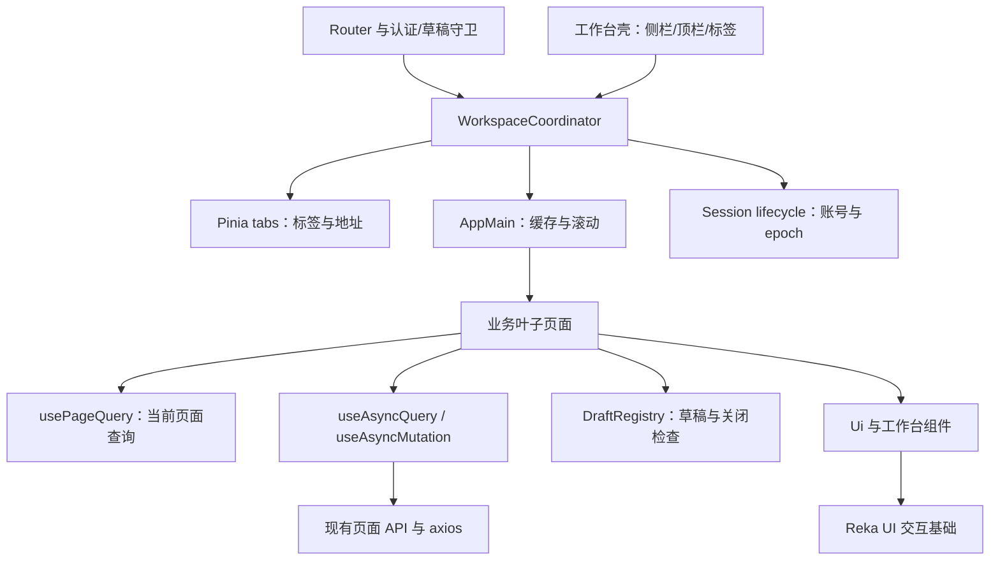

# cobotusr 工作台改版技术设计

状态：需求、视觉方向、技术设计、任务单和验收清单均已获用户批准，2026-11-08；前端实现与工程自动化验证已完成，真实环境及未覆盖项见 [验收报告](acceptance-report.md)。

## 技术决策

| 决策点 | 选择 | 理由与边界 |
|---|---|---|
| 前端栈 | Vue 3、TypeScript、Composition API、Pinia、Vue Router、Vite、Tailwind 3 | 沿用现有栈；改版目标是可靠状态和一致体验 |
| 基础交互 | Reka UI 提供 Dialog、AlertDialog、DropdownMenu、Tooltip；薄包装接入现有 Ui 入口 | 复用成熟焦点和交互机制；按视觉稿定制样式，不复制整套后台模板 |
| 图标 | @lucide/vue，按图标具名导入 | 统一菜单与操作图标；装饰图标隐藏于读屏，图标按钮保留名称 |
| 数据表格 | 原生语义 table + 局部滚动容器、状态与分页组件 | 当前没有复杂列编辑/拖拽需求，不先引入大型表格引擎 |
| 路由与菜单 | 布局下直接挂叶子页面；独立的类型化导航配置映射已命名路由 | 现有父包装页仅承担重复缓存和背景；视觉分组与路由层级解耦 |
| 标签 | 稳定 tabKey 标识页面，fullPath 保存当前地址；成功导航后同步 | 查询变化更新已有标签，切回保留参数；关闭不先破坏状态 |
| 页面缓存 | AppMain 单一 KeepAlive + 每个 tabKey 稳定命名的包装组件 | 使用公开 include 名称机制精确销毁标签实例；同组件不同对象可独立缓存 |
| 页面查询 | 页面 URL/当前标签路由快照为唯一查询来源 | 防止本地 pageNumber 与地址互相覆盖；后退、刷新和标签切换保持一致 |
| 请求生命周期 | AbortController + 请求序号 + 会话 epoch | 取消减少浪费；序号挡住迟到响应；epoch 防止旧会话结果写回 |
| 草稿 | 缓存页面内存保存；统一 dirty 注册与离开确认 | 保留连续工作上下文；密码、一次性密钥及草稿不写持久化存储 |
| 持久化 | 仅保存经过白名单过滤的标签地址、次序、滚动位置与布局主题偏好 | 当前需求是刷新恢复工作导航，不是自动保存敏感业务表单 |
| 验证 | Vitest + Vue Test Utils 验证状态/交互；Playwright 验证导航、焦点和响应式 | 基线缺陷依赖真实行为，单靠编译无法覆盖 |

计划新增的运行依赖仅为 `reka-ui` 与 `@lucide/vue`。不同时安装 shadcn-vue 整套脚手架，也不引入另一套状态管理。实现前按 registry 元信息核对兼容性，固定所用版本并更新工作区锁文件，所有安装与导入完成后必须跑类型检查、构建和基础组件行为验证。

2026-11-08 npm registry 检索快照：Reka UI 2.11.0（Vue >=3.4）、@lucide/vue 1.0.0（Vue >=3.0.1）、Vitest 5.1.0、Vue Test Utils 2.5.1、Playwright Test 1.65.0、jsdom 31.0.0。本机 Node 24.21.0 满足这些快照中的 Node 声明；最终安装还需验证实际项目解析版本。版本不是提前安装完成的声明，也不以本轮快照替代实施时的依赖校验。

## 架构与职责



`WorkspaceCoordinator` 只负责跨标签事务：确认、导航结果、状态提交及会话清理。标签内容由 tabs store 管理，实例由 AppMain 管理，请求由页面自身管理，草稿仍属于各业务表单。协调器不集中全部表单字段、DOM 监听和接口方法。

普通父子组件用 props/emits。只有页面上下文、全局确认宿主与草稿注册使用类型化 provide/inject，生命周期归属于同一个应用壳。异步组件、AbortController 和非响应式注册表不进入深层响应式代理。

## 核心数据结构与接口

以下签名是实现契约，不是已经新增的代码。

```ts
type TabKey = string
type SessionEpoch = number
type CloseScope = 'current' | 'others' | 'right'
type NavigationOutcome = 'success' | 'unchanged' | 'cancelled' | 'failed'

interface WorkspaceTab {
  key: TabKey
  routeName: string
  title: string
  fullPath: string
  affix: boolean
  cacheName: string
  scrollTop: number
}

interface WorkspaceSnapshot {
  version: 1
  ownerId: string
  tabs: Array<Pick<WorkspaceTab, 'routeName' | 'fullPath' | 'scrollTop'>>
  activeKey: TabKey
}

interface PageContext {
  key: TabKey
  route: Readonly<ShallowRef<RouteLocationNormalizedLoaded>>
  active: Readonly<Ref<boolean>>
  sessionEpoch: Readonly<Ref<SessionEpoch>>
}

interface WorkspaceActions {
  navigate(to: RouteLocationRaw): Promise<NavigationOutcome>
  close(key: TabKey, scope: CloseScope): Promise<boolean>
  resetSession(): void
}

interface DraftEntry {
  id: string // 同一页面可有多个独立表单
  tabKey: TabKey
  title: string
  dirty: () => boolean
  submitting: () => boolean
  discard: () => void
}

interface DraftRegistry {
  register(entry: DraftEntry): () => void
  checkNavigation(from: TabKey, to: TabKey): Promise<boolean>
  checkClose(keys: TabKey[]): Promise<boolean>
  reset(): void
}

interface PageQuery {
  page_number: number
  page_size: number
  q?: string
  role_id?: number
  application_id?: number
  user_id?: number
  roleId?: number // 分配页选择的角色，映射已有业务参数
}

interface QueryState<T> {
  data: T | null
  status: 'idle' | 'loading' | 'ready' | 'error'
  refreshing: boolean
  error: string | null
  stale: boolean
}

interface MutationState {
  pending: boolean
  error: string | null
}
```

`RouteMeta` 新增 `workspace?: boolean`、`tabIdentity?: 'route' | 'params'`、`tabParamKeys?: string[]`、`persistQueryKeys?: string[]`、`breadcrumb?: string[]`。`hidden` 仅控制菜单可见性，不能同时代替“是否允许工作台标签”或授权判断。生成 tabKey 的纯函数 `resolveTabIdentity(route)` 使用路由名及经过规范化的指定 params；查询项不参与身份。

示例：`/users?page_number=3&page_size=20&q=lin` 的身份为 `user-list`；后续翻页更新同一条 fullPath。已有对象详情若恢复为可达页面，则指定 ID 参数形成如 `detail:42` 的不同身份，不能用 title 或模糊 path 前缀作为身份。

## 路由、菜单与缓存

### 路由规范化

将工作台叶子页面直接作为 Layout 的子路由，保留现有 path 和实际叶子 name：`/users` → `user-list`、`/users/create` → `create-user`、`/roles` → `role-list`、`/authority` → `authority-list`、`/authority/assign` → `authority-assign`、`/permissions` → `permission-list`、`/permissions/assign` → `permission-assign`、`/applications` → `application-list`、`/authorized-apps` → `authorized-apps-list`、`/recordings` → `recordings-list`、`/profile` → `profile`。

首页规范地址为 `/dashboard`，保留 `dashboard-home` name，直接显示工作台概览。`/dashboard/introduction` 与其旧 name 兼容重定向到首页；现有 `/oauth` 及其旧子地址保持重定向到统一应用页。旧父级路由 name 若存在实际调用，增加仅用于兼容的命名重定向记录；迁移前通过引用搜索和 router.resolve 测试列举。登录、注册、OIDC、403、404 等继续独立于布局。

现有 `flatMultiLevelRoutes` 不是迁移开关。新路由显式注册，避免运行时临时 Router 与共同 history 带来的额外行为；没有引用的包装页与导航组件在迁移完成后才移除。

### 菜单配置

`router/navigation.ts` 提供有限的分组配置：工作台、身份管理、访问控制、应用与授权、审计。项用 route name 解析 href；API 权限与资源权限具有不同 title，分配入口不都显示为“权限分配”。菜单激活使用精确路由名映射，优先匹配叶子。

展开桌面侧栏显示分组和图标名称；收起时使用带 Tooltip 的直接链接，有多个入口的分组提供 DropdownMenu。窄屏用受控 Drawer/Sheet 展示同一导航配置；仅成功导航后关闭，取消导航仍保持菜单与当前页。

### 标签更新与关闭事务

Router `afterEach` 只在导航成功且目标是工作台页时同步标签，过滤失败、重定向中间地址和认证入口。活动标签从已完成的当前路由派生；重复导航视为 unchanged，不显示错误。

关闭当前标签依次执行：锁定关闭事务 → 收集目标集合 → 检查草稿/正在提交 → 确定保留标签 → await 导航 → 验证当前会话与目标 → 一次性提交标签删除 → include 移除相应名称并释放页面注册 → 持久化。回退优先选择左邻，次选右邻，最后固定首页。非当前标签关闭不产生导航，但执行同样草稿与提交检查。

关闭其他/右侧先确定全部目标，固定首页始终保留；一次确认显示脏表单数量和对象，用户取消时不删任何标签。此期间阻止新的关闭事务；新导航取消旧事务，不能让晚完成的确认删除用户已切换的标签。重定向到登录或会话 epoch 变化进入会话清理，不继续一般关闭事务。

### 缓存实现与验收边界

AppMain 使用 RouterView slot 渲染单一 KeepAlive，直接缓存 route component。每个 tabKey 有一个通过 `defineComponent` 创建的稳定包装类型，名称由单调编号生成，如 `WorkspacePage_7`；实际 leaf 组件及其 route props 固定归属该条目，避免缓存的旧 wrapper 随当前 slot 渲染成其他页面。

每个 wrapper setup 提供自己的 PageContext，只有所属页面导航成功时才更新该条 route snapshot； inactive 页面不会读到其他页面的 query。列表与草稿逻辑使用该上下文，而不是对全局 useRoute 做无条件 watcher。

KeepAlive `include` 来自已打开条目的 cacheName。关闭时删除对应名称，等待下一轮更新后释放注册表；同一组件的不同对象因 wrapper name 不同可以分别清理。当前标签刷新若会销毁草稿必须先确认。会话变更用整个 AppMain epoch key 销毁全部实例。

本轮不设置会静默销毁未保存草稿的 LRU max；内存使用随已打开标签增长，由明确关闭行为控制，并在回归中检查关闭后实例/监听释放。将来需要上限时必须设计可感知的关闭/保留策略，不加入未批准的自动草稿淘汰。

实现后的关键验证：第 3 页切换保持、同组件多对象分开关闭、inactive 页面不跟随其他页面参数请求、关闭后重新打开没有旧表单、关闭全部后仍有固定首页。禁止通过 Vue 私有缓存字段手工删除实例。

## 会话、持久化与草稿

### 会话识别

现有登录返回 username/nickname/token，没有稳定用户 ID；已有 `GET user` 能返回当前用户 ID。先在启动流程完成已有 cookie/用户信息恢复，再注册及启动 router；工作台会话由当前用户接口建立 `ownerId`，不从 token 文本或 nickname 推断。

在拿不到稳定 ownerId 时仍可显示合理的加载/重试或授权错误页面，工作台导航在内存运行；不恢复任何用户快照、不保存跨会话快照。收到 403 只标记对应请求/页面不可操作，不全局清除登录。401 保留既有刷新协议；刷新失败、明确退出或账号改变统一执行 resetSession。

身份接口只用于会话确认与个人信息，不伪造其未返回的权限集合。恢复标签先检查路由存在、工作台标志及 query 白名单；访问权仍由现有路由约定和真实接口判定。拒绝访问的标签展示可理解的不可用状态，关闭恢复记录，不宣称从本地 snapshot 得到授权。

会话 reset 清除当前用户 snapshot、tabs、DraftRegistry、确认宿主和 page registry，递增 epoch 并取消已注册的读取请求。强制失效不被草稿确认拦住；未完成旧请求也不能写入新账号页面。明确退出之前可确认脏表单；确认退出后即清理本地状态，后端退出请求失败也不恢复旧界面。

### 存储规则

`storage/workspace.ts` 使用版本化 key `cobotusr:workspace:v1:<ownerId>` 存 localStorage，保存 allowlist 地址和滚动位置，必要时节流写入。每种路由配置允许的参数：分页与本页搜索、用户/应用/角色筛选等；OIDC 参数、token、secret、密码、表单草稿、查询结果不进入 snapshot。JSON 解析失败、版本不匹配、ownerId 不匹配或存储禁用都回退内存运行，不阻断操作。

布局和主题使用独立 key，不包含业务身份。退出清除该会话工作台 snapshot；切换账号先销毁上一会话实例，再为新账号恢复其有效快照。存储变更事件只用于判断本应用会话或偏好变化，不能把其他应用的登录状态错误绑定到本应用。

### 草稿离开语义

每个页面内表单保存自己的初始快照；完成默认角色加载/数据初始化后才建立 baseline。dirty 比较经过业务规范化的字段，避免默认 role_id 导致刚打开就提示。保存成功更新 baseline；失败保留字段。注册项 onUnmounted 注销，deactivated 仍注册并保留内存草稿。

- 从脏表单切到其他已保留标签：统一确认“保留草稿并切换 / 留在当前页”，允许切换后旧实例保留。该确认覆盖 tab、侧栏、历史导航和程序导航；同标签查询变更依据该表单的实际语义判断，不能一律绕过。
- 关闭标签、放弃编辑或替换该页：确认“放弃修改并关闭 / 继续编辑”，确认后才 discard。
- 页面内弹窗取消、Esc、遮罩关闭：复用对应表单 dirty 检查，不静默丢输入。
- 浏览器刷新/关闭：dirty 或尚未完成的重要提交时注册 beforeunload，使用浏览器原生确认；不会承诺自定义文案或刷新后恢复敏感字段。
- 已发出的写请求：普通导航/关闭提示等待完成，禁用该次提交的 Esc/遮罩/重复确认，不能将取消前端显示解释为取消后端操作。强制会话失效仍立即清理，结果不写回旧实例。

确认宿主与 route guard 之间只创建一个受控 Promise，解决取消、会话 reset 与宿主卸载时均要 settle，避免导航永久等待。

## 查询与请求策略

`usePageQuery(context, schema)` 解析当前页面 route snapshot，返回只读规范值与 `setPage`、`setSize`、`setFilters`。页面大小为 10/20/50；页码为正整数，标量参数拒绝重复数组、NaN 与小数。首次非法地址通过一次 replace 修正；页码超出后端 total_pages 后 clamp 一次并重新查询，零页空结果显示第 1 页和空状态，不循环重试。

用户翻页/筛选提交使用 push，输入编辑过程或地址规范化使用 replace；后退/前进由路由恢复。筛选及 page size 改变同时重置 page_number=1。本页搜索标注“搜索本页”，只过滤本页数据；API 确有 application_id/user_id 等筛选时透传现有字段，不凭空添加后端搜索。

`useAsyncQuery<T>({ key, active, loader, sessionEpoch })` 对规范 query 与 active 状态进行单一调度：首次 active 仅一个 immediate watcher 发起读取，避免 mounted/activated 各自再拉取。切换回未失效页面直接使用缓存；涉及创建/修改/删除的相关查询标记 stale，激活时再刷新。显式刷新绕过已有缓存，但仍满足最后一次查询生效。

loader 每次收到新 signal。新查询、页面失活/关闭、会话切换和卸载时 abort，序号同步失效；只有序号与 epoch 都一致才能写 data/error/status/finally。Axios 拦截器遇到取消直接 reject 且不吐司、不退出。API 查询方法增加可选 `signal` 参数并原样转交现有 request。

首次请求失败显示完整 error 状态；有旧结果的刷新失败保留旧结果，显示“刷新失败，以下为上次结果”及重试，禁止当作成功。不同 query 下的旧行不能冒充当前结果，清晰 loading 或带上下文的占位。读取错误由页面负责展示；有具体本地处理的请求用 `errorPresentation: 'local'` 关闭重复全局 toast。其余旧调用在迁移完成前保留默认行为。

`useAsyncMutation` 管理 pending 与局部 error，重复调用 pending 时直接拒绝；默认不自动重试写请求，不自动 abort 服务端已经开始的修改。成功响应后业务决定刷新、关闭或显示一次性结果。会话 reset 后不再把结果送回页面。不要用共享列表 loading 控制所有行的保存状态，行操作按对象 key 管理 pending。

现有 token 刷新和 bearer/cookie 约定沿用；只补与改版必要的取消处理、错误归属、队列释放及会话清理调用。刷新失败时清空订阅且 resolve/reject 全部等待者；取消的原请求不在刷新成功后被重新发送。

## 弹窗与基础组件契约

`UiDialog` 保留现有 open/title/size/slots 等入口，新增 `description`、`busy`、`error`，由业务控制 open。`confirm` 仅发事件，不自动关闭；迁移所有调用方并移除目前“校验失败立即重开”补丁。默认非提交状态支持 Esc 和合理的外部点击；busy 阻止关闭与确认。不能用 UiButton 嵌套 UiButton/button。

普通编辑使用 Dialog；删除、撤销、踢下线等确认使用 AlertDialog 包装。详情、多步内容用 body/footer slot；一次性密钥结果单独显示“已保存密钥，完成”，不能把第二次确认误解释为再发创建请求。弹窗 title/description 关联读屏语义，焦点进入正确字段或取消项，错误时定位首个错误；关闭回触发入口，若入口被删除则回列表主操作或主内容区。

Drawer 用同一 Dialog 机制配置侧边位置。DropdownMenu/Tooltip 通过 Reka primitives 统一键盘行为，触发元素用 as-child 避免嵌套按钮；业务动作使用 button，导航保留真实 RouterLink href 以支持新标签打开。工作台标签采用“页面导航列表”，而不是生硬套用需 tabpanel 的 ARIA tablist：链接 aria-current=page，关闭按钮与链接是兄弟节点，标题不换行，焦点/激活项滚动进入视口。

`UiButton` 默认 type=button；表单提交显式 type=submit；非 button 渲染不传无效 disabled。`UiInput` 传递 id/name/autocomplete/inputmode/aria-*，支持标准字符串及必要 number/null 归一化；`UiSelect` 保留原生 select，明确空选项转 null，数值选择由契约解析，避免字符串 `'null'` 变 NaN。Checkbox 保留原生输入和点击标签，checked 仅来自 modelValue。

`Pagination` 新页面只使用一种 page-change / size-change 契约，不同时绑旧别名与新事件。确认禁用态作用于所有入口，包括页大小和跳页；跳页仅接受正整数。保留旧接口的适配层直至引用迁移结束。

`showModal` 改为挂接同一确认宿主，Promise 在确认/取消/Esc/卸载均 resolve；同步结果提示迁移到 toast 或内联提示，不能把每次创建成功都变成阻塞式确认弹窗。toast host 提供 live region、类型语义、可关闭动作与局部错误去重。

## 业务模块迁移

| 模块 | 页面/状态职责 | 专项设计 |
|---|---|---|
| 工作台 | 常用入口、当前身份与可用说明 | 使用真实当前用户；不存在聚合接口时不显示虚构用户/应用数量 |
| 用户列表 | 列表读取、URL 查询、行操作；独立权限覆写面板 | user-list 只协调；覆写读取/选择/保存由所属面板负责，API 与资源两个内容页保持明确标识 |
| 创建用户 | 初始角色加载、表单、校验和提交 | 角色初始化后 baseline；所有离开入口保护草稿；成功失效用户列表，跳转保留合理查询 |
| 角色 | 列表与创建/重命名表单 | 每个弹窗 dirty/pending 局部管理，提交失败不关闭 |
| API/资源权限 | 列表、编辑、筛选 | 独立 API adapter，共用页头/状态组件；显示不同的 URI/action/应用信息 |
| 角色分配 | 分配页角色 query；可选项加载、已授权基线、增删差异 | 有效授权基线必须全页获取；任何页读取失败不能当作空集合。可选项增量加载，明确加载范围与继续加载 |
| 应用注册 | 列表、应用表单、OAuth 步骤与一次性结果 | app-page 读取和客户端信息独立；某客户端失败只影响关联信息而非整页消失 |
| 已授权应用 | 授权列表、撤销目标与 pending | 失败留弹窗；成功撤销才清目标与刷新；重复点击只发一次 |
| 操作记录 | 记录 query 与用户选项 | 首屏记录立即加载；用户选项分页独立请求；切用户重置页码，不先循环获取全部用户 |
| 个人中心 | 当前信息、昵称表单、密码表单 | 两份独立 baseline 与 pending，敏感密码关闭/成功时清理，无持久化 |
| 登录/注册/OIDC | 独立 AuthLayout、表单、授权参数、提交状态 | 普通登录恢复已验证的本地工作台目标；OIDC 按原 flow 保留 query，双提交锁和失败反馈一致 |
| 错误页 | 清晰标题、返回可用入口 | 沿用地址；403 不伪装 404，返回按钮无历史时去固定首页 |

### 分配页增量与部分失败

`usePagedOptions` 暴露 `items / loading / error / hasMore / loadNext / retry`，按页去重，收到 total_pages 后逐页继续。可选列表默认首批 100，用户可继续加载；不能宣称未加载的项目已被全局搜索。角色已授权列表为了正确 diff 必须获取完整基线，按分页迭代，显示进度并可取消读取；完成前禁用提交。

`desiredIds` 与 `serverIds` 独立保存。新增成功、移除失败时更新已确认 serverIds，重新读取完整有效权限做 reconciliation，desiredIds 保留；重试只提交剩余差异。重新读取失败明确显示“部分操作可能已完成，需要重新获取当前权限”，禁用按旧基线重复提交，不自动回滚真实权限。未加载的可选项不从 desiredIds 中移除。

### 应用注册多步状态

`useApplicationRegistration` 只负责业务多步生命周期，不塞入表格 DOM。创建步骤 `idle → creating-client → linking-application → revealing-result → done`，出错保留已完成步骤的结果。客户端创建成功而应用记录失败，保留 client ID 与一次性密钥于内存，重试只发建立应用关联请求，不再次创建客户端；若当前请求超时而服务端结果未知，先查询已有结果确认，无法确认时显示结果未知，不自动重试非幂等创建。

更新按两步记录已成功项；删除按现有顺序客户端→应用，客户端已删除而应用失败时只重试未完成部分，已确认不存在不当作整个失败的新起点；不能把任何 404 都吞掉。一次性密钥不能进入 tabs snapshot、日志或 toast。结果页/弹窗关闭有明确“确认已保存”；刷新会丢失内存结果，界面提前说明。

## 视觉 token、布局与主题

视觉以已批准方向稿为依据。浅色基础：background `#f5f8f9`、surface `#ffffff`、foreground `#182b32`、muted foreground `#526a72`、primary `#0f766e`、border `#dce5e7`、success `#286541`、destructive `#b42318`。暗色使用独立语义色，不再依赖全局 text-gray 覆盖；最终在实际使用背景上验证对比度。弱装饰线可低对比，承载文字与交互边界需满足需求。

字体优先系统中文 sans-serif（PingFang SC、Microsoft YaHei、system-ui），无需运行时远程字体。字号主要 12/14/16/24px，长正文与操作说明使用 14px；mono 只用于真实 ID/URI/密钥。间距为 4/8/12/16/24/32px；按钮/字段约 36–40px，主要触控入口 44px；圆角按层级 4/6/8/12px，阴影主要用于浮层。

桌面应用壳高度 100dvh（提供 vh 回退），侧栏 224px/折叠 64px，顶栏约 56px，标签行约 40px。中间主区域 min-width:0/min-height:0，只有内容容器负责页面垂直滚动，宽表格在局部容器横向滚动；不由各模块添加 min-h-screen。小于 1024px 改抽屉导航；小于 640px 查询工具栏纵向排列，主操作保留可触达位置；手机布局不隐藏必须业务数据，超宽列可通过表格滚动查看。

Footer 的帮助入口放入侧栏/用户菜单，版权说明作为低优先级静态内容，避免始终占用小屏工作区。主内容有 skip link 与一致的 h1，面包屑不能替代页面标题。

`useTheme` 的偏好为 light/dark/system，resolved theme 从 matchMedia 派生；启动挂载前设置 html class、color-scheme 与 theme-color，避免首屏闪烁。系统模式监听媒体变更，其他模式不跟随；监听卸载清理。动画仅使用 transform/opacity 和明确属性，100–180ms 为基础交互范围；prefers-reduced-motion 禁用非必要动画；页面切换不采用阻塞的 out-in 出场动画。

## 文件组织与迁移界面

```text
cobotweb/apps/cobotusr/
  src/
    layouts/mode/left-top-mode.vue            工作台壳的现有入口
    layouts/components/AppMain/index.vue     页面缓存与滚动所有者
    layouts/components/Sidebar/index.vue     共用导航配置的桌面侧栏
    layouts/components/NavigationBar/index.vue 顶栏与用户菜单
    layouts/components/TagsView/index.vue    标签链接、关闭菜单与滚动
    layouts/components/Breadcrumb/index.vue  面包屑
    router/{routes,guard,index,config}.ts     叶子路由、认证与草稿守卫
    router/navigation.ts                    导航分组与路由名映射
    types/{router.d,workspace}.ts            meta 与工作台契约
    pinia/stores/{tabs,user,layout}.ts        状态所有者与会话入口
    workspace/tab-identity.ts               标签身份纯逻辑
    workspace/coordinator.ts                标签关闭与导航事务
    workspace/page-context.ts               页面 route snapshot 与 active
    workspace/page-registry.ts              稳定命名 wrapper 注册与释放
    workspace/draft-registry.ts             草稿注册、确认及 reset
    workspace/session.ts                    ownerId、epoch 与请求清理
    storage/workspace.ts                    版本化、白名单快照
    composables/use-page-query.ts            URL query 解析与动作
    composables/use-async-query.ts           读取请求生命周期
    composables/use-async-mutation.ts        写请求 pending/error
    composables/use-form-draft.ts            baseline 与 dirty 注册
    composables/use-paged-options.ts         分页选项与继续加载
    composables/use-theme.ts                 主题偏好与生命周期
    components/ui/                          现有输入/按钮/选择/弹窗适配
    components/ui/{alert-dialog,dropdown-menu,tooltip,drawer}/
    components/workspace/{page-header,query-toolbar,data-state,status-badge}/
    components/Feedback/{toast-host,confirm-host}.vue
    pages/users/components/user-overrides-dialog.vue
    pages/users/components/{authority-overrides,permission-overrides}.vue
    pages/applications/components/{application-form,secret-result}.vue
    pages/applications/composables/use-application-registration.ts
    pages/authority/composables/use-authority-assignment.ts
    pages/permissions/composables/use-permission-assignment.ts
    pages/*/api/                            现有 API 加可选 signal/错误呈现
    pages/*/views/                          全部实际业务页面迁移
    layouts/auth-layout.vue                 独立认证页共同视觉
    http/axios.ts                           取消识别、局部错误、会话 reset
    utils/{modal,toast}.ts                   统一宿主入口
    style.css                               语义 token 与基础规则
  tests/unit/                               状态与组件行为
  tests/e2e/                                浏览器流程与模拟响应
  {vitest,playwright}.config.ts              应用测试配置
  eslint.config.js                          Vue/TS 有效 lint 配置
  package.json                              依赖与 check/test/lint 命令
```

业务拆分只发生在有独立生命周期的覆写、应用表单/结果和分配请求上；简单列表不按行数机械拆成大量透传组件。共享包本轮只在实际需要时修改；应用新基础组件先留 cobotusr，公共导出及其他应用不先改变。

## 实施顺序与验证策略

task和checklist已批准并执行；实际进度、验证及剩余范围见progress和acceptance-report。

建议任务依赖：依赖与测试基础 → 标签身份/路由与 session → AppMain/cache/draft → Reka 组件与响应式壳 → 查询/请求统一 → 用户/角色样板 → API/资源分配、应用/授权、审计/个人中心 → 认证入口/错误页 → 全模块验收。可并行的是互不重叠的模块迁移与检查，不以并行取代共享状态的集成设计。

首批行为回归固定基线 B01–B09：URL 保持、最后查询生效、折叠菜单、异步失败保留弹窗、小屏正文、单一首页、首次单请求、会话清理与 dialog 焦点。另加关闭取消、inactive watcher、同组件不同对象释放、脏表单导航、部分成功重试、401 刷新失败与取消请求。以可见行为和接口次数断言，不只检查函数内部属性。

组件单测覆盖 Dialog/AlertDialog 的失败与 busy、Select null/number、分页边界与禁用、确认 Promise settle；浏览器测试覆盖桌面菜单/小屏抽屉/键盘焦点/标签滚动。Playwright 配置使用独立测试数据与浏览器上下文，读写请求模拟只用于前端行为；实际认证、刷新、OIDC 同意/拒绝和权限修改另外在真实后端环境中记录，不混同模拟通过。

浏览器多引擎自动化使用 Chromium/Firefox/WebKit；实际 Safari、iOS Safari、Android Chrome 的验证单独记录设备和版本，WebKit 模拟不冒充真实设备结果。视觉在需求中的全部尺寸、浅暗主题、长标题、空/错/加载状态取截图检查。

提供 `check`（vue-tsc）、`lint`、`test`、`test:e2e` 命令；构建优先输出临时目录以免覆盖已有 assets。当前存在 ESLint 依赖但没有应用有效配置，新增配置先测实际规则，区分既有问题与本次引入问题，不将关闭全部规则当作通过。

## 需求覆盖与风险

| 需求 | 设计归属 |
|---|---|
| F1/F2 | 叶子路由、navigation、tabs、coordinator、AppMain |
| F3 | PageContext、session、storage、DraftRegistry |
| F4/F5 | usePageQuery、useAsyncQuery、分页与局部错误 |
| F6/F7 | useAsyncMutation、Reka wrappers、表单 baseline 与确认宿主 |
| F8 | 用户/角色样板、权限覆写组件与 API adapter |
| F9 | 两种分配 workflow、分页选项、完整基线与 reconciliation |
| F10 | 应用多步 workflow、授权、记录与个人中心 |
| F11 | AuthLayout、原目标恢复、OIDC 参数与双提交锁 |
| F12/N1–N6 | 视觉 token、响应式壳、主题、行为测试与实际环境验收 |

重要风险与处理：

1. KeepAlive 与统一路由改造覆盖全部工作台页面。先建立真实最小缓存测试，验证稳定包装、include 清理与 inactive 上下文，再迁移其他模块。发现公开机制不满足时在实现前修订设计，不读写私有缓存。
2. 基础 UiDialog 默认关闭行为改变会影响全部调用方。一次检索列清清单，迁移期间每处异步提交显式控制 open；旧 OAuth 兼容/未可达页面与 showModal 也纳入检查。
3. 无完整用户权限信息的接口无法让前端预先判定全部菜单权限。当前设计沿用服务端最终判定与清晰错误反馈；若未来要权限过滤导航，需单独批准接口契约。
4. 多请求写入没有后端事务。前端只能记录已完成步骤、核对结果与重试剩余差异，无法保证跨刷新恢复一次性密钥或未知提交的幂等性。明确显示这些边界，不误报全成功。
5. 会话与请求取消涉及已有认证刷新。必须验证原协议、排队等待者释放与 OIDC 原始参数，不能把视觉改版演变成重写认证协议。

## 资料依据

本轮已读取 Vue 技能的 reactivity、SFC、component-data-flow、composables 核心参考。社区技能只辅助组织职责；API 行为依据主来源。Vue KeepAlive 的 include 按组件 name 匹配、activated 首次挂载也调用，是缓存设计与重复请求修复的依据；Vue Router 的导航 Promise/失败结果是关闭事务依据；Axios signal 是读取取消依据。

- Vue KeepAlive：<https://vuejs.org/guide/built-ins/keep-alive.html>；本轮读取官方仓库 `vuejs/docs` 对应文档。
- Vue Router slot：<https://router.vuejs.org/guide/advanced/router-view-slot.html>。
- Vue Router navigation failures：<https://router.vuejs.org/guide/advanced/navigation-failures.html>；本轮读取 `vuejs/router` 文档。
- Axios cancellation：<https://axios-http.com/docs/cancellation>。
- Reka UI 源码与组件文档：<https://github.com/unovue/reka-ui>；实施前核对所安装版本的事件/焦点契约。
- 包版本与 peer/engine 校验：<https://registry.npmjs.org/>。

## 审阅重点

用户已确认：集中缓存并规范路由、采用 Reka UI 与统一图标、URL 驱动查询、所有异步确认由业务控制关闭、草稿只在内存保留、会话变化整体清理，以及以用户/角色样板分阶段迁移。文件级任务已写入 [task.md](task.md)，后续按任务审批与验收设计推进。

实施依赖调整（2026-11-08）：registry 标记 lucide-vue-next 已弃用，改用官方维护的 @lucide/vue 1.70.0，沿用兼容的具名图标 API；Reka UI 与测试依赖按上面的固定版本安装。刷新接口核对原代码为 POST refresh，保持原契约。

## 实施差异与补充（2026-11-08）

以批准的行为契约为准，实际文件按职责聚合：权限目录/分配共享组件，应用分步处理使用createStepWorkflow与createVerifiedCreate；不再生成同职责专用封装。候选每批100继续加载，授权基线读取全部分页；用户可修改角色完整分页读取。

E2E使用临时生产构建与preview，避免开发态工具在Storage故障注入时产生额外异常；未知接口501与未处理页面异常都保留失败断言。Darwin23的冻结WebKit使用1.61驱动匹配协议，其余引擎使用1.65；失败trace通过公开API保存。

刷新滚动采用snapshot、pagehide提交和ResizeObserver等待异步高度恢复；用户主动滚动/键盘操作中止恢复。写成功后读取失败保留已删除/已更新事实，避免重复危险操作。弹窗记录真实鼠标触发按钮，关闭恢复适用于WebKit。

应用成功后隐藏长编辑表单直接呈现密钥结果；明确“已保存，完成”及关闭保存确认，复制失败可以手动处理。字段校验先清旧错误再定位当前首错误，并关联可读提示。

本轮未改变既有Cookie认证契约；严格“所有浏览器持久化无token”标准存在例外，C013仅部分通过。最新规范源未读取成功、实际读屏/设备/后端均如实列出边界。
