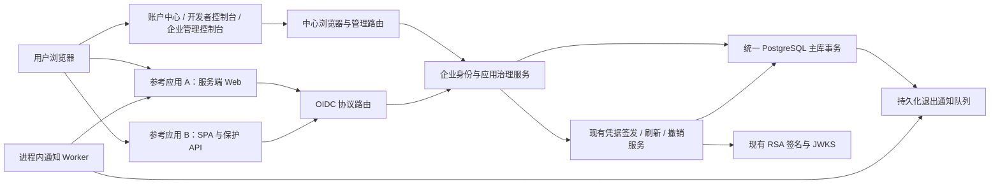
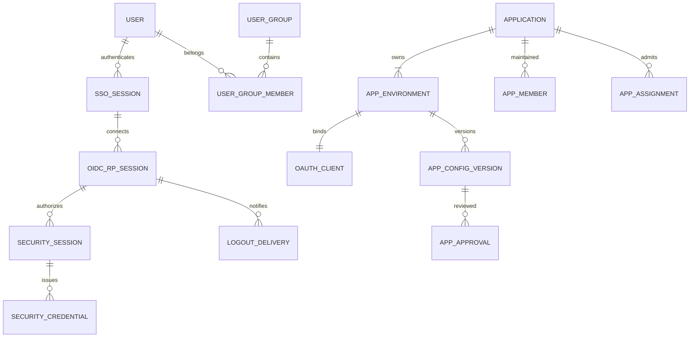
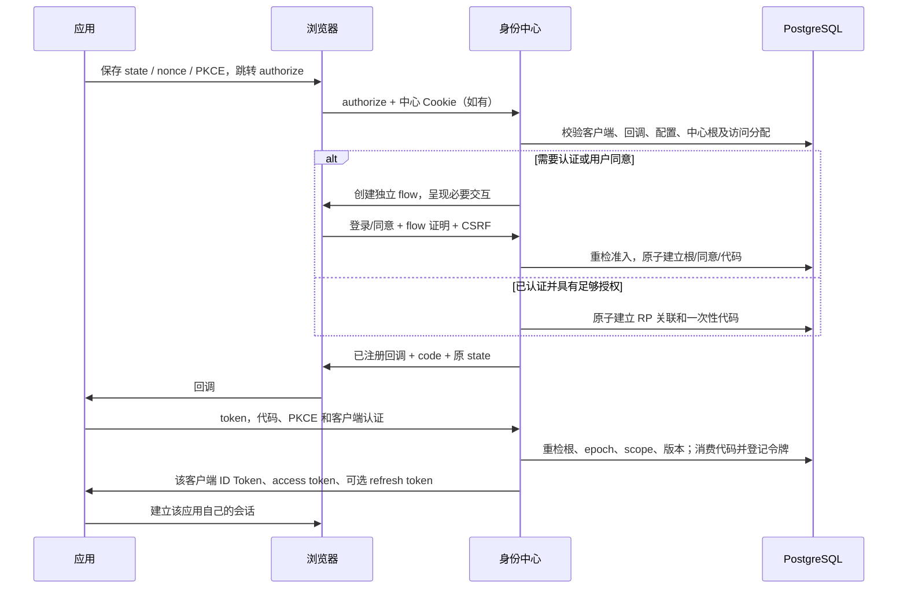

# 企业统一身份与受控应用接入 Plan

日期：2026-11-09，Asia/Shanghai。

状态：技术方案已于 2026-11-09 经用户“继续”确认。依据已确认的 [spec.md](spec.md)；本文定义实现方式，任务拆分及验收清单在后续文档中展开。本阶段没有编写实现代码，也没有执行新功能测试。

## 1. 实现结论与架构

在现有独立认证中心内形成完整的企业身份产品：保留 Rust/Axum、SeaORM/PostgreSQL、`libs/auth` 和 Vue/TypeScript 工程，新增身份准入、应用治理与中心会话模块。开发者控制台属于本产品，不另建开放平台服务。一个部署服务一家企业，使用固定 issuer。

中心持有自己的浏览器会话，应用通过标准 OIDC 授权码流程获得各自身份和令牌。登录判断分为中心认证、企业访问分配、批准的环境配置、身份披露四层；业务资源权限继续由业务应用及既有权限模块管理。



### 1.1 现状与改动归属

| 当前实现 | 本次改动 | 保留的基础 |
| --- | --- | --- |
| 中心访问令牌按标签页保存，缺少令牌时无法稳定恢复认证 | 后端验证独立中心会话 Cookie；前端启动先查询中心会话 | 原有管理访问令牌与刷新接口兼容能力 |
| `/oidc/authorize` 主要引导前端登录、同意 | 后端决定直接授权、重新认证、同意或拒绝，前端只呈现必要交互 | 已有授权码、S256 PKCE、标准端点 |
| application、oauth_client、安全关联分别创建 | 一个应用注册事务创建开发/生产环境及完整关联 | 既有客户端 ID、应用 key、安全注册表 |
| 账户缺少企业准入、启用状态和独立开发者资格 | 增加受控邀请、账户生命周期和资格管理 | 当前账户 ID、密码散列与角色体系 |
| 客户端缺少生产配置版本和用户分配 | 增加不可变配置版本、审批和用户/组分配 | 既有 URI 管理权限与审计入口 |
| 撤销以凭据、授权、单个安全会话为根 | 增加中心会话根及 RP 会话关联，复用原撤销递归 | 刷新轮换、重放证据、MCP 边界 |
| userinfo 受管理权限影响，邮箱由用户名拼接 | 单独验证应用身份令牌及授权资料，缺失资料不返回 | 签名与稳定主体标识 |
| introspection 查询旧 token 表 | 已纳管令牌使用安全注册表和当前准入状态 | 历史未纳管令牌的明确兼容路径 |

### 1.2 模块职责与依赖

新增 `cobotusr/src/domain/identity/` 保存纯规则和传输无关类型；`service/identity/` 编排账户、应用、准入、SSO、同意及通知；`service/identity/repository*.rs` 实现 PostgreSQL 持久化。现有 `service/security/` 继续负责凭据根、签发、刷新、撤销与有效性。

纯规则模块不依赖 Axum、SeaORM 或前端。HTTP 层调用服务接口，身份服务通过同一事务接口使用安全模块，不在两个服务中分别开启事务。PostgreSQL 适配器实现规则层定义的仓储契约。安全模块读取共享的 `ManagedAdmission` 值与事务能力，不反向调用身份编排服务，避免循环依赖。

## 2. 核心数据结构

### 2.1 约定与关系

沿用账户和应用的 `i32` ID、当前账户 ID 转字符串的 sub。新增会话、流程、版本、请求记录使用 UUID；秘密使用至少 256 位系统随机数，数据库只存散列或已有安全摘要。状态时间采用可信安全时钟的 UTC 毫秒，OIDC 对外时间按秒输出。新表使用明确外键、CHECK 与唯一约束，不用请求体中的 owner、subject 或 application 替代服务端绑定。



### 2.2 账户、资格和访问分配

| 表或字段 | 数据与约束 |
| --- | --- |
| `user` 新增字段 | `enabled` 默认 true；`person_kind=employee/collaborator`；`developer_enabled` 默认 false；`auth_epoch` 默认 0；可空 `email` 与 `email_verified_at`。保留原 ID、username、password、nickname、role_id |
| `identity_subject` | `(issuer, sub)` 主键，`user_id` 唯一关联、保留 tombstone。首次填充使用原 sub；删除账户接口改为停用/匿名化，不复用账户 ID 或身份主体 |
| `identity_provider` | 单企业部署的固定 issuer、初始化时间和 schema/profile 版本；启动时核对配置，不因 Host 或配置别名改变身份命名空间 |
| `identity_invitation` | `id, secret_digest, purpose, target_user_id, person_kind, developer_grant, created_by, expires_at, consumed_at, accepted_user_id, revoked_at`。purpose 为开户或已有账户资格邀请；消费与账户/资格变更在同一事务 |
| `identity_password_reset` | `id, user_id, secret_digest, auth_epoch_at_issue, created_by, expires_at, consumed_at, revoked_at`。只由管理员签发；密码变化后其他旧重置链接失效 |
| `identity_collaboration_candidate` | 管理员授予 `(requester_user_id, candidate_user_id)` 可见关系；只允许查询既有成员、本人及被明确允许的候选开发者 |
| `identity_user_group` / `identity_group_member` | 扁平组及 `(group_id,user_id)` 唯一成员。组记录 `revision`；不支持嵌套和继承 |
| `identity_app_member` | `(application_id,user_id)` 唯一，`member_role=owner/maintainer`。每个已纳管应用一个 owner；owner 交接在单事务内完成 |
| `identity_app_assignment` | `application_id, target_kind=user/group, user_id/group_id, created_by`；CHECK 要求恰好一个目标，分别设置唯一索引。用于生产用户访问 |
| `identity_app_test_user` | `(environment_id,user_id)` 唯一，管理员指定的开发测试用户；开发 owner/maintainer 的资格作为另一条开发准入来源 |
| `identity_access_generation` | `(environment_id,user_id)` 主键，`generation, eligible, changed_at`。首次使用创建；访问权最终丢失时增加 generation 并置 false；后续重新授予不恢复旧授权 |

管理员资格复用原管理操作授权来源，不由 `developer_enabled` 推导。开发者创建的应用负责人必须启用且具备开发者资格；管理员直接配置的第三方应用采用 `management_mode=admin_configured`，负责人可以是启用且有管理权限的管理员，无需自动授予开发者资格。

停用 owner 或撤销其必要管理资格前返回其负责应用清单；管理员必须先交接，或将相关应用置为 suspended。停用应用可保留原 owner 作为历史责任人，重新启用前必须恢复有效 owner。禁止停用最后一个有效企业管理员。

### 2.3 应用、环境、版本和审批

| 表或字段 | 数据与约束 |
| --- | --- |
| `application` 新增字段 | `management_state=legacy_unmanaged/managed`、`application_kind=internal/third_party`、`management_mode=developer_managed/admin_configured`、`lifecycle=active/suspended`。原 key 和关联不改号 |
| `identity_app_environment` | `id, application_id, kind=development/production, oauth_client_id, active_version_id, lifecycle_epoch, revision`；应用/环境唯一，客户端 ID 唯一；两环境分别绑定客户端 |
| `identity_app_config_version` | `id, environment_id, version, payload, payload_hash, created_by, created_at`。插入后不可修改。payload 为强类型配置序列化的 JSONB，包含回调、退出回调、浏览器 origins、客户端类型、访问 audience、身份范围、同意策略、退出能力 |
| `identity_app_approval` | `id, environment_id, version_id, snapshot, snapshot_hash, requested_by, status=pending/approved/rejected/obsolete, reviewed_by, reason, timestamps`。快照额外固定 owner、当前访问范围和退出限制接受记录；审批不得修改快照 |
| `identity_admin_activation` | 管理员直接接入第三方应用的操作、操作者、配置快照和退出限制接受记录。与开发者申请审批分别记录，避免将自批规则隐藏在通用审批入口 |
| `oauth_client` 新增关联 | `management_state` 和可空环境关联；客户端本身明确标记 legacy_unmanaged/managed，孤立历史客户端也不能靠缺少 application 关系逃逸。原 `user_id` 保留为历史创建者；旧文本配置仅镜像 active version，不接受绕过版本服务的更新 |
| `security_session_client` | 保留 `(issuer,client_id)` 唯一信任关联；已纳管客户端由环境 active version 同事务更新 application/audience/enabled |
| `identity_introspection_reader` | 独立保护 API 的 reader_id、secret_hash、目标 environment_id、approved_audience、enabled、secret_revision；仅授权内省，不是 SPA 的客户端密钥，不接受它在 token 端点认证 |
| `identity_request_operation` | `(actor_id, operation_kind, idempotency_key)` 唯一，保存规范化 request_hash、resource_id、已提交结果摘要及时间。结果不包含秘密 |

注册一次创建应用、owner、开发与生产环境、两个独立 OAuth 客户端和信任关联。开发环境立即具有有效配置；生产 active_version_id 为空且绑定 disabled，批准之前不能签发。客户端 secret_hash 使用当前密码散列实现；public_client 的 secret_hash 必须为空且禁止 client_credentials。后端需要替 SPA 验证保护操作时，可为明确的保护 API 单独注册 introspection reader，其目标及 audience 纳入接入配置核对；secret 只交付给该 API 服务端。

新身份客户端的 grant_types 限定 authorization_code 和按请求使用的 refresh_token；不因注册身份应用而创建机器凭据或 MCP 权限。ID Token audience 固定为该环境 client_id。访问令牌 audience 默认采用该环境唯一的身份 API 标识；可在批准配置中替换为受保护资源标识，其值始终由环境信任绑定提供，客户端参数不能覆盖。

客户端类型变化时创建新的环境客户端候选记录，批准后才切换主绑定并停用旧客户端；旧 ID 留作历史记录。只变回调、范围或 audience 时可保留 client_id，由版本和 lifecycle_epoch 阻止旧代码、令牌继续生效。这样保密类型转 SPA 不会沿用原 secret。

### 2.4 中心会话、授权继续流程与 RP 关联

| 表或字段 | 数据与约束 |
| --- | --- |
| `identity_sso_session` | `id, issuer, user_id, secret_digest, auth_epoch, authenticated_at, expires_at, revoked_at, created_at, last_seen_at`。Cookie 秘密唯一；固定最长生存期，不以读取会话延长认证时间 |
| `identity_authorization_flow` | `id, request_payload, environment_id, config_version_id, browser_proof_digest, bound_sso_session_id, created_at, expires_at, completed_at, reauth_completed_at`。只保存校验过的协议请求；每次流程绑定独立浏览器证明 |
| `identity_action_flow` | 邀请/重置入口交换后的短期动作记录，含动作类型、关联 invitation/reset、浏览器证明摘要、有效期和消费状态；与 OIDC flow 分开验证 |
| `identity_oidc_rp_session` | `id, sso_session_id, environment_id, config_version_id, protocol_sid, subject, auth_time, created_at, revoked_at`；protocol_sid 使用随机 UUID，对该 RP 的关联稳定；不同 RP 不共享 sid |
| `security_session` 新增字段 | 可空 `sso_session_id, oidc_rp_session_id, environment_id, config_version_id, auth_epoch, lifecycle_epoch, access_generation, identity_scopes`。已纳管交互授权必须完整填充，旧会话字段保持 NULL |
| `oauth_authorization_code` 新增字段 | 已纳管代码使用可空 `code_digest` 唯一及 `flow_id, sso_session_id, environment_id, config_version_id, auth_time, auth_epoch, lifecycle_epoch, access_generation`。新代码不存明文，旧代码仅走历史查找路径 |
| `oauth_consent` 新增字段 | `environment_id, config_version_id` 可空；纳管后按用户/环境/版本保存允许的身份范围，不能将 NULL 历史同意当成新版本授权 |

中心会话与安全会话通过外键关联，不把中心 Cookie 写成 `revocation_parent_jti`。现有凭据派生父链继续用于其原有安全用途；SSO 根是额外的服务端有效性条件。

授权码旧 `code` 列保留其 NOT NULL/唯一约束，新记录写入带类型前缀的摘要表示，实际兑换按 code_digest 查找；不能为兼容实体而把新授权码明文另存一份。已纳管记录以 CHECK/服务约束要求新增安全关联成组完整，不能只填 environment_id 却省略根和 generation。

### 2.5 审计、通知与历史冲突

`identity_audit_event` 保存 event_id、request_id、actor、action、对象、可信时间、result、原因代码、脱敏变更摘要及 commit 标识。管理成功事件与状态更新同事务提交；拒绝事件在原事务回滚后独立写入，可检索但不冒充成功。沿用 recording 历史，将身份事件通过审计读取接口合并展示。

`identity_logout_delivery` 保存 event_id、rp_session_id、client_id、批准的 endpoint 快照、status、attempt_count、next_attempt_at、lease_until、token_jti、最近脱敏错误和 delivered_at；`(event_id,rp_session_id)` 唯一。不保存完整 Logout Token，投递时根据事件生成短时签名令牌。

`identity_migration_conflict` 保存客户端、候选应用/owner、冲突类型、证据摘要、resolved_by 和解决结果；禁止根据名称相似或单个旧字段猜测绑定。

## 3. Rust 类型与接口契约

以下签名定义后续模块边界，属于设计示意。日期、ID、秘密和已验证上下文采用封装类型；DTO 不能直接反序列化成授权事实。

```rust
pub enum AppEnvironmentKind { Development, Production }
pub enum ClientKind { ServerWeb, BrowserSpa }
pub enum ConsentPolicy { UserConsent, EnterprisePreconsent }
pub enum LogoutCapability { BackchannelAndOnline, Online, LocalOnly }

pub struct EnvironmentConfig {
    pub client_kind: ClientKind,
    pub redirect_uris: Vec<ExactRedirectUri>,
    pub post_logout_redirect_uris: Vec<ExactRedirectUri>,
    pub browser_origins: Vec<ExactOrigin>,
    pub access_audience: Audience,
    pub identity_scopes: IdentityScopeSet,
    pub consent_policy: ConsentPolicy,
    pub logout_capability: LogoutCapability,
    pub backchannel_logout_uri: Option<ApprovedDeliveryUri>,
}

pub struct ManagedAdmission {
    pub principal: PrincipalRef,
    pub sso_session_id: Uuid,
    pub environment_id: Uuid,
    pub config_version_id: Uuid,
    pub auth_epoch: u64,
    pub lifecycle_epoch: u64,
    pub access_generation: u64,
    pub scopes: IdentityScopeSet,
    pub auth_time: u64,
}

pub enum AuthorizationOutcome {
    RedirectToClient(ValidatedAuthorizationResponse),
    RequireLogin(FlowHandle),
    RequireConsent(FlowHandle, ConsentSummary),
    ProtocolError(ValidatedAuthorizationError),
}

pub struct RegistrationReceipt {
    pub operation_id: Uuid,
    pub application_id: i32,
    pub environments: Vec<EnvironmentSummary>,
    pub newly_issued_secrets: Vec<IssuedSecret>,
}
```

`IssuedSecret` 仅在受控响应适配器中序列化一次，不实现普通 Debug/Display；重新读取 operation 不返回此字段。注册响应丢失后查询已有结果，再重置需要的环境密钥，不重新创建应用。

| 服务接口 | 输入、输出和授权责任 |
| --- | --- |
| `AccountService::accept_invitation` | verified action flow、开户资料或认证后的现有账户、可选授权 flow；原子返回账户及下一步，不接受自选资格 |
| `AccountService::change_password / reset_password` | 已验证个人上下文+旧密码，或重置 action flow；更新密码、auth_epoch、撤销全部身份会话与审计同事务 |
| `AccountService::set_enabled / set_developer` | 管理员上下文、目标账户、expected_revision；先校验 owner 和最后管理员约束 |
| `ApplicationService::register` | 认证 actor、CreateApplication、IdempotencyKey；返回 RegistrationReceipt |
| `ApplicationService::propose / submit / review` | app/env、版本、expected_revision；逐次验证成员或管理员，自批检查、快照校验、原子切换 |
| `ApplicationService::rotate_secret / suspend / resume / adopt_legacy` | actor、环境或应用、版本前置条件；返回提交后的操作回执 |
| `AssignmentService::assign / unassign / change_group_member` | 管理员上下文、明确目标；重算受影响准入并更新 generation |
| `SsoService::authenticate_browser / authenticate_password` | 原始 Cookie 或密码+CSRF+flow；输出服务端上下文或新会话，不相信客户端填写的 sub |
| `AuthorizationService::authorize / complete` | 已解析请求或 flow_id+浏览器证明；返回 AuthorizationOutcome，所有成功路径执行准入校验 |
| `IdentityProtocolService::userinfo / introspect` | bearer 或认证后的资源查询方；查询已注册 credential、关联会话、范围和当前准入 |
| `SessionService::revoke` | 当前个人/管理员上下文、明确 scope；返回中心提交回执及通知概况 |
| `LogoutDispatcher::dispatch_batch` | 可取消 worker、已租赁 delivery；外部请求与事务分离，处理重试及状态 |

仓储使用 `async_trait`，以项目现有 `SecurityBudget` 和错误体系为基础：

```rust
#[async_trait]
pub trait IdentityRepository: Send + Sync {
    async fn begin(
        &self, budget: &SecurityBudget,
    ) -> Result<Box<dyn IdentityTransaction>, IdentityError>;
}

#[async_trait]
pub trait IdentityTransaction: SecurityTransaction {
    async fn lock_identity_scope(
        &mut self, scope: &IdentityLockScope,
    ) -> Result<(), IdentityError>;
    async fn load_browser_session(
        &mut self, digest: &SecretDigest,
    ) -> Result<Option<BrowserSessionSnapshot>, IdentityError>;
    async fn evaluate_admission(
        &mut self, input: &AdmissionInput,
    ) -> Result<ManagedAdmission, IdentityError>;
    async fn apply(
        &mut self, command: IdentityWrite,
    ) -> Result<IdentityWriteResult, IdentityError>;
    async fn append_audit(
        &mut self, event: &AuditEvent,
    ) -> Result<(), IdentityError>;
    async fn enqueue_logout(
        &mut self, event: &LogoutEvent,
    ) -> Result<(), IdentityError>;
}
```

`IdentityWrite` 是按操作区分的强类型枚举，覆盖 invitation/reset 消费、账户与成员变更、环境配置插入/切换、分配与 generation 更新、SSO/RP/flow/code 建立和撤销；`apply` 执行约束写入，调用前由服务完成策略决策。PgIdentityRepository 与原 PgSecurityRepository 共用连接、事务执行器和安全注册逻辑；IdentityTransaction 的 commit/rollback 沿用父接口，不再增加第二次提交。

已有 `CredentialSnapshot` 扩展可空中心/RP/managed admission 事实。`status_for_snapshot`、刷新和签发均检查这些事实；类型为 legacy 的 NULL 字段仅在明确历史路径被接受。原 strict access JWT 格式可保留，获准身份 scope 在安全会话中保存，由 token response、userinfo、introspection 读取，不把未知字段塞入当前严格反序列化器。

已纳管身份登录的 `session_bounds` 强制为空，不查询业务角色后补入 grants；管理登录保留其原有专门边界。MCP 或其他派生凭据验证其已有父链时，也读取父会话关联的中心/环境失效事实；本轮不因获得 SSO 身份而允许创建新的业务执行凭据。

`IdTokenClaims` 增加可选 auth_time、sid 和受范围控制的 profile 字段；已纳管发行始终提供 auth_time 和 sid。`SessionTokenSigner` 接收独立 `IdentityTokenContext`，刷新时沿用原认证时间、nonce 规则和 RP sid，不将刷新时刻当成重新认证。

## 4. HTTP 与浏览器认证边界

### 4.1 中心 Cookie 与前端恢复

生产中心新增 `__Host-cobotusr-sso`：HttpOnly、Secure、SameSite=Lax、Path=/、无 Domain，值为随机不透明秘密。固定默认寿命 12 小时，通过新 `identity.sso_session_ttl_seconds` 配置；会话检查和普通 SSO 不轮换秘密、不修改 authenticated_at。过期、退出、停用和密码变化使服务端记录失效。

中心页面、账户 API 与新控制台 API 同源部署。新中心 API 使用该 Cookie 认证，GET `/account/session` 返回当前资料、入口资格和 CSRF 证明；无中心会话返回 401。前端启动、刷新及新标签页均先调用此接口，不能因 sessionStorage 没有 access token 而直接跳登录。

新 CSRF 证明在签名中绑定中心会话摘要，匿名登录时绑定匿名浏览器证明；写请求验证严格的 Origin、CSRF Cookie 与表单/请求头证明。沿用 `libs/auth` 的 CSRF 思路并增加绑定类型，旧 refresh-token CSRF 使用独立旧接口，不与新证明互换。中心 GET 响应不在每次读取时覆盖稳定 CSRF Cookie，避免普通标签页并发恢复发生证明竞争。

密码登录和重新认证成功才创建新中心会话；有旧中心会话时原子撤销旧根及关联授权，再建立新根，防止会话固定。重复提交同一登录 flow 不能建立多个有效中心根；后续标准授权只需要读取已建立的根。失效后的浏览器提示重新登录，不靠本地存储恢复撤销状态。

旧管理 bearer/refresh 接口仍接受其原有合法调用；中心 UI 切换到 Cookie API。旧 `/login` 浏览器入口委托同一认证服务建立中心根，并按兼容返回原管理 token set；这些管理凭据同事务关联该根。旧 `/refresh` 不用于新中心会话恢复，也不增加容忍真正重放的宽限窗口。

本机 HTTP 开发仅沿用显式 loopback 开关并使用 `cobotusr-dev-sso` 等非 `__Host-` 名称；生产配置校验 HTTPS 和持久 RSA key。跨站 SSO 通过顶层导航到中心发生，不依赖第三方 iframe Cookie。

### 4.2 端点分组

下表中心 API 以配置的 `api_prefix` 为前缀，默认 `/api/v1`；协议路径按实际 discovery 发布。

| 路由 | 认证方式与作用 |
| --- | --- |
| `GET /account/session`、`GET /account/profile` | 中心 Cookie；只返回本人资料和入口资格 |
| `PATCH /account/profile`、`POST /account/password` | 中心 Cookie+CSRF；个人资料或旧密码验证 |
| `GET /account/apps`、`GET /account/consents`、`DELETE /account/consents/{id}` | 本人访问与同意；撤回同意撤销相应环境身份授权，企业预授权是否生效单独显示 |
| `GET /account/sessions`、`POST /account/sessions/{id}/revoke`、`POST /account/logout-all` | 本人会话清单和指定/全部退出，写请求 CSRF |
| `GET /identity/csrf`、`POST /identity/login`、`POST /identity/logout` | 中心交互入口；登录校验匿名证据，退出校验当前中心证据 |
| `GET /identity/actions/{id}`、`POST /identity/invitations/accept`、`POST /identity/password-resets/complete` | 短期 action 浏览器证明+CSRF；已有账户接受邀请另需账户认证 |
| `GET /identity/flows/{id}`、`POST /identity/flows/{id}/complete` | flow 浏览器证明；完成时中心会话+CSRF，重新校验准入 |
| `/developer/apps`、`/developer/apps/{id}`、`/developer/apps/{id}/members` | 中心 Cookie+开发者资格+明确应用成员；写请求 CSRF |
| `/developer/apps/{id}/environments/{env}/versions`、`/submit`、`/secret-reset`、`/integration` | 当前成员权限、版本前置条件；secret reset 不返回他环境凭据 |
| `/developer/apps/{id}/environments/{env}/integration/readers` | 注册/停用/重置明确保护 API 的内省查询凭据；只属于后端 reader，不改变 public_client 属性或 grant_types |
| `GET /developer/collaboration-candidates` | 只查被允许的候选与既有成员；不提供全目录搜索 |
| `/admin/accounts`、`/admin/invitations`、`/admin/password-resets`、`/admin/groups` | 中心 Cookie+实际企业管理操作权限；全部写入 CSRF |
| `/admin/apps/{id}/assignments`、`/test-users`、`/approvals`、`/suspend`、`/resume` | 管理操作权限；支持版本检查及退出限制记录 |
| `/admin/third-party-apps`、`/admin/legacy-apps/{id}/adopt` | 管理员直接配置、历史纳管；独立审计和快照 |
| `GET /admin/audit-events`、`GET /admin/logout-deliveries`、`POST /admin/logout-deliveries/{id}/retry` | 脱敏审计与投递状态；开发者只能读取本人应用投递概况 |
| `GET /.well-known/openid-configuration`、`GET /oidc/jwks` | 公共只读 discovery/JWKS |
| `GET /oidc/authorize`、`POST /oidc/token` | 标准请求、已注册客户端、授权码+S256 PKCE、按客户端类型认证 |
| `GET /oidc/userinfo`、`GET /api/v1/oidc/userinfo` | 单独的应用身份 bearer 校验，不加载管理 URI-RBAC；第二条保留旧发布地址兼容 |
| `POST /oidc/introspect`、`POST /oidc/revoke` | 按查询方与目标令牌绑定认证；标准 JSON/表单错误 |
| `GET /oidc/logout`、`POST /oidc/logout` | RP 发起退出；GET 仅确认，POST 验证 flow、Cookie/身份提示和 CSRF 后撤销 |

资源类路径按通常 GET/POST/PATCH/DELETE 语义提供 DTO；创建和 secret reset 需要 Idempotency-Key，敏感更新要求 expected_revision 或 If-Match。冲突返回 409 并提供安全的已提交结果查询地址。

新 account/developer/admin 路由不能简单放入原“登录后管理权限”Router。分别装配本人、开发者成员、企业管理操作 guard，并在写事务内重检；前端导航显隐只用于体验。旧通用账户修改、删除、角色赋权、OAuth 管理入口也必须调用新的资格、owner、生命周期和版本服务，不保留直接修改已纳管实体的旁路。

原 `/register` 取消无邀请的注册路径，作为受控邀请接受的兼容适配；缺有效 action/邀请证据直接拒绝。原 `/user` 目录、角色/权限查询等读入口对合作方和普通开发者同样限制，不能只保护新候选人员接口而留下全目录旧接口。

### 4.3 协议和错误约定

已纳管授权只接受 response_type=code 和 response_mode=query，全部客户端要求 S256 PKCE；scope 必须含 openid，state 非空，nonce 在本产品接入配置中要求提供，参考客户端负责验证 state/nonce/issuer/audience。支持 prompt=login、consent、none 及 max_age；不宣告未实现的 implicit、混合流程、PAR、DPoP、SAML 或动态匿名注册端点。

无效 client_id 或 redirect_uri 直接返回中心错误，不跳转未知地址。只有回调验证后才带原 state 返回 invalid_scope、access_denied、login_required、consent_required 或 interaction_required。prompt=none 不能与其他 prompt 混用；不能满足认证时间时返回 login_required，缺同意返回 consent_required，必要账户选择返回 account_selection_required。界面无交互请求不呈现登录/同意页。

服务端客户端支持 client_secret_basic/client_secret_post，拒绝冲突认证；SPA 为 none，仅在精确批准 origin 允许 token、userinfo 和 discovery 的必要 CORS，禁用跨域凭据 Cookie，不能从浏览器开放 introspection 管理查询。身份会话刷新不依赖中心 Cookie；关联的中心根必须仍有效，因此本版不提供中心退出后持续运行的 offline_access 授权。

所有含秘密、身份、令牌和 flow 的响应使用 Cache-Control: no-store；交互页面增加 Referrer-Policy: no-referrer、禁止嵌入及必要 CSP。错误只返回固定原因代码和 request_id，日志禁记请求体、完整 query、Cookie、Authorization、令牌与 action secret。

### 4.4 控制台读取与本人撤回的实现契约

新增 `domain/identity/console.rs` 定义闭合查询类别和最小 DTO；`service/identity/console.rs` 在同一主库快照中验证中心会话、管理员资格及精确读取权限，再调用共享事务的 `console_read`。查询使用游标分页，默认 25、最大 100，不接受调用方指定本人 user_id。账户应用候选还经过现行准入评估，展示不建立授权或同意。根会话与 RP 会话分别分页，响应只含资源 ID、应用名称、状态和时间，不含摘要、nonce 或协议 sid。

补齐 `/account/apps`、`/account/consents`、`/account/sessions`、`/account/rp-sessions`、`/admin/accounts`、`/admin/audit-events`、`/admin/logout-deliveries`。本人 RP 撤销复用 `SessionService::revoke_personal`；同意撤回锁定 Policy、应用、环境和完整撤销图，锁后重检本人归属，删除该环境的本人同意并撤销该环境授权，审计与通知同事务。管理员手动重试只重新排队尚在通知期限内且未送达、未被有效租约占用的原投递，保留原 endpoint 与 jti；单独登记读取/重试权限，追加 seed 不恢复用户已编辑的授权。

## 5. 关键交互与事务流程

本轮补充开发者本人的环境投递概况：`GET /developer/apps/{id}/environments/{env}/logout-deliveries` 与管理员同路径 `/admin/...`。前者要求应用成员且资格启用，后者要求 `DeliveryRead`；两条路径都校验环境属于该应用，只返回该环境的投递状态、尝试次数、错误码与时间，不返回 endpoint、jti 或租约信息。前端在应用详情页按环境展示并提供游标翻页，文案明确 2xx 只表示对端接受通知。

### 5.1 邀请开户、密码与身份稳定

管理员创建限时邀请，默认 24 小时且可提前撤销。链接秘密在中心入口换成短期 action flow 和该动作独立浏览器证明，再跳到不含秘密的页面；原始链接页面不加载第三方资源，不写入访问日志。OIDC flow 原有绑定独立保留，邀请不能替换回调。

开户事务锁定 invitation 和目标 username，验证未消费、有效期和管理员授予内容，插入账户、identity_subject、资格及消费记录后提交。撞名时要求登录现有账户后接受，不自动合并；已有账户邀请可绑定明确 target_user_id。用户名使用原唯一性语义，任何归一化调整另作数据迁移，避免本轮改变身份对应。

邀请接受成功不自动授予任意应用。开发者资格、组成员与 app assignment 均由明确管理动作授予；完成中心认证后继续原 flow，若缺分配则显示拒绝。新账户登录可在同一事务建立中心根；密码重置后必须使用新密码重新认证，原 flow 保留但未完成。

个人修改密码验证旧密码；重置默认有效 30 分钟。成功后更新 auth_epoch、撤销所有 SSO 根和该用户相关 identity grants、取消旧代码及重置链接、写 audit/outbox，一次提交。停用采用相同撤销边界，重新启用保留最新 epoch。原删除接口转为停用，identity_subject 永久防止 sub 复用。

邮箱只接受真实填写的资料；本版无验证投递时不设置 email_verified=true。原 email_domain 拼接不用于纳管身份响应；旧用户缺邮箱则省略对应 claim。

### 5.2 应用注册和幂等结果

注册输入包括应用类型、管理方式、负责人及开发/生产接入草案；开发者请求强制 owner 为本人或明确有权交接的用户，不能通过 owner_id 请求扩大资格。服务端校验开发者/管理员资格、URI 和类型规则，再在单事务建立应用、owner、两个环境、客户端、安全绑定及 operation/audit。

生产草案可保存未完成的配置字段，但没有 active version 与有效信任绑定，不会被运行时使用；提交申请要求完整配置。开发配置只允许最小身份范围和本地/明确开发回调；普通开发者不能配置企业预授权或给自己追加测试用户。

同 actor+幂等键+相同请求返回已有资源摘要；不同请求 hash 返回冲突。秘密仅在首次产生的成功响应中显示，查询或重试不读取旧明文；响应丢失时已有资源可核对，再重置单个环境密钥。secret reset 同事务替换散列、增加 secret_revision 并写 operation/audit，旧 secret 提交后立即无法认证；另一个环境不变。

### 5.3 配置版本、审批与访问范围

开发配置更新也创建不可变版本并原子切 active pointer；涉及安全配置时增加环境 lifecycle_epoch，撤销旧环境授权，防止旧 scope/回调继续用。普通名称和说明直接更新显示数据，不改变安全版本。

生产状态由 active version 和 pending approval 推导：无 active 时为准备/待审批；有 active 且有 pending 时为已启用并待变更；suspended 独立覆盖运行状态。提交时固定配置版本、owner、用户/组分配集合及退出能力快照，环境 revision 递增。

管理员审批要求 reviewer!=requested_by，检查 pending、version、snapshot_hash 和当前 owner/访问范围版本。敏感配置或待审批快照变化将申请标记 obsolete，需重新提交。批准事务写批准记录，切 active pointer，更新兼容 client 和安全绑定，增加 lifecycle_epoch 并撤销该环境旧代码/授权、写审计与通知；失败全部回滚，旧配置继续可用。

配置批准后管理员仍可单独管理用户访问分配，作为企业访问策略更新审计；开发者不能借新配置扩大用户范围。待审批期间访问范围变更需重建审批快照。管理员直接接入第三方应用通过 admin activation 同样固定配置/访问/退出能力，不使用 approve 自批路径。

停用应用将 lifecycle=suspended，并对两环境递增 lifecycle_epoch、撤销授权、登记通知。恢复仅允许仍批准且有有效 owner 的配置，旧 epoch 令牌永远不匹配。更换生产客户端类型使用候选客户端切换，界面明确提示更新 client_id 和重新登录。

### 5.4 用户/组准入与撤销范围

统一 `evaluate_admission` 同时检查 enabled user、有效中心根、managed app 未停用、对应环境 active version、请求范围子集和访问分配。生产访问为直接分配或任一已分配组；开发访问为启用且有开发者资格的 owner/maintainer 或管理员指定测试用户，管理员无自动测试访问特权。

直接取消分配、移除组成员或移除开发维护者时计算每个受影响 `(user,environment)` 的剩余准入来源。只有最终失去该环境访问权时 generation 增加、eligible=false 并撤销该范围已有根；存在其他有效分配时保留访问。重新添加分配使 eligible=true，旧 generation 不回退，因此已撤销授权不会复活。

group assignment 取消或 group 删除使用集合 SQL 计算受影响用户，按上述规则更新 generation 和撤销。无关应用、另一环境和其他用户不被连带撤销。账户停用使用 auth_epoch 覆盖全部用户身份会话；应用停用用环境 epoch 覆盖全部应用用户，两者不需要遍历每条 JWT 才能阻止签发和在线保护操作。

### 5.5 授权、SSO 与继续流程



每个需要交互的授权流程使用 10 分钟有效期和独立 Cookie 名 `__Host-cobotusr-flow-{flow_id}`，绑定随机浏览器证明，最多保留 8 个未完成 flow。避免两个应用第一次同时进入中心时互相覆盖一个全局 flow Cookie；完成/超时清理相应 Cookie。URL 只携带 flow_id，授权请求的回调/state/nonce/PKCE 从服务端记录恢复，不接受 return_to 任意跳转。

有中心根且无需交互时，直接校验后生成授权码，不消耗旋转刷新秘密；两个应用并发各建独立 RP 会话和代码。prompt=login 或超出 max_age 时必须完成该 flow 的新密码认证，记录 reauth_completed_at；不能因其他标签页已有旧 Cookie 而跳过该请求的重新认证。强制重新认证替换浏览器中心根，旧关联会话按撤销规则退出。

同意与代码/RP 关联同事务落库；用户拒绝返回 access_denied，不修改同意。授权码默认 60 秒有效，数据库仅存摘要，兑换使用条件消费并确认环境、版本、epoch、PKCE 和中心根；兑换后重复请求返回 invalid_grant。token 事务签名、注册 access/refresh 和消费代码全部成功才返回；回包丢失后重新发起授权，不为已消费代码重放原 token。

刷新保留原 session/grant/family、安全边界、identity scopes、auth_time 和 RP sid，并逐次检查根和准入。不放大角色或披露范围。SPA 各标签页不共用 refresh secret；同一标签页刷新串行化，服务端 Web 对同一本地会话使用刷新互斥。中心恢复从根 Cookie 查询，不再竞争旧管理 refresh Cookie；真正旧 refresh 重放仍撤销 family。

已纳管 access/refresh 的到期不晚于中心根到期；默认身份 access token 寿命 5 分钟，可由部署配置设置但不超过根剩余时间。refresh 只在批准配置允许时发放，绝对到期受原根与 family 最长寿命限制，轮换不无限延长。ID Token 使用原认证时间，并按签名配置限制有效期；中心根到期后需要新的交互认证。

### 5.6 身份输出、userinfo 与内省

已纳管 ID Token 包含 iss、稳定 sub、aud=当前 client_id、iat、exp、nonce、auth_time、RP sid 和批准的资料。openid 基础身份不要求任何业务角色；profile 只给实际存在的 nickname/name/preferred_username，email 仅给实际存在邮箱及真实验证状态。令牌范围为 requested∩approved∩consented，不能将全部用户资料、管理权限或业务角色打包返回。

userinfo 使用 bearer 签名、受信发行者、security registry、绑定 client/environment、中心/RP 根、当前分配和 identity scope 验证。不能用中心管理令牌或另一应用令牌调用当前身份上下文。环境 audience 来自注册表；userinfo 只允许已有身份授权的 audience，不将任意验签 JWT 当成身份凭证。

introspection 对已纳管 access/refresh 查询 security registry；过期、撤销、失去分配、epoch/版本不符均 active=false。Web 只能用自己的保密客户端查询自身令牌；SPA 配套保护 API 使用单独的保密查询凭据，服务器端保管，绑定到该 SPA 环境及其批准 audience。此凭据只有内省查询用途，不自动获得 client_credentials、业务 API 或 MCP 权限。用户不知道其他客户端秘密也不能借内省枚举企业身份。

内省响应包含标准 active/scope/client_id/token_type/exp/sub 和会话联动所需 sid；查询方错误返回标准认证错误，依赖失败返回 503，不能返回 active=true。现有 userinfo 地址和旧 introspection 分支仅为 legacy_unmanaged 明确兼容；新客户端一律走已纳管逻辑。

## 6. 撤销、退出通知与 5 秒验证

### 6.1 撤销范围

| 动作 | 中心原子生效范围 | 应用侧行为 |
| --- | --- | --- |
| 应用 A 本地退出 | 应用清本地 Cookie/存储；可标准 revoke A 的授权 | 中心根及 B 不变，后续 A 可重新走 SSO |
| 当前中心退出/指定 SSO 会话结束 | 撤销该 sso_session、关联 RP、安全授权及待用代码 | 通知关联 RP；在线检查拒绝旧授权 |
| 全部退出、密码变化、账户停用 | auth_epoch 增加，撤销该用户全部中心与应用身份授权 | 全浏览器身份会话退出，不影响他人 |
| 最终失去某环境访问权/撤回个人同意 | generation 或具体授权撤销，仅对应 user/environment | 通知该范围 RP，其他应用保持有效 |
| 应用停用/生产配置切换 | 对应环境 epoch 增加并撤销旧环境授权 | 退出相应应用授权；中心认证可继续用于别的应用 |

所有状态读取都同时考虑根的 revoked_at/expiry 和 epoch，不靠后台“逐条改 revoked”完成正确性。现有 kickout、用户删除/改密、同意撤销、client revoke、管理 revoke 和 MCP 关联路径按其实际范围接入新根判断，不能遗留旧入口复活新授权。

### 6.2 RP 发起退出

`/oidc/logout` 支持 id_token_hint、client_id、post_logout_redirect_uri、state。验证 hint 的 issuer、签名、aud 和已发行 RP 会话关联；按退出规范处理已过期但可关联的 hint，不将其作为 bearer 授权。退出回调使用专门 post_logout_redirect_uris 列表，不能借用登录回调自动允许。

GET 生成浏览器绑定退出 flow 并呈现确认，不撤销。POST 验证确认、当前中心证据和 CSRF，原子结束当前根后清 Cookie，回到已注册地址并原样带回 state。hint 指向其他用户/浏览器根时不能据此结束其会话；无 hint 时可通过明确 client_id 加当前 Cookie 确认退出。无中心会话的有效提示请求仅安全返回确认结果，不撤销不属于当前浏览器的其他根。

### 6.3 Back-channel 投递

中心撤销事务同时追加 outbox。进程内 Worker 使用短租约及 `FOR UPDATE SKIP LOCKED` 领取，事务外发送 application/x-www-form-urlencoded 的 logout_token，完成后短事务更新状态；进程重启或多实例不会丢弃待投递事件。

Logout Token 用既有 RSA/JWKS 签名，含 iss、aud=RP client_id、iat、jti、sid、sub 和标准 backchannel logout events；无 nonce，与 ID Token 使用独立载荷类型。默认令牌有效 120 秒。重复失败投递可生成新的短时 token jti，但事件/RP 目标保持不变，接收端按 jti 防重复、按 sid 幂等清除本地会话。

默认单次网络 timeout 2 秒，对网络失败、429、5xx 采用 5 秒、30 秒、2 分钟、10 分钟、1 小时退避，最多 24 小时；遵守限额内 Retry-After。普通 4xx 标记 permanent_failed，由管理员修复配置后手动重试。2xx 标记“对端已接受通知”，不能标记“第三方全部会话已退出”。中心提交不等待网络返回。

生产后通道地址必须 HTTPS 且经批准；默认拒绝访问 loopback、链路本地和云元数据地址，企业私网目标由部署管理员配置显式 allowlist。投递拒绝重定向，并在连接时校验解析地址符合许可，防止开发者注册地址变成任意内网请求。测试 fixture 的本地地址只在隔离测试策略中允许。

### 6.4 参考应用的保护操作

服务端参考应用 A 在每个保护操作前验证本地会话和内省状态；SPA B 的配套 API 对 bearer 做同样验证。使用标准 OIDC 客户端库和标准 introspection，不引入中心数据库或内部 Rust auth 库依赖。

默认正向缓存最长 2 秒，键包含 token 摘要、client_id、issuer/audience；从发起内省查询的单调时钟起计龄，返回已耗尽预算的结果不缓存。多层转发不能重新起算允许结果寿命，总年龄硬上限 5 秒且受 token 到期限制。保护写入在执行前再次确认允许结果未到期，不能用早先缓存且已过期的结果批准后续操作。

通知被接受时清除 sid 对应会话和缓存；通知不可达时在线检查仍能在期限内拒绝。内省不可达且缓存已到期、签名未知、clock/dependency 不可用均拒绝保护操作，返回 401 或依赖错误，不沿用过期允许。纯 SPA 页面显示状态不构成服务端授权证据。

验收以中心提交完成后的实际响应和单调测量建立时间边界，在超过 5 秒后请求两个应用的保护 API，必须失败；同时记录通知不可达、参考应用重新访问、数据库/内省故障与无关应用继续可用的证据。未经适配的第三方只按批准登记的能力提供承诺，LocalOnly 必须由管理员明确接受限制。

## 7. 一致性、锁顺序与故障处理

沿用 PostgreSQL 主库 REPEATABLE READ 和现有 2 秒 SecurityBudget。发行、刷新、资格/分配变化、审批与撤销共用可信时钟和同一预算；没有通过放宽安全期限解决慢查询。UI 等待可重试不代表后端已成功。

事务先读取用于定位的稳定 ID，再按统一顺序加锁并重检：application/environment → group → user（含 actor 与目标，按 ID）→ sso_session → flow/action/code → RP session → grant → security_session → refresh_family → credential。相同层按稳定 ID 排序，禁止批量途中逆序补锁；现有受影响安全路径使用共同 lock planner。只读有效性查询使用一致主库快照，不持锁进行外部网络。

会话发行根对账户行取 `FOR SHARE`（`serialize_session_mint`），失效动作对同一行取排他写屏障（`serialize_user_roots`）；新增环境/group revision 与 generation 屏障。共享锁让同一账户的并发登录彼此兼容，排他屏障让旧 REPEATABLE READ 快照在撤销后失败，而不是批准已撤销资格。账号/环境 state、epoch、批准版本和 generation 必须在锁定后加载，不能复用 HTTP guard 的过期副本。

集合操作在同一事务内更新受影响 generation、撤销根和写 outbox，不以后台任务作为成功前置状态。大用户组操作如果无法在预算内提交则回滚并返回明确可重试错误；首版不承诺未经压测的组容量。后续如需分批治理，另行设计原子失效屏障，不能直接切碎本方案的生效边界。

序列化冲突/死锁允许最多 3 次整事务重试，沿用剩余原预算；不足时失败关闭。一次性 code/invitation/reset 的消费证据、secret reset 操作和批准版本禁止重复生效。签名或提交失败不返回令牌；commit 结果不确定时依幂等 operation 查询管理操作，不能盲目返回成功或再建资源。

账户登录、授权/同意、代码兑换、应用注册、审批切换、secret reset、分配撤销分别建立可注入失败点；事务之外只允许 Cookie 响应写出和异步投递。成功审计、active pointer、client binding、epoch/generation 和通知事件必须具有同一 commit。

清理 worker 定期删除到期未完成的 flow/action 及超出保留期的非秘密操作摘要；invitation/reset 消费证据和审计按管理员配置保留。已消费 refresh 摘要在其 family/派生后代仍可能有效时不得清除，避免真正重放变成无证据查找失败；SSO/RP tombstone 保留到全部关联授权失效及必要审计期限结束。

## 8. 前端、参考应用与文件组织

### 8.1 三个入口

账户入口 `/account` 提供本人资料、密码、可访问应用、同意与中心/RP 会话。开发入口 `/developer` 展示本人应用、环境配置、成员、生产申请、密钥一次性结果和接入指引。企业入口 `/admin` 展示账户邀请、组、资格、审批、分配、应用停用、历史纳管与审计。

复用当前页面布局、数据状态、表单草稿和操作反馈组件，调整 router guard、session coordinator、Pinia 和 Axios 的中心恢复方式。401 清当前认证后回登录，403 保留认证并显示缺失资格/分配；pending、rejected、obsolete 和 suspended 状态按真实后端状态展示。失去维护权立即清对应页面缓存，不继续展示曾读取的 secret 结果。

OIDC 登录/同意页面使用 flow_id 加服务端概要：应用名称、实际范围、当前账户与必要交互；邀请开户和重置完成后只恢复已验证 flow。接入配置页面区分 active 配置与 pending 草案，生成的示例只引用 active 值。

### 8.2 参考应用

`examples/oidc-web` 使用 Node.js 和 `openid-client` 完成 discovery、PKCE/state/nonce、回调、刷新、userinfo、RP logout；服务端保存独立会话，Cookie 不含中心 access token。使用标准 JWT 校验库处理 backchannel Logout Token，并通过 introspection 验证保护操作。

`examples/oidc-spa` 使用 Vite/TypeScript 和 `oidc-client-ts` 的 public code+S256 流程，浏览器秘密只留本标签页，不配置 client_secret，不用 iframe 静默认证作为 SSO 前提。附属 Node 保护 API 持有独立的内省查询秘密，浏览器仅持有该 SPA 的 access token；它不是替 SPA 兑换授权码的 BFF。

两个示例在不同站点运行，按 `(iss,sub)` 自动生成最小本地业务资料；A 与 B 有不同 client_id、受众及会话，不分享存储。示例依赖通过 pnpm workspace 和 lockfile固定，具体稳定版本在实现时以当前官方兼容性核对后锁定，不在设计中虚构版本号。

### 8.3 文件安排

| 路径 | 新建或修改内容 |
| --- | --- |
| `cobotusr/src/domain/identity/{mod,account,application,admission,session,error}.rs` | 核心类型、规则、资格/范围/状态决策 |
| `cobotusr/src/service/identity/{mod,account,application,assignment,sso,authorization,protocol,session,logout}.rs` | 各业务编排与标准身份输出 |
| `cobotusr/src/service/identity/{repository,repository_account,repository_application,repository_session,repository_admission,repository_outbox}.rs` | Pg 事务适配、锁和集合更新 |
| `cobotusr/src/entity/identity_*.rs` | 第 2 节新实体，按表独立文件；修改 user/application/session/code/consent/client 实体 |
| `cobotusr/src/route/{account,developer,enterprise_admin,identity_browser}.rs` | 本人、开发者、管理和交互路由 |
| `cobotusr/src/route/{mod,auth,oidc,oidc_admin,application,user}.rs` | Router 认证分组、协议更新和旧入口封闭 |
| `cobotusr/src/service/security/{repository,lifecycle,revocation,repository_revocation,repository_bounds,browser}.rs` | 共享事务、managed 根/准入检查、签发、刷新与范围撤销 |
| `libs/auth/src/{claims,token_manager}.rs`、`libs/auth/src/security/csrf.rs` | auth_time/sid/受控资料和 Logout Token 签名、CSRF 绑定扩展 |
| `cobotusr/src/{lib,config,swagger_docs,recording_middleware}.rs`、`src/cobotusr.rs` | 服务装配、worker 启停、部署校验、OpenAPI 与秘密脱敏 |
| `cobotusr/src/migration/m20261109_00000{1,2,3}_*.rs` | 身份准入、应用治理、SSO/outbox/历史纳管；注册到 migration/mod.rs |
| `cobotusr/src/seed/m20261109_000004_identity_operations.rs` | 注册管理操作目录；不向新用户赋业务/MCP 许可 |
| `cobotweb/apps/cobotusr/src/pages/{account,developer,enterprise-admin}/` | 三入口 API/types/views/components，复用现有组件 |
| `cobotweb/apps/cobotusr/src/{router,workspace,pinia,http}/` 和原 login/oidc 页面 | 中心恢复、guard、请求认证和 flow 交互 |
| `examples/oidc-web/`、`examples/oidc-spa/` | 独立标准客户端与保护 API、package.json、配置样例和 README |
| `tests/cobotusr/routes/{identity_account,identity_application,identity_assignment,identity_session,identity_protocol,identity_migration,identity_browser}.rs` | 黑盒 API、并发、迁移和真实浏览器 fixture |
| `cobotweb/apps/cobotusr/tests/{unit,e2e}/` | 入口/flow/权限/状态测试；独立 enterprise-sso 配置与脚本 |
| `docs/integration/enterprise-oidc.md`、`docs/operations/enterprise-identity-upgrade.md` | 接入契约、退出能力、升级/纳管/回滚和诊断说明 |
| `package.json`、`pnpm-workspace.yaml`、`pnpm-lock.yaml`、`.github/workflows/rust.yml` | 示例 workspace、固定依赖、真实 SSO 专用验证命令 |

实体与 DTO 不向客户端返回 password_hash、secret_digest、浏览器证明或完整 Token。上述是文件职责，具体有序任务和步骤写入后续 task.md。

## 9. 新部署与历史升级

新增版本化迁移，不改写已执行的迁移历史，不删真实应用数据。新部署默认受控开户、无公开开发注册、无默认全员应用分配；引导管理员使用原已有初始化入口并明确生产凭据配置。

迁移先增加默认/可空字段及新表，启动初始化服务在核对并固定配置 issuer 后，以幂等事务回填现有用户的稳定 identity_subject；数据库结构迁移不猜测运行时 issuer。已有普通用户默认无新增开发者资格；账户角色保持原值。已存在客户端/应用记录标记 legacy_unmanaged，保持原 ID、redirect、secret hash、issuer/signing key 与已有关联。若历史记录包含不一致 issuer，报告冲突并阻止相关纳管，不归一化合并主体。

历史扫描仅记录可靠关系和冲突，未纳管不自行追加新的信任绑定、组/用户分配或身份披露。管理员核对 owner、环境、client 类型、回调、退出能力和访问范围后，纳管事务绑定原 client_id、固定配置与分配并启用 managed 校验；冲突未解不能上线。选择保留一个历史客户端作为指定环境，另一个环境由明确管理操作补建独立客户端。

新旧协议分支由数据库管理状态决定，不能由请求参数选择 legacy 模式。旧管理创建接口必须转入受控注册或返回迁移说明；已纳管编辑统一走版本服务。原 bootstrap 配置不得在启动时继续追加已纳管回调；已有历史 bootstrap 保留兼容读取，新配置条目必须经过显式管理员配置导入和完整治理，不能悄然注册不受控客户端。

历史用户/客户端标识和可解释记录保留；本轮不保证升级前所有浏览器 Cookie 直接变成新中心根。用户重新认证建立 SSO 根，历史独立 session 不伪造绑定。纳管时撤销该历史客户端的旧代码/授权，同意重新计算，应用提示重新登录；其他未纳管应用行为保持原范围。

issuer 在初始化时持久化核对，不根据某次请求 Host 推导；已有 issuer 原字串保留。已有密钥必须继续读取，持久 RSA key 缺失时生产启动失败，不静默生成新 key 造成旧身份验证失效。纳管后不得通过手动降级字段返回 legacy。

运维文档要求升级前备份主库、配置及 key；先预演迁移与冲突报告，再维护窗口停旧进程、执行迁移、启动新进程、核对 discovery/JWKS 与样本主体/客户端。失败在开放新写入前可恢复备份；开始新身份治理后不直接运行会忽略 managed 规则的旧二进制，回滚需停止服务、明确数据恢复方案并告知其后的变更会丢失。

### 9.1 显式纳管接口与事务细化

`GET /admin/identity/migrations` 分页读取脱敏历史客户端快照，`POST /admin/identity/migrations/scan` 持久记录可解释关联及冲突。读取和扫描分别校验 MigrationRead、MigrationScan 操作；扫描只保存客户端/候选应用/候选负责人 ID、固定冲突码和数量，不保存秘密或完整历史令牌。

`POST /admin/identity/migrations/{id}/adopt` 要求 Idempotency-Key，管理员提交扫描快照摘要、保留旧客户端的 development/production 环境、明确现有应用或新应用、完整两环境配置、负责人、分配与有限退出确认。复用 CreateAdminApplication 的校验；保留环境的客户端类型必须与原 public/confidential 类型一致，不读取或返回旧秘密。新环境独立生成秘密，首次成功返回；重复仅返回安全回执，变更请求冲突。

纳管先取得 Policy barrier，发现关联应用及全部旧凭据派生图，按统一锁序锁定资源和当前管理员，再重载快照。issuer 不一致、多应用关联或已有 managed 绑定拒绝，负责人选择不由历史 user_id 推断。保留原 application ID/app_key（显式选择已有应用时）、client ID/secret hash、用户 sub 和 Provider key；两环境配置采用当前治理版本与管理员激活快照。旧 code/consent/token/注册凭据、grant/session/family 的撤销以及冲突解决、operation/audit 均在同一事务内完成。

bootstrap 初始化只读取既有条目并报告需要显式注册的新条目，不创建客户端、改变类型或追加回调。历史兼容测试在隔离库中显式预置旧数据，生产不增加测试用旁路配置。

## 10. 验证设计与交付证据

### 10.1 测试层次

| 层次 | 必要证据 |
| --- | --- |
| 纯规则 | 资格/成员/访问/同意独立、owner 交接、自批、范围子集、环境状态、epoch/generation、URI 与错误决策 |
| 隔离 Pg+HTTP | 注册完整性、邀请/重置条件消费、真实授权码兑换、userinfo/introspection、拒绝与审计一致、旧入口不能绕过 |
| 并发及故障 | 两 app 同时授权、多标签恢复、相同代码/邀请/refresh 重放、批准与配置/分配交错、撤销和签发竞态、签名/提交/回包失败 |
| 会话/通知 | 本地/中心/全局范围、重复通知、Worker 重启/lease、不可达目标、expired positive cache 与保护写入拒绝 |
| 迁移 | 全新库、带真实形状旧 fixture、重复启动、冲突解除、样本 sub/client/key 不变、纳管旧令牌失效、MCP 与权限回归 |
| 前端/真实浏览器 | 三入口及直接请求权限、邀请 continuation、active/pending 差异、A→B 跨站 SSO、prompt/max_age/none、刷新和退出 |

沿用 testcontainers 的独立 PostgreSQL 与每例随机端口，不读取业务数据库环境变量。身份集成使用真实 RSA signer、受控安全时钟、假退出接收端；不使用 HMAC 测试身份替代真实标准客户端兼容证据。

新增独立真实 SSO fixture 启动 OP、Web A、SPA B/API，在 `127.0.0.1`、`localhost`、`127.0.0.2` 等不同站点通过隔离 TLS 代理运行。测试生成仅含 fixture 地址的证书，由浏览器测试上下文信任/忽略证书错误；应用侧仅加载 fixture CA，不全局禁用 TLS。站点选择和 Cookie 隔离由测试断言，不能只用同域不同路径证明跨站 SSO。

fixture 启动三个浏览器引擎 Chromium、Firefox、WebKit；每个 browser context 独立用户和应用。经真实管理接口邀请/注册/审批/分配应用，再由标准客户端完成真实回调，不直接 seed 成已认证状态、不拦截 authorize/token 伪造成功。现有 mock UI 测试可继续覆盖布局，但不计入标准 SSO 验收。

### 10.2 Spec 覆盖

| 需求 | 方案归属 | 对应验收 |
| --- | --- | --- |
| F1 | 2.2、4.1、5.1、6.1、9 | AC1、AC2、AC3、AC4 |
| F2 | 2.2、3、4.2、5.4、8.1 | AC5、AC6 |
| F3 | 2.3、3、5.2、8.2 | AC7、AC8 |
| F4 | 2.3、5.3、7 | AC9、AC10 |
| F5 | 2.2、5.4、6.1 | AC11、AC12 |
| F6 | 2.4、4.1、4.3、5.5 | AC2、AC13、AC14、AC15 |
| F7 | 2.4、5.1、5.5、5.6 | AC4、AC11、AC16、AC17 |
| F8 | 2.3、3、4.2、5.2、5.3 | AC5、AC8、AC10、AC18 |
| F9 | 2.4、2.5、6、7 | AC3、AC12、AC19、AC20、AC21、AC22 |
| F10 | 8.2、8.3、10.1 | AC23 |
| F11 | 2.5、4.2、7、8.1 | AC22、AC24 |
| F12 | 4.2、5.6、9、10.1 | AC25、AC26 |
| N1 | 2、4.2、5.4、5.6、7 | AC27 及权限/会话各场景 |
| N2 | 4、5.1、5.5、6.2、6.3 | AC27 及传输/凭据各场景 |
| N3 | 5、7、9、10.1 | AC14、AC26、AC27 |
| N4 | 4.3、5.5、5.6、6.2、6.3 | AC15、AC17、AC20、AC27 |
| N5 | 6.3、6.4、7 | AC21、AC27 |
| N6 | 10.1、10.3 | AC27 |
| N7 | 8.3、9、10.3 | AC27 |

### 10.3 必要检查与实际记录

实现后执行现有 `pnpm build:cobotusr`、前端 test/check/lint、`cargo fmt --all -- --check`、全 workspace/all-targets/all-features clippy 与 build、隔离集成及 doctest。新增示例各自 check/build/test 与专用 `test:sso` 命令；CI 保留当前平台构建，Ubuntu 执行带真实 OP 的三引擎 SSO 测试。

验收报告记录 commit、依赖版本、OS/浏览器、临时数据库和站点配置、实际命令、通过/失败数量、跳过原因、并发和 5 秒撤销时间证据。保存脱敏截图/网络摘要/审计/通知状态及迁移样本比对；trace/报告不得包含密码、邀请/重置秘密、完整 code/token/Cookie/secret，必要日志在产生时脱敏。Docker、浏览器或测试依赖缺失时明确记为未验证，不能把历史通过记录当本轮新功能证据。

## 11. 技术决策与限制

| 决策 | 选择与原因 |
| --- | --- |
| 平台形态 | 在现有认证中心提供三入口，保持单企业独立部署与运维路径 |
| SSO 根 | 独立不透明服务端 Cookie；普通恢复不轮换刷新秘密，支持标签页并发 |
| 应用令牌 | 每环境独立客户端/受众/会话；使用标准 ID Token 建立业务身份 |
| 资格与分配 | 维护权与用户准入分别验证；以明确 group/user assignment 控制生产访问 |
| 配置审批 | 不可变版本+active pointer+审批快照，旧配置服务到新版本提交生效 |
| 撤销正确性 | 根状态+auth/environment/access generation，同步失效与持久异步通知结合 |
| 同意 | 按批准版本记录，企业预授权只能由管理策略产生，不能替代分配 |
| 在线保护 | 参考应用正向缓存默认 2 秒、总年龄不超过 5 秒，过期验证失败即拒绝 |
| 接入示例 | 标准 Node Web/OIDC SPA 客户端及配套保护 API，证明无需内部数据库和权限库 |
| 数据升级 | 加法迁移，历史应用显式纳管，保留 sub/client/key，不静默扩大准入 |
| 事务和规模 | 沿用主库一致快照与 2 秒预算，超预算集合更新回滚，不虚构容量保证 |

后通道与在线验证需要业务应用按契约实现；未适配第三方的本地 Cookie 无法由中心强制删除。浏览器跨站第三方 Cookie 限制使 iframe 静默恢复不适合作为本版 SSO 前提。敏感生产配置切换、类型变化及强制重新认证可能要求已有应用重新登录，页面与接入文档须明确说明。

公开开发者市场、多租户、复杂组织权限、联邦协议和强认证仍按 Spec 留待后续。本文不宣称达到 OIDC 官方认证或未经执行的安全、容量与性能等级。

## 12. 一手参考与审核记录

本方案协议语义依据以下官方资料；2026-11-09 已核对相关正文。产品默认寿命、重试、缓存、审批和准入策略是本项目的设计选择。

- OIDC Core 1.0：`https://openid.net/specs/openid-connect-core-1_0.html`，核对 prompt、max_age/auth_time、授权码、ID Token 和身份范围。
- RP-Initiated Logout 1.0：`https://openid.net/specs/openid-connect-rpinitiated-1_0.html`，核对 id_token_hint、client_id、专门退出回调和 state。
- Back-Channel Logout 1.0：`https://openid.net/specs/openid-connect-backchannel-1_0.html`，核对签名 Logout Token、sid/sub、events、禁止 nonce 和失败重试。
- RFC 7662：`https://www.rfc-editor.org/rfc/rfc7662`，核对受保护的内省查询、active 与元数据。
- `openid-client` 官方 README：`https://github.com/panva/openid-client`，核对 discovery、授权码和 PKCE/state 的标准服务端接入。
- `oidc-client-ts` 官方 README：`https://github.com/authts/oidc-client-ts`，核对浏览器授权码+PKCE、会话及令牌管理能力。

本次只生成技术方案并检查与 F1—F12、N1—N7、AC1—AC27 的覆盖；没有将尚未实现的设计记为已验证功能。技术方案已于 2026-11-09 获用户确认，后续形成 task.md，再形成 checklist.md。
